# Predicting environmental fate and toxicity from structure and/or MS/MS spectra, with calibrated uncertainty, by a decentralized agentic AI swarm

*Plata lab hackathon work on environmental fate and toxicity. Draft v8, built 2026-11-01. Figures are drawn by `make_figures_v4.py  [not redistributed; VM-internal]` (Figures 1-5 and the S1-S18 series) and `make_figs_v7.py  [not redistributed; VM-internal]` (later supplementary panels); the cached number store behind the v4 figures is `scribe_numbers_v4.json  [not redistributed; VM-internal]` (computed 2026-10-31T21:50). Every number in the text is traced to the result file named beside it; where a figure and the text come from different files, both are named.*

> **Corrections applied in v7 (this build), after a second adversarial review round.** All
> subtractive or source-corrections; each is traced to a result file. (1) **BCF is not "at the
> measurement noise floor"** - that compared a median absolute error with the median of a
> range-valued label column; BCF is reported only as "skill not established" (88.1%,
> CI [68.3, 104.5]) and is removed from every "has skill" list. (2) **No endpoint is at its label
> noise floor** under any estimator, and the cross-endpoint headroom ranking is withdrawn because
> the floor estimator moves it by up to 3.7x. (3) **The strictly-novel-scaffold claim is melting
> point and water solubility only**; logKow is withdrawn there because a one-line range-clipping
> control removes it. (4) **"Leak-free" is now always qualified** as "no training analogue at
> Tanimoto >= 0.40 on Morgan r2/2048", with the fingerprint-dependence stated and the
> novel-scaffold cut given as the stricter test. (5) **Physics is demonstrated on scaffold-shared
> rows only**; off-scaffold the test is underpowered and is negative for Henry, so physics
> improving extrapolation is neither shown nor refuted. (6) **The spectrum-only result is reported
> per endpoint with the model and ion block named**, replacing a three- or four-endpoint pass/fail
> list that two different models disagreed about. (7) **Every figure and table caption names the
> model that produced it.** (8) EPI home turf is reported with the cell it is computed on: on
> PhysProp rows intersected with leak-free only melting point and water solubility keep a margin
> and four are not resolved; on all PhysProp test rows melting point, water solubility and vapour
> pressure keep one. (9) Section 8 (data priorities) is recomputed on the shipped model and on the
> completed value-of-data runs: 148 class x endpoint tests, 77 significant, and "a few measurements
> buy most of it back" is withdrawn. (10) Transformation-product differences now carry intervals
> (all span zero). (11) The docking arm is reported as infrastructure only - run, not evaluated.
> (12) Section 4.2's ablation table now shows leak-free n beside leak-free intervals.
>
> **Corrections applied in v6 (overnight, after the v5 draft).** Each is subtractive and each is
> traced to a result file. (1) The shipped/frozen model contains **no spectral features** -
> 2296 columns in two blocks, struct and physics (`W-MODEL/frozen_v5/columns.json  [not redistributed; VM-internal]`); spectral
> results are separate models and did not produce the headline or the EPI comparison.
> (2) The EPI comparison is **9 comparisons on the leak-free family, 29 across all three
> protocols**, unadjusted; 4 wins survive Bonferroni, logkow and koc do not, and the
> kOH loss to EPI Suite survives (`data/fate_vs_epi_suite.csv  [shipped aggregate; working file not redistributed; VM-internal]`). pKa is absent from the
> EPI comparison because EPI Suite has no pKa module, not for want of leak-free rows (38 acidic /
> 54 basic). (3) The causal story for which endpoints EPI wins is **withdrawn** as untraceable.
> (4) The falsification of our own label-fidelity bet (P-004) **holds for AR and is not established
> for ER-alpha** once like is compared with like. (5) A measured spectrum adds nothing to a known
> structure for acute lethality (interval spans zero), and that negative is reported in the main
> text. (6) The water-solubility miscibility gate (206 rows) is now disclosed in Section 2.

## Abstract

Chemists who design new compounds need estimates of environmental fate before anything is synthesized. Analysts who detect an unknown by mass spectrometry need the same estimates, but they may have only a spectrum. We built a predictor that works from a structure, a structure plus a measured MS/MS spectrum, or a spectrum alone. It covers 12 physicochemical fate endpoints and 5 hazard tasks on measured labels, and it reports conformal intervals, a domain flag and the EPI Suite estimate beside every prediction. A swarm of cooperating AI agents built and audited it. Each agent had a defined role, and every claim was tested against the experiment that could falsify it. Accuracy is reported as RMSE as a percentage of a naive guess (the training mean; 100% = no skill), measured first on **leak-free** test compounds, meaning those with no training analogue at Tanimoto >= 0.40. On those compounds the shipped model scores vapor_pressure 45%; water_solubility 51%; logkow 51%; koc 52%; henry 52%; melting_point 53%; boiling_point 53%; koh_gas 58%; pka_basic 74%; bcf 88%; pka_acidic 97%. (The full-test percentage for kOH-gas, 48% over all 101 test rows, is computed on a different denominator from the dashboard's 55.4%: AOPWIN abstains on 4 perhalogenated halons, and most of that gap is the naive baseline - 1.4287 over 101 rows against 1.1916 over 97 - not the model, 0.6836 against 0.6606. Naive RMSEs: `data/headline_leakfree.csv` (SP, full, n=101) and `data/fate_vs_epi_suite.csv` (koh_gas, full, n=97).) The last two carry intervals that cross 100% of naive ([68.3, 104.5] for bcf and [82.1, 115.0] for pka_acidic), so skill is not established for either, and the bcf figure should not be read as a model result. Endpoints with fewer than 20 leak-free compounds are not scored (logkoa). Against EPI Suite on the same leak-free rows, scored for the shipped model in the one paired file (`data/fate_vs_epi_suite.csv  [shipped aggregate; working file not redistributed; VM-internal]`), a cluster bootstrap finds our model significantly better on 6 endpoints (boiling_point, koc, logkow, melting_point, vapor_pressure, water_solubility) and EPI Suite significantly better on 1 (koh_gas); the difference is unresolved on 2 (bcf, henry). EPI Suite's training data overlap our test set, so its numbers are optimistic. Two of those wins are marginal and we do not claim them: for koc, logkow, the bound of the paired model-minus-EPI interval nearest zero sits within 1.0 point of it, and on the shipped structure+physics model CRITIC's six label-exclusion rules make logKow a tie under 5 of the 6 and Koc a tie under 1 of the 6 (`CRITIC/audit_epi_exclusion_verdicts_sp.csv  [not redistributed; VM-internal]`; Sec. 4.1). The wins we do claim are boiling_point, melting_point, vapor_pressure, water_solubility. Those wins are not equally robust to the tails. Under symmetric trimming controls that treat both methods alike - dropping the union of each method's 5 worst rows, and 95% winsorising - melting point (union [-33.2, -24.0]; winsor [-36.3, -26.8]) and water solubility ([-29.4, -16.4]; [-36.1, -22.2]) keep their margins, and vapour pressure keeps a marginal one ([-9.8, -0.5]; [-13.6, -4.1]). Boiling point is tail-sensitive (union [-10.4, +2.3], which contains zero) and logKow's margin comes entirely from avoiding a small number of large EPI Suite errors: trimmed, its interval contains zero ([-5.4, +2.8]), and on a typical compound the median absolute error slightly favours EPI Suite (0.434 against our 0.474 log10 units) (`CRITIC/attack_trim_symmetric.csv  [not redistributed; VM-internal]`). Twelve fate endpoints exist in the label table; 9 of them have at least 20 leak-free test rows and an EPI Suite estimate, so nine comparisons were made (EPI Suite has no pKa module, and logkoa has 3 leak-free rows). Those nine intervals are unadjusted for multiplicity; under a Bonferroni correction over m=9 (recomputed by W-MODEL with 20,000 bootstrap draws in `data/fate_vs_epi_suite.csv  [shipped aggregate; working file not redistributed; VM-internal]`, which reproduces the unadjusted file at 1,000 draws and gives the same verdicts; the unadjusted and adjusted columns of the older multiplicity file come from different bootstrap draws, which is why we quote raw intervals from one file only) (`data/fate_vs_epi_suite.csv  [shipped aggregate; working file not redistributed; VM-internal]`) 4 survive (boiling_point, melting_point, vapor_pressure, water_solubility), koc, logkow do not, and the EPI win on koh_gas survives. The set that survives correction is the set we claim. S-8's label-source attack cuts the other way on three of the six and belongs here rather than in a supplement: restricted to curated OPERA2.8 / PhysProp-sourced labels, the shipped model and EPI Suite are indistinguishable for boiling point (27.9% vs 29.9% of naive, CI [-12.6, +8.7]) and vapour pressure (29.7% vs 33.4%, [-11.9, +5.3]), and for logKow the comparison leans towards EPI Suite but is not resolved (44.2% vs 34.4% of naive, n=237, CI [-1.5, +20.5], which contains zero) (`data/label_source_attack.csv`, which replicates READER-1's v4 joint comparison on the shipped model). **Most of the margin over EPI Suite is what a cheap modern baseline already buys.** CRITIC fitted a gradient-boosted model on ten cheap RDKit descriptors (`data/attack_cheap_vs_epi.csv`) and scored it on the same leak-free rows. It already beats EPI Suite on melting point, water solubility, boiling point and vapour pressure. Against that baseline the full 2,296-column structure+physics feature set adds a further 6-14 points of naive on melting point, water solubility, vapour pressure, logKow and henry, and nothing demonstrable on boiling point, Koc or BCF. The honest reading of our EPI result is therefore that the incumbent is behind a 2020s gradient-boosting baseline, and our feature work is a second, smaller increment on top of that.

| endpoint | n lf | GBM-10 % naive | shipped SP % naive | EPI % naive | GBM-10 - EPI [95% CI] | SP - GBM-10 [95% CI] |
|---|---|---|---|---|---|---|
| melting_point | 820 | 61.4 | 53.1 | 84.4 | [-29.3, -17.3] | [-10.4, -6.1] |
| water_solubility | 403 | 57.4 | 50.5 | 87.5 | [-43.6, -15.6] | [-11.1, -3.1] |
| boiling_point | 367 | 56.9 | 52.9 | 78.4 | [-40.8, -2.0] | [-9.1, 1.4] |
| vapor_pressure | 302 | 53.0 | 45.3 | 92.9 | [-71.7, -4.2] | [-11.5, -4.0] |
| logkow | 451 | 60.7 | 51.3 | 92.6 | [-83.7, 10.4] | [-13.6, -5.5] |
| koc | 27 | 65.3 | 51.7 | 64.6 | [-18.2, 19.9] | [-28.9, 2.1] |
| henry | 121 | 67.0 | 52.4 | 76.9 | [-40.8, 20.2] | [-20.2, -8.0] |
| bcf | 52 | 98.1 | 88.1 | 99.2 | [-26.2, 21.6] | [-30.3, 1.7] |
| koh_gas | 30 | 82.2 | 57.6 | 26.7 | [23.3, 92.4] | [-45.4, -1.3] |

*All columns: leak-free rows, RMSE as % of each subset's own naive (training-mean) RMSE, paired cluster-bootstrap CIs in points of naive. Source `data/attack_cheap_vs_epi.csv`; the SP and EPI columns reproduce `data/fate_vs_epi_suite.csv  [shipped aggregate; working file not redistributed; VM-internal]`.*

A second, harder baseline than the training mean gives the same ordering. W-TP scored a 5-nearest-neighbour predictor in the shipped model's own feature space over the reconstructed training pool (`W-TP/knn_control.md  [not redistributed; VM-internal]`): on leak-free rows the shipped model beats kNN5 by 24-38 points of naive on vapour pressure, water solubility, logKow, melting point and boiling point, with paired intervals excluding zero on 9 of 11 endpoints. It is not established for BCF or acidic pKa, and on full-test rows with a close training analogue (nn_sim >= 0.7) boiling point and henry show no margin over kNN5 at all - which is what one should expect, and is a control rather than a claim. Taking every cut together, **melting point and water solubility are the two endpoints we would defend in front of a referee**: they win leak-free, after Bonferroni, outside PhysProp, on typical (median) error, and under the label-source restriction. Boiling point and vapour pressure win leak-free and after Bonferroni but not under the label-source restriction, and we flag them as such rather than claiming them unconditionally. **What the shipped model actually is.** The frozen model that produces every fate number and every EPI Suite comparison below has exactly two feature blocks - structure descriptors (2265 columns) and AIMNet2 physics (31 columns), 2296 in total - and **zero spectral features** (`W-MODEL/frozen_v5/columns.json  [not redistributed; VM-internal]`). It is a structure + physics model. One disclosure that belongs beside that sentence: panels (a)-(c) of Figure 1 are drawn from W-SPACE's structure-only model, not the shipped one, and every figure and table caption in this paper now names the model that produced it. The spectral results reported here come from separate models (W-MODEL's v5_spec_pos / v5_spec_neg / v5_spec_ei ablations and W-SPECTRA's spectrum-only model); no spectral feature contributed to the headline or to the EPI comparison. From a single measured HR ESI+ MS/MS spectrum and no structure, a separate spectrum-only model (W-SPECTRA v3.2) keeps real but reduced skill - leak-free, as % of naive with 95% CI: water_solubility 74.7 [67.0, 82.4], vapor_pressure 70.3 [56.4, 87.0], logkow 78.9 [70.1, 87.6], melting_point 86.1 [79.3, 93.1] - which sits either side of the 85%-of-naive bar pre-registered for this comparison depending on which spectrum-only model is quoted, and is therefore reported and not promoted. **[DISPUTED, deliberately left open:** W-SPECTRA's deployed single-spectrum model puts leak-free melting point at 86.1% (over the bar) and W-MODEL's pooled spectra-only arm at 81.0% (under it). They are two different models scored on different row sets (one spectrum n=198, pooled n=218), so the published 5.1-point gap is not a clean model contrast; the margins to the bar are 1.12 points over for the single-spectrum arm and 4.03 points under for the pooled arm. Scored on the 198 identical leak-free rows that carry both arms, the paired difference is +1.43 points of naive with a 95% cluster-bootstrap CI of [-3.26, +6.32] over 154 clusters, which includes zero, so the two arms are not distinguishable and the pass/fail flip sits inside the noise (the same paired test on logKow gives +4.86 [+0.55, +9.95] and does exclude zero, so this is a null and not thin power), and no agent settled which should be quoted, so this paper prints per-endpoint values and no pass/fail count. A human should pick.** Skill is **not established** for boiling_point (82.6 [67.7, 106.3]) or henry (92.9 [77.8, 103.5]), which is not the same as showing there is none; bcf, koc and the two pKa endpoints have fewer than 20 leak-free ESI+ spectra and are not scored leak-free (`W-SPECTRA/v32/R6_spectrum_only_per_endpoint.csv  [not redistributed; VM-internal]`); fragments add information beyond the precursor mass, on the full test, for henry, koc, logkow, melting_point, pka_acidic, vapor_pressure and water_solubility - of which vapour pressure's leak-free interval crosses zero and Koc and acidic pKa cannot be assessed leak-free - and a known structure is still better for henry, logkow, melting_point, vapor_pressure, water_solubility. Rebuilding the spectral representation did not beat the previous one. Adding physics descriptors from AIMNet2 relaxations lowers leak-free error with a CI that excludes zero on 4 of 11 scored endpoints (boiling_point, melting_point, pka_acidic, pka_basic), every gain between 1 and 7 points of the naive error, and on no endpoint does it flatten the loss of accuracy with unfamiliarity. That set is unstable: it changed at every rebuild of the model (v4: henry and vapour pressure; v5 before de-duplicating repeated InChIKeys: pka_acidic, pka_basic; v5 after: boiling_point, melting_point, pka_acidic, pka_basic), so we report the physics contribution as small and not reliably attributable to any one endpoint. The significant set is also unstable with the test subset for one and the same frozen model: across 33 endpoint x subset cells (leak_free / lf_v2 / full) in `data/headline_leakfree.csv`, 13 are significant and none in the opposite direction, but membership changes with the subset (water_solubility and vapor_pressure significant on the full test and null leak-free; pka_basic the other way round) [READER-2 recount, `READER-2/multiplicity_count.py  [not redistributed; VM-internal]`]. On measured hazard labels the picture is weaker and we report it as such: rat oral LD50 reaches 87% of naive on 1012 leak-free compounds, receptor potency 52% (oestrogen) and 83% (androgen), and for the rare-positive activity calls we give PR-AUC against each familiarity bin's own base rate rather than accuracy: in the least familiar bin the oestrogen-receptor model scores 0.33 against a base rate of 0.047, with recall 0.44. The place a spectrum alone fails most clearly is acute lethality (96% of naive, against 82% from the structure on the same 345 compounds): there the tool should widen the interval and say so. Empirical coverage of the nominal 90% intervals ranges from 0.81 to 1.00 across endpoint x familiarity cells on the full test set (cells with n>=20; `W-MODEL/v5_main/coverage_by_bin.csv  [not redistributed; VM-internal]`). Three fall below nominal on a Wilson interval and one (boiling_point, nn_sim>=0.7, 0.83, n=93) on the more conservative Clopper-Pearson interval the file reports; leak-free logKow at nn_sim 0.3-0.5 also falls below (0.863, n=336, Clopper-Pearson upper bound 0.898).

## 1 Introduction

EPI Suite and similar structure-based estimators are the working standard for screening the fate of chemicals. They are least reliable where a designer most needs them: in chemistry that differs from anything measured. A second user is the analytical chemist who detects an unknown compound by high-resolution mass spectrometry. That user has an MS/MS spectrum but no confirmed structure, so a structure-only model cannot be used at all. We treat three input modes as separate first-class cases, each with its own honest answer: **structure only**, **structure + spectrum**, and **spectrum only**.

Three choices run through the work. (i) Error is always reported as a percentage of a naive guess, so that skill can be told apart from scale. (ii) Results on test compounds that have a close training analogue are reported only *after* results on leak-free compounds. In Run 1, leakage flattered the numbers by a median 15% and went unnoticed until an audit. (iii) Interval coverage is measured on held-out data, never assumed from the nominal level.

Prior spectrum-to-property models exist. Within the literature we could review (team library; `READER-1/prior_art_spectrum_only.md`), they address single endpoints and use random or chemical-level splits: aquatic toxicity (doi:10.1021/acs.est.2c02536, pp.3-4), fish BCF (doi:10.1021/acsesttox.6c00068, p.D), ready biodegradability (doi:10.1021/acs.analchem.6c02844, pp.4-7) and LC retention (doi:10.1186/s13321-023-00699-8, pp.4-5). We report spectrum-only predictions for a multi-endpoint physicochemical fate set, evaluated on a cluster-disjoint split by distance to training, with conformal intervals and their empirical coverage.

## 2 How the work was done: an agent swarm with an audit

**What the market actually decided.** 9 proposals were put up; 6 were funded and 3 were rejected or replaced, each with the reason on the record (`PRINCIPAL/market_decisions_run3.csv  [not redistributed; VM-internal]`). **P-001** (Conformer ensembles beat single-conformer physics) - funded (scope restricted): Restricted to the 5 endpoints with >=50 test rows in the nn_sim<0.3 bin (melting_point 215, logkow 128, water_solubility 122, boiling_point 86, vapor_pressure 85) after CRITIC's power challenge; all others reported as underpowered with n. Conditions: dimension-matched or capacity control, stratify by rotatable-bond count, READER-1's mechanism prior that single-molecule gas-phase physics has no mechanism for melting point. Reversal: Compute scope later widened to full coverage on GPU (team notes N-007/N-009) while the claim stayed restricted. **P-003** (Mechanism-matched quantities beat generic descriptors) - rejected (claim); compute funded separately: Rejected as a CLAIM on power and capacity: the only clean design is CRITIC's 2x2 crossover, and it would be scored on kOH (101 test rows, 30 leak-free) and pka_acidic (172 / 38). OPS-2 had finished its budget and the agents who could own it were carrying deliverables. Reversal: PARTIALLY REVERSED for compute only (T-036): GPU credit expires tomorrow and team note N-009 forbids reporting a GPU calculation as incomplete for lack of compute. The descriptors are computed and shipped as a dataset; the modelling claim stays unfunded. **P-004** (Measured receptor potencies beat model-derived hazard labels) - funded (weak form); docking refused: Funded without docking. CRITIC's circularity challenge accepted: evaluation reported on BOTH held-out measured ChEMBL potency AND the CompTox receptor labels, the latter being OPERA consensus calls rather than measurements. Rare positives reported as PR-AUC against each bin's own base rate with a familiarity-only control; accuracy never reported as skill. Reversal: Docking was later attempted anyway on team-note instruction and failed on credentials (nvcr.io pull access denied), recorded as a limitation, not as a result. **P-005** (Input modes form a user matrix) - funded: Skill bar pre-registered before running: RMSE <=85% of that mode's own naive baseline with a cluster-bootstrap CI excluding 100%. Structure arms from W-MODEL v5 on one agreed compound list. Reversal: NMR arm first cut, then REINSTATED: the 113-compound figure was an artefact of labels_v2's has_nmr flag; NMRexp joins to 8,679 of 27,730 labelled compounds. Assigned to W-TP. **P-006** (Inventory-scale ML quantum-chemistry descriptors) - rejected then reversed to a deliverable: Rejected as framed: the novelty half ('no public dataset exists') is uncheckable from this VM (PubChem/EPI-only network) and probably false, and I judged the artefact to be a bet competing with the deliverables. Reversal: REVERSED after team note N-005: it is a stakeholder deliverable ranking with the dashboard and whitepaper, not a bet. Novelty framing dropped; target raised to all 782,693 inventory structures after N-007. **P-007** (Transformation products test extrapolation) - rejected: Premise false for the model (W-TP: first-generation hydrolysis products median nn_sim_train 0.489 vs parents 0.455, n=202) and the stated test cannot fail (interval width widens by construction for a Mondrian-by-nn-bin conformal model). Reversal: Superseded by P-008. **P-008** (TPs test extrapolation only where the TP is measured) - funded: Funded on W-TP's own pair counts (logkow 271, MP 508, VP 137, WS 130, BP 90 measured non-train parent->product pairs). Conditions: cluster bootstrap, pathway breakdown, delta sign AND magnitude vs EPI, empirical coverage beside nominal, and an explicit statement that it tests the property change and not whether the transformation occurs. Two of these are worth a reader's attention, because they are the cases where the process did something a single author would not have. P-007 was rejected on the proposer's own feasibility data and replaced by a version of itself with the unfalsifiable test removed. P-004 was funded and then falsified by the experiment it was funded to run, and the falsification is reported in Section 4.6 rather than quietly dropped. P-003 was designed, scoped and costed and then not run, which we record as a decision rather than as a gap. We report the rejections because a list of only the funded bets would make the night look tidier than it was.

Fifteen AI agents with fixed but negotiable roles shared a task board, a hypothesis market, a budget ledger and a lockbox. A principal agent funded work, a steward agent managed the budget and a critic agent audited. Worker agents owned spectra, physics, modelling, toxicity, chemical-space splits, transformation products and the dashboard. Two reader agents searched a private literature library, and a scribe agent (this document) wrote it up. Every claim entered the market with the experiment that would falsify it. The critic challenged each one before the principal funded it, and audited finished work for leakage, missing controls, claims of skill on rare positives that merely track the base rate, and numbers that could not be traced to a file. Domain experts among the agents reviewed every data representation before any model was fitted to it. The lockbox strips held-out validation compounds from any external label table, and a human scores frozen models on a validation set that no agent can see.

The work reported here was produced in a single overnight session under a fixed API and compute budget; the per-agent ledger is internal. The board held 34 tasks with status counts {'done': 16, 'todo': 8, 'claimed': 7, 'blocked': 3}. A per-agent spend chart (formerly Figure S1) was withdrawn from the public bundle.

## 3 Data, splits and metrics

**Labels.** Experimental values from the CompTox exp_props table, standardized by InChIKey (stereo kept), for 12 endpoints (`results/v2/labels_v2.parquet  [not redistributed; VM-internal]`). Compounds are split by chemical-space cluster into train / calib / test. A further validation set is held out from every agent. Skeletons per split: {'train': 19589, 'test': 4818, 'calib': 3323}. Label rows per endpoint and split:

| endpoint | units | train | calib | test | leak-free test rows in shipped model |
|---|---|---|---|---|---|
| bcf | log10_L_per_kg_linear | 942 | 145 | 210 | 52 |
| boiling_point | degC | 5896 | 906 | 1355 | 368 |
| henry | log10_atm_m3_per_mol | 1860 | 292 | 434 | 123 |
| koc | log10_L_per_kg_linear | 458 | 72 | 105 | 27 |
| koh_gas | log10_cm3_per_molecule_s | 441 | 68 | 101 | 30 |
| logkoa | log10 | 193 | 23 | 36 | 3 |
| logkow | log10 | 7719 | 1166 | 1757 | 454 |
| melting_point | degC | 15106 | 2314 | 3458 | 822 |
| pka_acidic | log10 | 743 | 114 | 172 | 38 |
| pka_basic | log10 | 913 | 140 | 211 | 54 |
| vapor_pressure | log10_mmHg | 4940 | 768 | 1127 | 305 |
| water_solubility | log10_mol_per_L | 6665 | 1042 | 1536 | 405 |

**Water-solubility label gate (disclosure).** 206 water_solubility rows (141 standardised InChIKeys; 126 train / 36 calib / 44 test) were removed from fitting, conformal calibration and scoring: every row of any compound whose record in the miscibility table exceeds a conservative threshold of 1.0 log10 mol/L (10 mol/L). Because the gate is keyed on InChIKey, that is 149 rows above the threshold plus 57 further rows of the same compounds at or below it (38 train / 7 calib / 12 test, minimum -6.13 log10 mol/L), several of which are evident transcription errors (`W-MODEL/ws_gate_audit_v5.json  [not redistributed; VM-internal]`) (`W-MODEL/train_v5.py  [not redistributed; VM-internal]`, recorded as `ws_rows_excluded_miscibility_gate` = 206 in `v5_main/results.json  [not redistributed; VM-internal]`; the same gate is applied in W-SPACE's split and graph-CV scripts). Aggregated databases store the qualitative statement *miscible* in the numeric field: 77 of the 141 compounds carry an explicit miscible flag, and 1 row exceeds the molarity of neat water (max 1.9675 log10 mol/L = 92.8 mol/L). Water solubility is one of the four endpoints on which we claim an EPI Suite win, so the gate is stated here rather than left in the limitations log (verified independently by READER-2). One residual inconsistency is known and small: the replicate-noise floor used in the data-priority section is computed on ungated labels, so any water-solubility headroom ratio should be read as indicative only. The dashboard applied the same gate to its naive baseline during the run, so the dashboard and the paper now quote the same denominator (W-TOOL, W-MODEL).

**Units and log bases.** Every log is base 10: water solubility log10 mol/L, vapour pressure log10 mmHg, Henry's law constant log10 atm m3/mol, Koc and BCF log10 L/kg, kOH log10 cm3/molecule/s, logKow and logKoa dimensionless log10, pKa in pKa units. Melting and boiling points are in degrees C.

**Familiarity and leakage.** `nn_sim_train` is the maximum Morgan-r2 (2048-bit) Tanimoto similarity of a compound to the training set. The median for test compounds is 0.48 (Fig. 5b). A test compound is *leak-free* if its skeleton is absent from W-SPACE's quarantine list, i.e. it has no training skeleton at Tanimoto >= 0.40 (`W-SPACE/quarantine_skeletons_v3.txt  [not redistributed; VM-internal]`). Results are always also given by familiarity bin (<0.3, 0.3-0.5, 0.5-0.7, >=0.7). **The word "leak-free" is always meant in that exact sense - no training analogue at Tanimoto >= 0.40 on Morgan r2/2048 - and it is fingerprint-dependent.** READER-1's audit of the split shows that under MACCS166 the median leak-free test compound still sits at 0.750 Tanimoto to a training compound, under RDKit-path 359 of 1,198 sit at 0.60 or above with some at 1.000, and 57.4% of leak-free test rows share a Bemis-Murcko scaffold with a training compound of the same endpoint (`READER-1/split_leakage_audit.md  [not redistributed; VM-internal]`). The stricter, fingerprint-independent cut is the novel-scaffold subset used in Section 4.1. One tautomer-duplicated melting-point row (152.0 degC) was found in both train and leak-free test; removing it moves the melting-point headline from 53.07% to 53.08% of naive, i.e. found and negligible.

**Metrics.** 100*RMSE(model)/RMSE(training-split mean), same rows; 100 = no skill. Cells with n < 20 are reported as `n<20` (unresolvable). Paired differences between two predictors on identical rows use a cluster bootstrap over labels_v2 clusters, 1000 resamples, seed 0. Empirical coverage is the fraction of test labels inside the interval, with a 95% Wilson interval. For rare-positive labels we report PR-AUC and balanced accuracy against the base rate, never accuracy.

**Label noise floor.** Some compounds have two or more *distinct* measured values. The pooled within-compound SD of these values, as a percentage of the training SD, gives a rough, estimator-dependent floor: melting_point 22%, vapor_pressure 27%, boiling_point 28%, henry 28%, water_solubility 30%, logkow 37%, bcf 45% under this estimator. CRITIC re-estimated the same floors two other ways and they move by up to a factor of 3.7 (10-29% of the training SD under its third estimator; `data/attack_noise_floor.csv`), so the floor is a scale, not a line, and no endpoint in this work sits on it: the model is at least 1.28x above it everywhere under every estimator (`data/label_noise_floor.csv`). Between 6% and 65% of multi-row compounds per endpoint carry only copies of one value propagated between databases, so a row count is not a replicate count.

## 4 Results

### 4.1 Accuracy far from the training data, and a fair comparison with EPI Suite

**How good is a structure-only model on chemistry it has not seen?** The official test split has few leak-free compounds for some endpoints (n = 3 to 813). W-SPACE therefore added a graph-partitioned 5-fold cross-validation. It partitions the Tanimoto >= 0.40 similarity graph with METIS and removes every training neighbour of a test fold, so that every labelled compound is tested once with no training analogue; leak-free n rises to 252 to 19473 per endpoint. The same structure-only LightGBM (structure-only LightGBM, W-MODEL S features, fixed hyper-parameters (W-SPACE); `W-SPACE/eval_splits_v3.csv  [not redistributed; VM-internal]`) scores, as RMSE % of naive (leak-free test / graph CV): logkoa n<20 (n=3) / 31 (n=252); logkow 52 (n=444) / 45 (n=9931); vapor_pressure 48 (n=304) / 46 (n=6361); melting_point 56 (n=813) / 51 (n=19473); water_solubility 54 (n=392) / 51 (n=8280); boiling_point 56 (n=362) / 53 (n=7758); henry 60 (n=122) / 54 (n=2502); koc 53 (n=28) / 54 (n=632); koh_gas 61 (n=30) / 58 (n=609); pka_basic 81 (n=54) / 66 (n=1264); pka_acidic 97 (n=39) / 71 (n=1028); bcf 90 (n=52) / 78 (n=1237). Leak-free test error is at or above 95% of naive (no skill) for pka_acidic; under graph CV it is below 95% on every endpoint with n >= 20. The flattered full-test number is lower than the leak-free number on most endpoints (Fig. 1a). In W-SPACE's control (same test compounds, training set with all near neighbours removed), removing every near neighbour from the training set costs a median 1.4 points of naive error beyond the cost of removing the same number of compounds at random (CI excluding zero on 6 of 12 endpoints; the negative control, the same effect measured on rows that had no near neighbour to begin with, passes on 10 of 11; `W-SPACE/recall_control_summary.md  [not redistributed; VM-internal]`). Memorised neighbours are therefore a small part of the full-to-leak-free gap and harder chemistry is most of it. An earlier statistic of ours, that recall explained a median 23% of the gap, was withdrawn by W-SPACE after CRITIC showed it confounded (Figure S2).

**Against EPI Suite, on leak-free rows.** The numbers in this paragraph come from `data/fate_vs_epi_suite.csv  [shipped aggregate; working file not redistributed; VM-internal]` (subset `leak_free`, shipped `SP` structure+physics model) and `CRITIC/audit_epi_exclusion_sensitivity_sp.csv  [not redistributed; VM-internal]` (same model); the PhysProp-split table further down comes from `READER-1/epi_joint_comparison.csv  [not redistributed; VM-internal]` on the superseded frozen_v4 structure-only model, and its leak-free row counts are not the same (water_solubility 418 there against 403 here, logkow 461 against 451 - see the note under that table). An earlier draft described the two as identical leak-free rows; the files do not support that, so it is withdrawn. Within each table a paired comparison is on identical rows. Across the three protocols reported in this paper (leak-free paired, full test, graph CV) 29 model-versus-EPI endpoint comparisons were made, and four wins are claimed from them; no multiplicity adjustment is applied to the individual intervals, and the Bonferroni-corrected version of the leak-free family is in `data/fate_vs_epi_suite.csv  [shipped aggregate; working file not redistributed; VM-internal]`. We offer no mechanism for the pattern of wins and losses: an earlier draft of this paragraph attributed it to fragment regressions versus mechanistic estimators, and that explanation is not traceable to any source we hold, so it is withdrawn. The clearest negative first: for the gas-phase OH rate constant (kOH), EPI Suite's AOPWIN beats our model. On the shipped structure+physics model the RMSE ratio (ours/EPI) is 2.16 (0.7223 vs 0.3341, both RMSE in log10(cm3 molecule-1 s-1), n=30 leak-free rows; `data/fate_vs_epi_suite.csv  [shipped aggregate; working file not redistributed; VM-internal]`, columns `model_rmse` and `epi_rmse`), and the paired cluster-bootstrap CI of the RMSE difference is [+0.22, +0.60] log10 units, excluding 0 (`CRITIC/audit_epi_exclusion_sensitivity_sp.csv  [not redistributed; VM-internal]`, `subset = leak_free`, `rule = R0_none`). An earlier draft quoted 2.41 from the same sensitivity table scored on the superseded frozen_v4 structure-only model; the direction is identical and the magnitude is 2.16 on the model we ship. CRITIC repeated the comparison under 6 label-exclusion rules (none, reader1, structure only, echem only, wspace undefined, wspace or echem) on the shipped model (`CRITIC/audit_epi_exclusion_sensitivity_sp.csv  [not redistributed; VM-internal]`, verdicts in `audit_epi_exclusion_verdicts_sp.csv  [not redistributed; VM-internal]`; the unsuffixed files score the superseded frozen_v4 structure-only model and are not used here). On leak-free rows our model has lower RMSE under every one of the six rules for boiling_point, melting_point, vapor_pressure and water_solubility; EPI Suite is better under every rule for koh_gas; bcf and henry are a tie under every rule. The two verdicts that move with the rule are exactly the two marginal wins: logKow is 'model' under R0 only and a tie under the other five, and Koc is 'model' under five and a tie under R2 (structure-only doubt). **Disclosure:** the 'physically doubtful' rule (eChemPortal-only labels, sulfonic acids/sulfates, unpaired formal charges) was written *after* inspecting the 25 largest logKow errors. It is safe to use only because the multi-rule table shows that the verdicts do not depend on it (READER-1, `READER-1/epi_joint_provenance.md  [not redistributed; VM-internal]`). We do not claim the full-test logKow advantage. CRITIC checked eChemPortal-only logKow labels against an independent second source (PubChem experimental logP; `CRITIC/second_source_logkow_dedup.json  [not redistributed; VM-internal]`): their median deviation is 0.38 log units (n=23), against 0.0 for other labels (n=52). On those rows EPI is closer to the independent values than our model (RMSE 0.762 vs 1.304; CI of the difference [-0.259, 1.432], which spans 0). Our apparent logKow win therefore rests on noisy labels, not on better predictions.

**Which rows EPI Suite was built on.** **[DISPUTED, deliberately left open: how far the home-turf caveat extends.** On PhysProp rows intersected with leak-free, melting point and water solubility keep a margin; Koc's unadjusted interval also excludes zero, but only by 0.29 points of naive (n=27, CI [-24.3, -0.3]) and it is not claimed; kOH's interval excludes zero in EPI Suite's favour (n=30, [+16.8, +47.2]); boiling point, vapour pressure, logKow, Henry and BCF are not resolved (`data/label_source_attack.csv`, `src_group = OPERA_physprop`, columns `d_pct_ci_lo`/`d_pct_ci_hi`, SP minus EPI in points of naive). On ALL PhysProp test rows, melting point, water solubility AND vapour pressure keep one and boiling point, logKow and henry do not (`data/dg2_fairness_dedup.csv`). Those are two defensible cells with different answers and no agent settled which is the right one, so both are stated with the cell named and neither is promoted. A human should pick.** READER-1 and READER-2 split the comparison by whether the measurement is in PhysProp, the database EPI Suite was fitted on (`READER-1/epi_joint_comparison.csv  [not redistributed; VM-internal]`; model W-MODEL frozen_v4 struct_only (per epi_joint_comparison.py docstring)). EPI Suite's skill is concentrated on PhysProp rows: the last column of the table gives how many more percentage points of naive error EPI recovers there than elsewhere, beyond the same contrast for our model. For Koc and kOH every test label is PhysProp-sourced, so no out-of-sample EPI comparison exists for them (READER-2). EPI values are EPI's estimates, never its experimental-database lookups: queries were sent as SMILES without a CAS number, and the experimental-value field was empty in every cached response (CRITIC). Its estimators were still fitted on measured data that overlaps our test labels, which biases the comparison in EPI's favour.

*Model for this table only: the earlier structure-only build (frozen_v4 struct_only), not the shipped structure+physics model used everywhere else in Section 4.1; the comparison is kept because it is the only PhysProp-split table we have, and S-8 replicates its verdicts on the shipped model. Its leak-free n differ from the paired table above (e.g. water_solubility 418 here against 403, logKow 461 against 451) The explanation previously given here (that this table also scored rows without an EPI Suite value) was wrong and is withdrawn: both tables require an EPI Suite value on every row (`READER-1/epi_joint_comparison.py  [not redistributed; see README, "What you cannot reproduce"]`, docstring). They were built by different scripts on different prediction files, and this one joins on the first InChIKey block; the row difference has not been traced further. A de-duplicated rerun of this table (`READER-1/epi_joint_comparison_dedup.csv  [not redistributed; see README, "What you cannot reproduce"]`) gives leak-free n = 379 (water_solubility) and 436 (logKow) and moves some percentages, e.g. melting point on all leak-free rows from 64.8 vs 93.0 to 53.3 vs 83.6 percent of naive (model vs EPI Suite); the table above has not been regenerated from it. [FOR BB: rebuild this table from the de-duplicated file or keep it with this caveat.]*

| endpoint | n lf | RMSE % naive, all rows: ours / EPI | verdict | doubtful removed: ours / EPI | verdict | + outside PhysProp: n, ours / EPI | verdict | MedAE % naive, doubtful removed + outside PhysProp: ours / EPI | verdict | EPI's extra gain on PhysProp rows, pp [95% CI] |
|---|---|---|---|---|---|---|---|---|---|---|
| water_solubility | 418 | 52 / 88 | **ours** | 50 / 88 | **ours** | 246, 56 / 103 | **ours** | 41 / 71 | **ours** | +21 [+0, +42] |
| logkow | 461 | 53 / 92 | n.s. | 46 / 45 | n.s. | 105, 45 / 57 | **ours** | 31 / 34 | n.s. | +73 [+15, +142] |
| koc | 27 | 54 / 65 | n.s. | 54 / 65 | n.s. | 0, n<20 / n<20 | n<20 | n<20 / n<20 | n<20 | - |
| henry | 122 | 56 / 77 | n.s. | 56 / 77 | n.s. | 109, 53 / 80 | **ours** | 37 / 32 | n.s. | +64 [+3, +93] |
| vapor_pressure | 310 | 56 / 95 | **ours** | 44 / 79 | **ours** | 89, 51 / 107 | **ours** | 20 / 15 | n.s. | +52 [+12, +92] |
| boiling_point | 374 | 56 / 78 | **ours** | 53 / 78 | **ours** | 113, 69 / 109 | **ours** | 32 / 36 | n.s. | +34 [+8, +62] |
| koh_gas | 30 | 64 / 27 | **EPI** | 64 / 27 | **EPI** | 0, n<20 / n<20 | n<20 | n<20 / n<20 | n<20 | - |
| melting_point | 862 | 65 / 93 | **ours** | 65 / 92 | **ours** | 466, 72 / 106 | **ours** | 53 / 86 | **ours** | +15 [+5, +27] |
| bcf | 53 | 86 / 99 | n.s. | 86 / 97 | n.s. | 38, 92 / 106 | n.s. | 64 / 81 | n.s. | +19 [-18, +73] |
| logkoa | 3 | n<20 / n<20 | n<20 | n<20 / n<20 | n<20 | 0, n<20 / n<20 | n<20 | n<20 / n<20 | n<20 | - |

On the fairest cut (leak-free, doubtful labels removed, outside PhysProp), RMSE favours our model on boiling_point, henry, logkow, melting_point, vapor_pressure, water_solubility and EPI Suite on none. That is a direction-of-point-estimate statement with individual, unadjusted intervals; no multiplicity adjustment is applied to them, so it is not a list of statistically distinguishable wins. By median absolute error the advantage holds only for melting_point, water_solubility, and EPI is better for none. Our model's RMSE advantage on the other endpoints comes from EPI's large errors on a minority of compounds, not from better typical predictions. **The defensible claim is therefore this.** Far from training, and on rows less likely to be in EPI Suite's training data, our model has lower typical AND lower RMSE error than EPI Suite for melting point and water solubility; for boiling point and vapour pressure it has lower RMSE only, and that advantage is carried by EPI's large errors on a minority of compounds rather than by better typical predictions. The six-endpoint list in the table above is READER-1's v4 structure-only model; on the shipped v5 model, restricted to curated label sources, the boiling-point and vapour-pressure advantages do not reproduce (S-8). **How far that caveat extends is the disputed question flagged above and is not settled here**: on PhysProp rows intersected with leak-free, boiling point, vapour pressure, logKow and henry are all unresolved, while on all PhysProp test rows vapour pressure keeps its margin and only boiling point, logKow and henry do not. The two cells disagree and the paper states both. **The win survives on strictly novel scaffolds, which is the cut that does not depend on one fingerprint.** Restricting the leak-free test rows to compounds whose Bemis-Murcko scaffold is absent from that endpoint's training set *and* whose MACCS, RDKit-path and FCFP similarities to training are below 0.90, 0.80 and 0.70 (`data/vs_epi_by_scaffold.csv`, Figure S21), the model still beats EPI Suite, as % of naive, model vs EPI: melting_point 53.2 vs 92.0 (n=363) and water_solubility 59.9 vs 106.9 (n=207), each with an interval excluding zero and each surviving every control we applied - **those two are the strictly-novel claim**. Three more show the same direction with unadjusted intervals excluding zero, but are shown rather than claimed: logkow 47.5 vs 116.3 (n=227), vapor_pressure 43.8 vs 74.5 (119) and boiling_point 64.3 vs 99.7 (84). Each of those three loses its margin under a per-endpoint control - clipping EPI Suite's estimates to the training-label range for logKow ([-15.0, +0.8]) and boiling point ([-29.4, +3.5]), dropping EPI Suite's five worst rows for vapour pressure ([-12.8, +1.1]) (`data/attack_strict_novel.csv`). Koc (n=14) and bcf (n=26) also exclude zero on this cut and survive those two controls, but we do not show them as results: n is small, their enclosing leak-free intervals cross zero (bcf [-44.5, +10.2]), and Koc's labels are 100% PhysProp, so quoting the strict cut alone would be subset selection. These intervals are unadjusted; under a Bonferroni correction over the 36 sub-cut intervals (9 endpoints x 4 cuts, 20,000 cluster bootstraps; `READER-1/vs_epi_by_scaffold_bonf36.csv  [not redistributed; VM-internal]`) melting point, water solubility and vapour pressure still exclude zero on the strictly-novel cut, and bcf and koc do not. Our own error rises on novel scaffolds where EPI's rises further - boiling point goes from 47.2% of naive on scaffold-shared rows to 64.3% on strictly novel ones - and we would rather report that than quote only the easier cut. Henry does not qualify on the leak-free, scaffold-novel or strictly-novel cuts: its leak-free interval ([-53.3, +3.3]) and its strictly-novel interval ([-59.9, +7.1]) both cross zero, so it is not one of the six. It does exclude zero on scaffold-SHARED rows ([-69.4, -4.2]), which is the opposite of the direction an extrapolation claim would need. The withdrawal of logKow from the strictly-novel claim is worth stating explicitly, because it was in an earlier draft: under CRITIC's range-clipping control - EPI Suite's estimate clipped to the training-label range, no fitting, which touches 7 of its 227 strictly-novel logKow estimates - the interval becomes [-15.0, +0.8] and the median absolute error then favours EPI Suite (`data/attack_strict_novel.csv`). A margin that one outlier-clipping line removes is not a margin we claim. **A one-line control removes most of what is left.** Clipping EPI Suite's estimate to the [0.5, 99.5] percentile range of the training labels - no learning, no fitting - cuts the logKow gap from 41.3 to 3.6 points of naive (EPI 92.6 to 54.9% vs our 51.3%, CI [-9.1, +2.0], not significant), the vapour-pressure gap from 47.6 to 11.7, the boiling-point gap from 25.5 to 10.6 and the water-solubility gap from 37.0 to 22.6, and leaves melting point unchanged (`CRITIC/attack_epi_clip.csv  [not redistributed; VM-internal]`, Figure S20). On a compound-by-compound win rate the two tools are a coin flip for logKow, vapour pressure, boiling point and Henry's law, and we win about two thirds of compounds for melting point and water solubility (`CRITIC/attack_epi_headline.csv  [not redistributed; VM-internal]`). Much of our apparent margin over EPI Suite is therefore EPI producing occasional physically implausible out-of-range estimates, not better chemistry on a typical compound. EPI Suite's kOH estimator is clearly better than our model - under all six label-exclusion rules and after Bonferroni correction, on n=30 leak-free rows - and we do not know why; we prefer to report that we do not know rather than offer an untraceable mechanism. Any comparison with EPI Suite means something only after it controls for label quality and for EPI's training-set overlap. W-TP's independent audit sharpens both sides of this. On EPI Suite's home turf - labels tagged PhysProp, which EPI Suite plausibly trained on - de-duplicated and paired over all six endpoints (`data/dg2_fairness_dedup.csv`), the margin survives for three: melting_point 40.5% vs 65.3% of naive (n=1145), water_solubility 36.0% vs 52.0% (n=480) and vapor_pressure 28.9% vs 34.7% (n=400), each with a paired CI excluding zero. For the other three the two tools are indistinguishable on home turf: boiling_point 25.6% vs 28.5% (n=712, CI [-6.79, +1.25] degC), logkow 32.7% vs 32.3% (n=987, CI [-0.094, +0.111] log10) and henry 60.5% vs 55.7% (n=65, CI [-0.78, +0.98] log10, EPI ahead on points). Those three margins therefore live on rows EPI Suite probably never saw. Koc and kOH labels are 100% PhysProp-sourced (104/104 and 97/97), so for those two endpoints no out-of-EPI comparison exists at all: the direction of the kOH loss is interpretable, its magnitude is not. The caveat runs both ways - the home-turf cut flatters EPI Suite, while the leak-free cut removes training rows from us and nothing from EPI Suite - so we report the pair. On the strictest cut (leak-free AND non-PhysProp AND doubtful labels removed) six endpoints keep intervals excluding zero: melting_point n=443, water_solubility n=244, henry n=108, boiling_point n=106, logkow n=102, vapor_pressure n=88; BCF is not significant there either (n=37, CI [-0.573, +0.186]) (`data/dg2_fairness_dedup.csv`, subset OUTSIDE_BOTH). An earlier draft quoted n=463/245/113/109/104/89 from the superseded `dg_epi_fairness.csv  [not redistributed; VM-internal]`, whose merge did not de-duplicate 487 repeated (InChIKey, endpoint) keys, so those counts were inflated and the repeated rows were double-weighted; the verdicts are unchanged (CRITIC, re-derived). And the headline is not an artefact of a weak baseline: a 1-NN predictor in the model's own feature space, on the reconstructed training pool, scores 94.4% (logKow), 98.3% (melting_point), 104.3% (water_solubility) and 102.4% (vapor_pressure) of naive on leak-free rows, against 45-53% for the model, every paired CI excluding zero (`W-TP/dg_baseline_audit.md  [not redistributed; VM-internal]`). BCF, by contrast, is not a result in either direction. Skill is not established for it: 88.1% of naive with a 95% CI of [68.3, 104.5], which crosses 100, on 52 leak-free rows (`data/headline_leakfree.csv`). An earlier draft of this paragraph called BCF "at the measurement noise floor"; that compared a median absolute error (0.544 log10) with the median of an undocumented label-spread column (0.727 log10), which are two different statistics, and we withdraw it. The defensible version is a scale caveat. Against an independent replicate floor built from raw CompTox records (sigma = 0.616 log10 L/kg over 888 BCF compounds with >=2 distinct values, `data/label_noise_floor.csv`), the model's leak-free BCF RMSE of 1.12 log10 is 1.8 to 2.8 times the floor depending on how the floor is estimated (`data/attack_noise_floor.csv`), so BCF is not at its measurement floor. The arithmetic behind the withdrawn sentence is worth recording: the stored `spread` column is a max-minus-min range over a compound's measurements, not an SD, and with a median of 5 measurements per BCF compound the median range of 0.727 log10 implies a single-measurement SD near 0.34 log10 (`W-TOX/r4/noise_floor_rangefix.csv  [not redistributed; VM-internal]`); the model's median absolute error of 0.544 log10 is about 1.6 times that. What is true is that the BCF label range is narrow relative to its measurement noise (about 2.2 replicate SDs, the second narrowest of the twelve endpoints; `data/dg2_floor_vs_model.csv`), so percent-of-naive is a weak yardstick for BCF and should not be compared across endpoints.

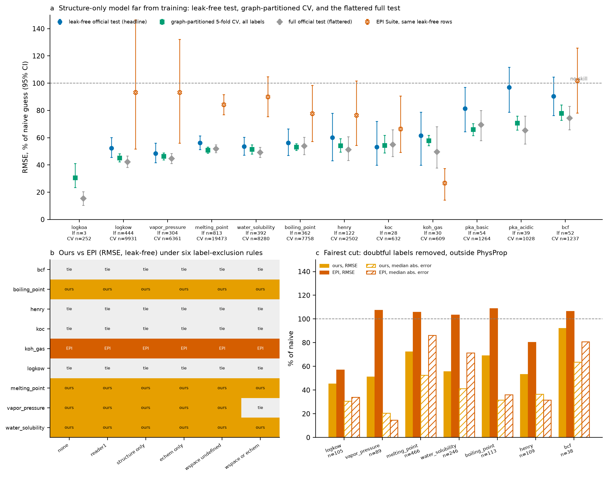

**Figure 1.** *[Model: structure-only throughout. Panel (a) is W-SPACE's structure-only model (`W-SPACE/eval_splits_v3.csv  [not redistributed; VM-internal]`); panels (b) and (c) are W-MODEL's frozen_v4 structure-only model (`CRITIC/audit_epi_exclusion_verdicts.csv  [not redistributed; VM-internal]`, `READER-1/epi_joint_comparison.csv  [not redistributed; VM-internal]`, both scored on `yhat_frozen_v4_struct_only`). No panel of this figure uses the shipped frozen_v5 structure+physics model; the shipped-model version of the same comparison is Figure S21 and Sec. 4.1.]* A structure-only model keeps real skill far from training, and once label quality and EPI Suite's training overlap are controlled, it beats EPI Suite on melting point and water solubility on both typical and RMSE error, on boiling point and vapour pressure on RMSE only, and not on gas-phase kOH; clipping EPI's estimates to the training-label range removes most of the remaining gap (Figure S20). (a) RMSE as % of the naive training-mean guess (100% = no skill; 95% cluster-bootstrap CIs) for W-SPACE's structure-only model under three evaluations: leak-free official test (headline), graph-partitioned 5-fold CV (every compound tested with no training analogue at Tanimoto >= 0.40) and the full official test (flattered); open crosses = EPI Suite on the same leak-free rows. (b) Verdict of the paired RMSE comparison (ours vs EPI Suite, leak-free, frozen structure-only model) under six label-exclusion rules; 'ours'/'EPI' = paired cluster-bootstrap CI excludes zero. (c) The fairest cut (leak-free, doubtful labels removed, measurements outside PhysProp): RMSE (solid) and median absolute error (hatched) as % of naive, ours vs EPI Suite. *Source: `W-SPACE/eval_splits_v3.csv  [not redistributed; VM-internal]` + CRITIC/audit_epi_exclusion_verdicts.csv + READER-1/epi_joint_comparison.csv, drawn by `make_figures_v4.py  [not redistributed; VM-internal]`.*

**The shipped model on every endpoint.** The shipped model (`SP`, file `W-MODEL/v5_main/test_predictions.parquet  [not redistributed; VM-internal]` (W-MODEL v5, frozen 21:10)) is scored on all 12 endpoints, including the two pKa endpoints, for which EPI Suite has no module:

| endpoint | units | n lf | shipped % naive lf | RMSE lf (units) | structure-only % naive lf | shipped % naive full | label noise floor | coverage lf (nominal) |
|---|---|---|---|---|---|---|---|---|
| vapor_pressure | log10_mmHg | 305 | 45% | 1.65 | 46% | 43% | 27% | 0.90 (0.90) |
| water_solubility | log10_mol_per_L | 405 | 51% | 1.13 | 51% | 45% | 30% | 0.91 (0.90) |
| logkow | log10 | 454 | 51% | 1.07 | 52% | 41% | 37% | 0.86 (0.90) |
| koc | log10_L_per_kg_linear | 27 | 52% | 0.57 | 54% | 55% | - | 0.85 (0.90) |
| henry | log10_atm_m3_per_mol | 123 | 52% | 1.79 | 54% | 46% | 28% | 0.95 (0.90) |
| melting_point | degC | 822 | 53% | 55.11 | 54% | 49% | 22% | 0.90 (0.90) |
| boiling_point | degC | 368 | 53% | 57.08 | 56% | 51% | 28% | 0.93 (0.90) |
| koh_gas | log10_cm3_per_molecule_s | 30 | 58% | 0.72 | 62% | 48% | - | 0.93 (0.90) |
| pka_basic | log10 | 54 | 74% | 2.46 | 80% | 65% | - | 0.89 (0.90) |
| bcf | log10_L_per_kg_linear | 52 | 88% | 1.12 | 89% | 72% | 45% | 0.92 (0.90) |
| pka_acidic | log10 | 38 | 97% | 3.26 | 104% | 64% | - | 0.95 (0.90) |
| logkoa | log10 | 3 | n<20 | 1.13 | n<20 | 15% | - | n<20 (0.90) |

The 'shipped % naive full' column is scored on the whole test split, not the leak-free subset; its n per endpoint is melting_point 3253, logkow 1670, water_solubility 1408, boiling_point 1326, vapor_pressure 1076, henry 431, pka_basic 210, bcf 206, pka_acidic 168, koc 104, koh_gas 101, logkoa 36 (`data/headline_leakfree.csv`, variant `SP`, subset `full`). For example, koh_gas is 58% of naive on its 30 leak-free rows and 48% on all 101 test rows.

On leak-free compounds the shipped model has skill - defined as a 95% CI upper bound below 100% of naive, checked endpoint by endpoint in `data/headline_leakfree.csv` - on boiling_point, henry, koc (n=27), koh_gas (n=30), logkow, melting_point, pka_basic, vapor_pressure and water_solubility (Figure S5). It is **not established** for bcf (88.1% [68.3, 104.5]) or pka_acidic (97% [82.1, 115.0]), both of which cross 100, and logkoa cannot be assessed at all (3 leak-free rows).

**The same comparison under the harder protocol.** The leak-free subset of the official test split is small, so W-SPACE repeated the EPI comparison on the graph-partitioned cross-validation, where every labelled compound is predicted by folds containing no neighbour at Tanimoto >= 0.40 (`data/fate_vs_epi_graph_cv.csv  [shipped aggregate; working file not redistributed; VM-internal]`; structure-only LightGBM, naive = each fold's own training mean). Ours vs EPI Suite, as % of naive: bcf 77.6 vs 85.7 (n=207); boiling_point 52.7 vs 72.2 (n=1296); henry 59.2 vs 63.6 (n=419); koc 56.2 vs 55.0 (n=107); koh_gas 57.7 vs 23.0 (n=99); logkoa 24.5 vs 8.3 (n=37); logkow 46.7 vs 67.8 (n=1649); melting_point 53.0 vs 76.9 (n=3246); vapor_pressure 42.8 vs 77.8 (n=1057); water_solubility 54.4 vs 87.1 (n=1374). Paired cluster-bootstrap intervals put our model ahead on 5 endpoints (boiling_point, logkow, melting_point, vapor_pressure, water_solubility), EPI Suite ahead on 2 (koh_gas, logkoa), and leave 3 unresolved (bcf, henry, koc). **Two caveats belong in the same breath.** Our EPI cache covers only the fraction of graph-CV rows that were in the official test split - for logKow, about 1.6k of 9.9k rows - so the EPI column is close to the official test set rather than to the whole graph-CV set. And EPI Suite's PhysProp training data overlap CompTox, so on any CompTox-derived row EPI is being scored partly on its own training data and its numbers are optimistic. The direction of both caveats is the same: they flatter EPI, and our margin on the five large endpoints survives them.

### 4.2 Error versus familiarity, and what physics and spectra add

Every variant is scored on the same compounds with the same model; only the feature blocks differ (S, SP; file `W-MODEL/v5_main/test_predictions.parquet  [not redistributed; VM-internal]` (W-MODEL v5)). The question is not whether physics lowers error on average, but whether it lowers error more far from the training data.

| endpoint | leak-free n | SP - S, leak-free pp [95% CI] |
|---|---|---|
| bcf | 52 | -1.0 [-4.1, +1.9] |
| boiling_point | 368 | -2.3 [-4.2, -0.4] |
| henry | 123 | -2.0 [-4.7, +1.0] |
| koc | 27 | -1.9 [-6.1, +2.9] |
| koh_gas | 30 | -4.4 [-12.2, +5.5] |
| logkoa | 3 | n<20, not scored |
| logkow | 454 | -0.4 [-2.0, +1.3] |
| melting_point | 822 | -1.2 [-2.2, -0.2] |
| pka_acidic | 38 | -6.9 [-14.1, -1.0] |
| pka_basic | 54 | -6.4 [-13.1, -0.1] |
| vapor_pressure | 305 | -0.9 [-2.1, +0.3] |
| water_solubility | 405 | -0.3 [-1.7, +1.0] |

(Point estimate and interval are both leak-free, from `data/headline_leakfree.csv`; an earlier draft of this table printed the full-test n beside the leak-free intervals.)

- **SP**: lowers error with a CI excluding zero on leak-free rows for boiling_point, melting_point, pka_acidic, pka_basic; raises it for none; full set lower for boiling_point, melting_point, pka_acidic, vapor_pressure, water_solubility.

Error rises as familiarity falls for every feature set (Fig. 2, top row). Adding physics or spectra moves a curve down by a few points on some endpoints, but it does not change the slope. No added block flattens that curve. Whether physics helps disproportionately far from training is not resolved at these sample sizes, and for henry it goes the other way: the physics block is significantly worse off-scaffold (-10.1 points of naive [-16.8, -3.7]; `data/physics_scaffold_interaction.csv`). A cleanly measured negative result is a result, and we report this one as such.

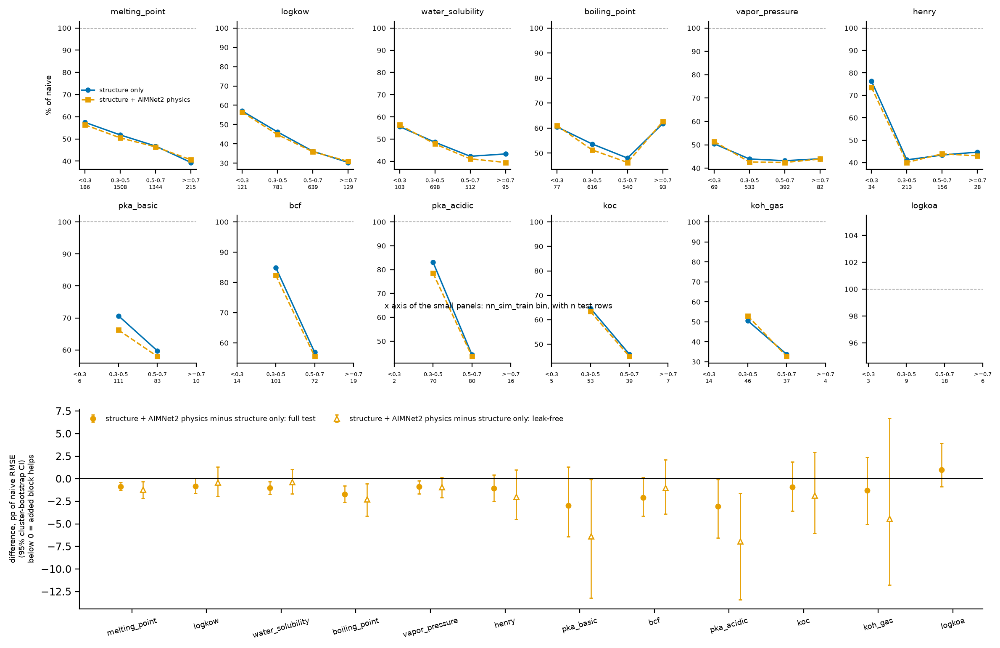

**Figure 2.** *[Model: shipped frozen_v5, variants S and SP on identical rows.]* Error rises with unfamiliarity for every feature set, and no added block flattens that rise. Top: RMSE as % of naive per nn_sim_train bin (n test rows under each bin). Bottom: paired cluster-bootstrap difference of each variant from structure-only, in percentage points of the naive error (filled = full test set, open = leak-free; left of zero = better). *Source: `W-MODEL/v5_main/test_predictions.parquet  [not redistributed; VM-internal]`, drawn by `make_figures_v4.py  [not redistributed; VM-internal]`.*

**Physics, measured honestly.** In CRITIC's independent paired audit of the previous model version (v4), the physics block made a difference with a CI excluding zero for henry (full), henry (leak_free), vapor_pressure (leak_free) (`CRITIC/audit_wmodel_v4.csv  [not redistributed; VM-internal]` (an earlier feasibility build)). In the audit of the current version (v5, same split, one row per InChIKey), the endpoints with a CI excluding zero are boiling_point (full), boiling_point (leak_free), melting_point (full), melting_point (leak_free), pka_acidic (full), pka_acidic (leak_free), pka_basic (leak_free), vapor_pressure (full), water_solubility (full) (`CRITIC/audit_wmodel_v5.csv  [not redistributed; VM-internal]` (CRITIC audit of W-MODEL v5)). The two audit files differ only in whether repeated InChIKeys are collapsed to one row before scoring, and that alone changes the answer: the pre-de-duplication run (`CRITIC/audit_wmodel_v5_nodedup.csv  [not redistributed; VM-internal]`) gives pka_acidic, pka_basic, the de-duplicated run (`CRITIC/audit_wmodel_v5.csv  [not redistributed; VM-internal]`) gives boiling_point, melting_point, pka_acidic, pka_basic, and the previous model version gave henry and vapour pressure. Three different sets from three defensible scoring choices, on the same data and the same feature blocks. The physics effect is small relative to the noise of the evaluation, and we do not claim that physics helps on any particular endpoint.

**A larger test of the same question, with a permutation control.** Because the leak-free subsets are small, W-SPACE re-estimated the physics effect under graph-partitioned cross-validation, which scores every labelled compound once with no training neighbour (`W-SPACE/p009_physics_graphcv_summary.md  [not redistributed; VM-internal]`). This measures the physics *effect*, not the shipped tool's accuracy: these models train on compounds that are in the official calibration and test splits, so their absolute numbers are not comparable with the headline. Physics beats both structure-only and a control in which the physics rows are permuted between molecules on 5 of 12 endpoints (koh_gas, logkow, melting_point, pka_basic, water_solubility), by 1-3 points of naive error in every case. The permutation control is the point: it has the same number of columns and the same capacity, so a gain over it is information, not model size. One of those is borderline - the interval against the permutation control reaches within 0.2 points of zero for pka_basic - so even here the effect is at the edge of what this evaluation can resolve. There is no sign that the gain concentrates far from the training data. Physics lowers the error curve slightly; it does not flatten it.

**Conformer ensembles: the follow-up bet, and a clean negative.** The caveat above was itself a pre-registered hypothesis (P-001): if the single conformer is the problem, an ensemble should help, and it should help most for flexible molecules and far from training. W-PHYSICS built the ensemble features (Boltzmann-weighted, lowest-energy and spread forms), restricted the claim to the 5 endpoints with enough low-similarity test rows to have power, and read it against a pre-registered rule (`W-PHYSICS/PREREG_P001_ensemble.md  [not redistributed; VM-internal]`, Amendment 1): a gain counts only if it appears in the high-rotatable-bond strata and is absent in the rigid stratum. It does not appear anywhere. On the final run (15,069 skeletons, 3 seeds; `W-PHYSICS/results/p001_contrasts.csv  [not redistributed; VM-internal]`) exactly one of the 10 endpoint-level cells excludes zero for the equal-dimension contrast - logKow on the full test, with the ensemble *worse* - and none of the 10 for the permuted-capacity control. Across the 69 stratified cells that carry an interval - by familiarity bin and by rotatable-bond count, leak-free and full - 3 exclude zero for the equal-dimension contrast and 4 for the permutation control, of which 1 and 1 favour the ensemble: close to what that many comparisons at the 95% level produce by chance, and with no concentration in the flexible strata where the hypothesis predicted it. The conformer explanation for the small physics effect is therefore wrong, or at least not recoverable at this sample size. We had the pre-registration in hand before the result, which is the only reason we can say that without arguing about it. The final run of this experiment covers 15,069 skeletons and 3 random seeds: the only endpoint-level interval that excludes zero has the ensemble *worse* (logKow, full test, +0.86 points of naive [+0.16, +1.57]); every other endpoint-level interval, for both pre-registered primaries, contains zero (`W-PHYSICS/results/summary_ens.json  [not redistributed; VM-internal]`, `p001_contrasts.csv  [not redistributed; VM-internal]`).

**Is the small physics effect an artefact of a strong learner?** W-MODEL repeated the ablation with ridge regression, a much weaker learner, on the same rows (`W-MODEL/v5_main/learner_control_ridge.csv  [not redistributed; VM-internal]`). With ridge the physics block helps consistently: the leak-free interval excludes zero on 5 endpoints (boiling_point, logkow, melting_point, vapor_pressure, water_solubility). But structure-only gradient boosting still beats ridge *with* physics on 10 of the 11 leak-free comparisons. The reading we take is that the physics descriptors do carry genuine information about these properties, and that a strong structure learner has already extracted almost all of it from the graph. That is a more precise negative than 'physics does not help', and it tells a practitioner something useful: if you are fitting a simple model, these descriptors are worth computing; if you are fitting a good one, they are not. **And where the physics block does measurably contribute, it contributes inside known families.** Splitting every endpoint large enough to split into scaffold-shared and strictly-novel-scaffold rows (pKa acidic and basic cannot be split), the physics contribution is demonstrated on scaffold-shared rows; off-scaffold the test is underpowered for boiling point, melting point, water solubility and vapour pressure (interaction CIs include zero or fail a Holm correction) and is significantly negative for henry, which is worse off-scaffold by 10.1 points of naive ([-16.8, -3.7], Holm p = 0.006) (`data/physics_scaffold_interaction.csv`). Physics improving *extrapolation* - the premise of this work - is therefore neither demonstrated nor refuted at these sample sizes, and we say so rather than letting the ablation imply it.

**A permutation control on the physics block (re-trained models, 4 of 12 endpoints, awaiting human confirmation).** This is a control on the ablation above, not a new result and not evidence about extrapolation. CRITIC re-fitted the model with the 31 AIMNet2 columns permuted across compounds, so every physics feature keeps its marginal distribution and only the structure-physics correspondence is destroyed. On leak-free rows the real block improves on structure alone by 2-7 points of naive (pka_acidic [-14.11, -1.02], pka_basic [-13.65, -0.31], boiling_point [-3.73, -0.73]; paired cluster bootstrap, SP minus S), while the permuted block buys nothing (all three intervals span zero: [-1.49, +4.79], [-1.94, +2.55], [-0.70, +1.05]); henry shows no gain in either arm. This is consistent with the physics gain on these three endpoints being information rather than a regularisation effect of 31 extra columns in a column-subsampling learner. The control was run by CRITIC on re-trained, not frozen, models over 4 of the 12 endpoints and has not been confirmed by a human (`data/attack_physics_placebo.csv`). It does not change the statement that physics is demonstrated only on scaffold-shared rows: whether physics helps more far from training is still not shown at these n.

**A caveat for anyone reusing our physics table.** Descriptors were computed from one relaxed conformer per molecule. W-PHYSICS's pre-test for the conformer-ensemble hypothesis (P-001; `W-PHYSICS/pretest_flex_shard0.json  [not redistributed; VM-internal]`) compared that seed conformer with the lowest-energy conformer found in an ensemble. The seed conformer lies more than 0.1 eV above the ensemble minimum for 7% of molecules with 0-1 rotatable bonds (n=327); 24% of molecules with 2-4 rotatable bonds (n=348); 50% of molecules with 5-8 rotatable bonds (n=145); 73% of molecules with >=9 rotatable bonds (n=82). For flexible molecules, the shape and dipole columns are therefore close to a single random draw from the conformer distribution. The dataset card records this.

### 4.3 Input modes: what a spectrum alone can tell you

For the analytical chemist, the question is what a measured MS/MS spectrum gives *without* a structure. W-SPECTRA rebuilt the spectral representation for this run. The new representation keeps the accurate mass, separates instruments and resolution classes, adds neutral losses, and scores spectral quality; it was reviewed by the spectra owner before any model was fitted. Each rung of the ladder is scored on the *same* compounds, per spectrum type (`W-SPECTRA/v31/report/scribe_input_modes_rows.parquet  [not redistributed; VM-internal]` (W-SPECTRA v3.1)). The naive baseline is the training-subset mean of the same compounds (per-row `naive` column from the result file): compounds that have spectra differ systematically from those that do not, so the all-compound mean would flatter every arm (READER-1). HR ESI+ is shown here; ESI- and EI are Figures S7-S8.

**Leak-free first.** The headline for this mode is the leak-free one: one spectrum, no structure, on compounds with no training analogue at Tanimoto >= 0.40, scored against the same compounds' structure-only prediction (`W-SPECTRA/v31/report/leak_free_v31.csv  [not redistributed; VM-internal]`). As % of naive, one spectrum vs known structure: EI boiling_point 69 vs 38 (n=50); EI henry 86 vs 77 (n=30); EI logkow 73 vs 37 (n=50); EI melting_point 85 vs 55 (n=67); EI vapor_pressure 59 vs 29 (n=44); EI water_solubility 77 vs 54 (n=51); HR ESI- MS/MS logkow 95 vs 58 (n=59); HR ESI- MS/MS melting_point 97 vs 72 (n=89); HR ESI- MS/MS vapor_pressure 66 vs 68 (n=21); HR ESI- MS/MS water_solubility 74 vs 48 (n=73); HR ESI+ MS/MS boiling_point 83 vs 84 (n=48, unstable: it depends on which spectrum is drawn - over 200 redraws of the test spectrum the median is 91.5 with a 2.5-97.5 percentile range of [83.0, 97.3], `W-SPECTRA/v4/specchoice_v4.csv  [not redistributed; VM-internal]`, and its own CI is [67.7, 106.3], so it should not be read as a spectrum matching a structure); HR ESI+ MS/MS henry 93 vs 77 (n=58); HR ESI+ MS/MS logkow 79 vs 46 (n=151); HR ESI+ MS/MS melting_point 86 vs 60 (n=198); HR ESI+ MS/MS vapor_pressure 70 vs 57 (n=89); HR ESI+ MS/MS water_solubility 75 vs 57 (n=174). On novel chemistry a spectrum alone therefore retains real but reduced skill, and the gap to a known structure widens. Empirical coverage of these leak-free one-spectrum intervals runs 0.81 to 0.96 against a nominal 0.90, so they under-cover exactly where the user needs them most. The flattered full-test numbers follow in the table below, labelled as such.

| endpoint | n (lf) | precursor m/z + adduct | full spectrum, Run-2 representation | full spectrum, rebuilt (top-5 pooled) | one spectrum (deployment case) | known structure (same compounds) | coverage of one-spectrum interval (nominal 0.90) |
|---|---|---|---|---|---|---|---|
| bcf | 60 (17) | 101% (n<20) | 101% (n<20) | 94% (n<20) | 94% (n<20) | 81% (n<20) | 0.97 |
| boiling_point | 140 (48) | 98% (97%) | 98% (96%) | 99% (86%) | 102% (83%) | 96% (95%) | 0.93 |
| henry | 163 (58) | 109% (101%) | 89% (86%) | 94% (95%) | 100% (93%) | 74% (78%) | 0.88 |
| koc | 69 (19) | 100% (n<20) | 80% (n<20) | 80% (n<20) | 80% (n<20) | 68% (n<20) | 0.94 |
| logkow | 466 (151) | 94% (93%) | 75% (83%) | 73% (74%) | 76% (79%) | 47% (52%) | 0.85 |
| melting_point | 635 (198) | 104% (101%) | 86% (87%) | 86% (85%) | 88% (86%) | 62% (68%) | 0.86 |
| pka_acidic | 28 (4) | 109% (n<20) | 97% (n<20) | 87% (n<20) | 99% (n<20) | 85% (n<20) | 0.93 |
| pka_basic | 40 (16) | 122% (n<20) | 109% (n<20) | 105% (n<20) | 111% (n<20) | 85% (n<20) | 0.90 |
| vapor_pressure | 272 (89) | 83% (74%) | 75% (62%) | 76% (70%) | 75% (70%) | 65% (58%) | 0.86 |
| water_solubility | 501 (174) | 82% (79%) | 73% (76%) | 70% (71%) | 71% (75%) | 54% (59%) | 0.87 |

(% of naive on all test compounds with an ESI+ spectrum; leak-free in brackets.) **Fragments carry information beyond the mass.** The rebuilt full spectrum beats precursor m/z + adduct (paired CI excluding 0) for henry, koc, logkow, melting_point, pka_acidic, vapor_pressure and water_solubility **on the full test**. Three of those are full-test only: vapour pressure's leak-free interval crosses zero ([-9.6, +4.7]), and Koc and acidic pKa have too few leak-free spectra to assess (CRITIC's audit of the spectral ablation). With the shared fixed-size model, single-feature mass arms overfit and sit near or above 100%. W-SPECTRA's regularised refit of the mass + adduct rung gives bcf 98%, boiling_point 97%, henry 102%, koc 88%, logkow 89%, melting_point 102%, pka_acidic 99%, pka_basic 106%, vapor_pressure 79%, water_solubility 77% (ESI+; `W-SPECTRA/v31/mass_sensitivity_v31.json  [not redistributed; VM-internal]`). Against that stronger baseline, fragments still help significantly for henry, logkow, melting_point, water_solubility. **A single spectrum is the deployment case, and we report it per endpoint.** Two models answer this question and they do not give the same list, so we give neither as a pass/fail list. **W-SPECTRA's single-spectrum model** (the deployment case: one measured HR ESI+ MS/MS spectrum, no structure), leak-free, RMSE as % of naive with a 95% cluster-bootstrap CI (`W-SPECTRA/v32/R6_spectrum_only_per_endpoint.csv  [not redistributed; VM-internal]`, Figure S22): water_solubility 74.7 [67.0, 82.4] (n=174); vapor_pressure 70.3 [56.4, 87.0] (n=89); logkow 78.9 [70.1, 87.6] (n=151); boiling_point 82.6 [67.7, 106.3] (n=48); melting_point 86.1 [79.3, 93.1] (n=198); henry 92.9 [77.8, 103.5] (n=58). **W-MODEL's spectra-only (X) arm** of the shared ablation, same ion block, scores melting point at 84.2% of naive on the full test and 81.0% leak-free, so under the pre-registered bar (<= 85% of naive with the CI upper bound below 100%) melting point passes on that model and fails on the single-spectrum one (88.1% full). The bar is carried by less than a point for that endpoint, which is why we print values rather than a list. The ion block matters as much as the model, so we print values rather than counts: the full per-endpoint table, with both spectrum-only models named, both ion blocks, n, 95% CIs and empirical 90% coverage, is `W-SPECTRA/spectrum_only_final_table.md  [not redistributed; VM-internal]`. Endpoints with fewer than 20 leak-free rows are not scored at all by the spectral evaluation (ESI+: koc 19, bcf 17, pka_basic 16, pka_acidic 4), so their absence from these lists is a sample-size statement, not a no-skill one. Predictions for boiling_point, henry and the pKa endpoints from a spectrum alone should carry a no-skill warning. Empirical coverage of the leak-free single-spectrum intervals is 0.81 (water_solubility), 0.83 (logkow), 0.87 (vapor_pressure) and 0.84 (melting_point) against a nominal 0.90 - they under-cover exactly where they are needed. **A known structure is still better**, significantly so for henry, logkow, melting_point, vapor_pressure, water_solubility. Adding the spectrum to a known structure changes performance by less than 3 points of naive on every endpoint with 60 or more test compounds, and the unadjusted significant cells go both ways: ESI+ henry is 2.9 points *worse*, ESI- water solubility 3.0 points better and ESI+ acidic pKa 9.1 points better on 28 compounds (`W-SPECTRA/RESULTS_v31.md  [not redistributed; VM-internal]` Sec. 4; in W-MODEL's SPX-SP contrast 1 of 28 cells has an interval below zero). **The rebuilt representation is not better than the earlier one** under the same model and compounds: across 3 ion modes, the full test, the leak-free subset and four similarity bins, no old-versus-new contrast survives a Bonferroni correction. Unadjusted, a handful of cells favour each side - new better for ESI- water solubility (+6.5 points), ESI+ logKow leak-free (+8.7) and EI boiling point, melting point and vapour pressure (+4.5, +4.9, +6.5); old better for ESI+ vapour pressure leak-free (-8.3) - most consistently in EI, where new is better in 3 of 10 cells (`W-SPECTRA/v32/leakfree_control_v32.json  [not redistributed; VM-internal]`). Hypothesis P-002 ('the old representation, not spectra, was what failed') is therefore not supported. We report this as a clean negative result: most of the information a spectrum carries was already reachable with the old representation.

**Provenance of the spectra.** All 56,368 spectra used anywhere in this work (HR ESI+ 31,072; HR ESI- 18,403; EI 6,893) are measured CompTox AMOS library records, byte-identical to the AMOS source; none is simulated, and a direct check against IBM CFM-ID simulated spectra found zero copies. About 1% (MassBank EPA-ENTACT / Agilent strata) have peak m/z replaced by calculated formula masses, so for those rows part of the mass information is structure-derived; W-SPECTRA's 3/5/10 ppm jitter arms found no systematic effect (19 of 20 and 15 of 16 paired intervals contain zero; largest shift 3.1 and 4.2 points of naive, correcting an earlier "<=1.6") and the mass-only rung has no skill, but the dependency is stated rather than assumed harmless (`S-8/trace_spectra_summary.json  [not redistributed; VM-internal]`, `S-8/ibm_vs_arm_summary.json  [not redistributed; VM-internal]`; W-SPECTRA `audit_predicted_spectra.py  [not redistributed; VM-internal]`: across 13 AMOS sources and 2,493 sampled HR MS2 spectra the per-source fraction flagged as looking theoretical is 0.000-0.010, with median ppm scatter from formula masses of 0.87-4.77. That detector under-flags: the 36-record Agilent PFAS stratum has a median of 0.038 ppm - i.e. it *is* calculated - yet reads 0.000, because the rule needs 90% of peaks below 0.05 ppm and only 2 of its 3 peaks qualify. A run-4 recheck found something worse about that stratum: all 36 records, spanning 12 different PFAS substances, decode to one identical 3-peak list, so they carry no compound-specific fragment information at all (`W-SPECTRA/v32/dup_peaklist_audit_v32.json  [not redistributed; VM-internal]`)).

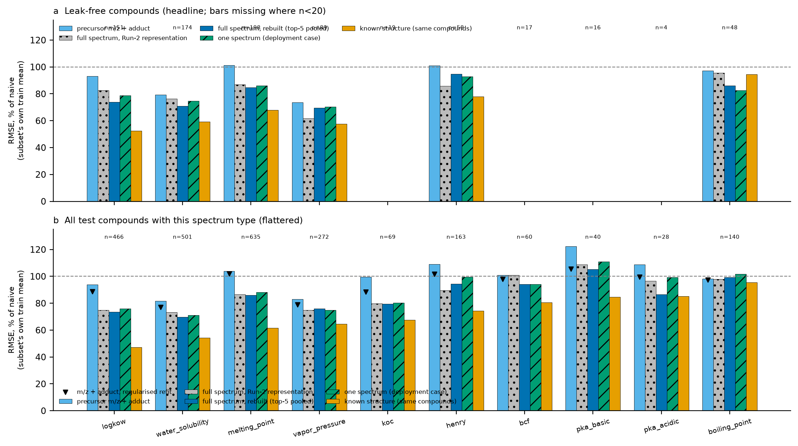

**Figure 3.** *[Model: W-MODEL v5 spectral ablation (X arm) and W-SPECTRA v3.1 spectrum-only model, as labelled per panel.]* From a spectrum alone the model has real but limited skill: fragments add information beyond the precursor mass, a single spectrum is about as informative as a pooled set, the rebuilt representation is no better than the old one, and a known structure is better still. HR ESI+ MS/MS. RMSE as % of the naive guess (each subset's own training mean), same compounds for every bar. (a) Leak-free compounds; (b) all test compounds with an ESI+ spectrum. Black triangles: precursor m/z + adduct with a regularised model, the fair mass-only baseline. *Source: `W-SPECTRA/v31/report/scribe_input_modes_rows.parquet  [not redistributed; VM-internal]` + W-SPECTRA/v31/mass_sensitivity_v31.json, drawn by `make_figures_v4.py  [not redistributed; VM-internal]`.*

**The intervals in this mode are the weakest part of it.** Empirical coverage of the single-spectrum intervals ranges from 0.854 to 0.967 against a nominal 0.90 (`CRITIC/audit_spectra_v31.csv  [not redistributed; VM-internal]`), and falls below nominal on 5 of 10 endpoints (henry, logkow, melting_point, vapor_pressure, water_solubility). A spectrum-only prediction is therefore less trustworthy than its stated level, and the dashboard says so in this mode. 
**And the spectral domain flag does not work.** We had hoped that similarity to the nearest training spectrum would warn the user when a spectrum-only prediction is about to be wrong. It does not: the rank correlation between absolute error and the best-matching training spectrum's cosine similarity has a median absolute value of 0.063 across 10 endpoints, the largest being 0.454 for pka_acidic (n=28; `CRITIC/audit_spectra_v31_domain.csv  [not redistributed; VM-internal]`). Structural familiarity predicts spectral-mode error about as poorly. We report this as a negative result and the dashboard shows spectrum-only domain information as descriptive, not as a reliability score.

**Spectrum-only acute toxicity: the mode's limit, measured.** The same ladder was run for rat oral LD50 on the 345 test compounds that have a quality-selected HR ESI+ spectrum, every arm on the same compounds (log10 mmol/kg bw; naive RMSE 0.837; `data/hazard_spectrum_only_ld50.json  [shipped aggregate; working file not redistributed; VM-internal]`). As % of the naive guess: mass only 105.4%; mass plus adduct 104.9%; full spectrum 95.8%; structure 81.6%; structure plus spectrum 84.4%. Empirical coverage of the nominal 0.90 intervals runs 0.858, 0.861, 0.867, 0.887, 0.852 across the arms, i.e. every arm under-covers. W-TOX's paired cluster bootstrap shows that fragments do carry information beyond the mass for this endpoint too (full spectrum vs mass + adduct, -9.1 points of naive, 95% CI [-17.8, -2.9]), but that the full spectrum is still far worse than the structure (+14.2 points, CI [+5.0, +21.5]), and that adding the spectrum to a known structure changes nothing (CI [-1.7, +7.5]). Stated plainly: for acute lethality, a spectrum alone buys a wide interval around the training mean. That is the opposite of the fate endpoints, where a spectrum alone is genuinely informative, and the tool should say which case the user is in rather than printing a number in both. This is why spectrum-only is a per-endpoint capability in the dashboard and not a mode-wide claim. *Not independently audited:* this result was computed once, by the agent that owns it, and has not been recomputed by a second agent. The result file is named above.

**A fourth input mode: an experimental 1H NMR peak list.** W-TP built an NMR arm from NMRexp (3.37M experimental spectra, CC BY 4.0, doi:10.5281/zenodo.17296666), which joins to the labelled set on InChIKey skeleton (`W-TP/nmr_summary.csv  [not redistributed; VM-internal]`). As % of naive, peak list plus acquisition solvent vs a size-only control vs the known structure: boiling_point 76.3 vs 96.1 vs 54.7 (n=382); logkow 70.4 vs 92.2 vs 41.0 (n=420); melting_point 80.9 vs 97.8 vs 53.9 (n=849); vapor_pressure 77.8 vs 93.7 vs 42.8 (n=237); water_solubility 73.5 vs 90.9 vs 47.8 (n=298). A peak list plus its acquisition solvent carries real skill on 5 of 5 endpoints, beating the size-only control by 15.9-21.8 points on the full test for the 1H block quoted above (14-24 points for 1H+13C) - so it is not merely a proxy for molecular size - but it adds nothing on top of a known structure. On leak-free compounds the same gaps are 4.6-19.5 points (peak list vs size-only: melting_point 91.4 vs 96.0, n=131; logkow 74.0 vs 84.3, n=86; boiling_point 67.6 vs 87.1, n=78; water_solubility 74.1 vs 89.4, n=62; vapor_pressure 78.2 vs 83.4, n=56), with melting point the weakest - and on leak-free compounds the melting-point gain comes from the solvent one-hot rather than from the chemical shifts, since removing the solvent feature gives 97.0 against the size-only control's 96.0 (n=131); acquisition metadata alone sits below the skill line but is not null (melting_point 91.8 [88.9, 95.0], logkow 93.6 [90.0, 97.2], both CIs excluding 100). The result mirrors the MS/MS one: a measured spectrum is a usable substitute for a structure and not a supplement to it. CRITIC re-scored the leak-free arm independently (`CRITIC/audit_nmr_arm_lf.csv  [not redistributed; VM-internal]`): on leak-free rows the peak-list-versus-size-only interval excludes zero for boiling point and water solubility in the 1H block, and for logKow only once 13C is added, so the leak-free half of this result is weaker than the full-test half.

### 4.4 Uncertainty: empirical against nominal coverage

Intervals are split-conformal. The nominal level comes from W-MODEL/v5_main/results.json, and the empirical coverage is measured on the test split for each familiarity bin.

| endpoint | nominal | cov <0.3 (n) | cov 0.3-0.5 (n) | cov 0.5-0.7 (n) | cov >=0.7 (n) | median width <0.3 | median width 0.3-0.5 | median width 0.5-0.7 | median width >=0.7 |
|---|---|---|---|---|---|---|---|---|---|
| bcf | 0.90 | n<20 (14) | 0.87 (101) | 0.88 (72) | n<20 (19) | 3.71 | 3.35 | 2.91 | 3.36 |
| boiling_point | 0.90 | 0.91 (77) | 0.93 (616) | 0.87 (540) | 0.83 (93) | 118.46 | 89.17 | 57.19 | 64.58 |
| henry | 0.90 | 0.97 (34) | 0.94 (213) | 0.94 (156) | 0.86 (28) | 7.58 | 4.92 | 3.26 | 1.90 |
| koc | 0.90 | n<20 (5) | 0.81 (53) | 1.00 (39) | n<20 (7) | 1.97 | 2.28 | 2.95 | 1.53 |
| koh_gas | 0.90 | n<20 (14) | 0.93 (46) | 1.00 (37) | n<20 (4) | 3.70 | 2.32 | 2.57 | 1.05 |
| logkoa | 0.90 | n<20 (3) | n<20 (9) | n<20 (18) | n<20 (6) | 2.99 | 3.32 | 3.95 | 3.85 |
| logkow | 0.90 | 0.87 (121) | 0.90 (781) | 0.90 (639) | 0.90 (129) | 3.11 | 2.37 | 1.77 | 1.74 |
| melting_point | 0.90 | 0.92 (186) | 0.89 (1508) | 0.90 (1344) | 0.91 (215) | 194.23 | 155.71 | 121.58 | 111.92 |
| pka_acidic | 0.90 | n<20 (2) | 0.99 (70) | 0.89 (80) | n<20 (16) | 8.45 | 14.40 | 3.38 | 3.45 |
| pka_basic | 0.90 | n<20 (6) | 0.95 (111) | 0.95 (83) | n<20 (10) | 7.74 | 8.61 | 5.87 | 4.81 |
| vapor_pressure | 0.90 | 0.93 (69) | 0.89 (533) | 0.88 (392) | 0.99 (82) | 4.93 | 3.79 | 2.84 | 6.15 |
| water_solubility | 0.90 | 0.91 (103) | 0.92 (698) | 0.92 (512) | 0.92 (95) | 3.42 | 3.27 | 2.82 | 2.91 |

Across endpoint x bin cells with n >= 20, empirical coverage ranges from 0.81 to 1.00 against a nominal 0.90. Coverage falls significantly below nominal in 3 cells on a Wilson interval - boiling_point 0.5-0.7 0.87 (n=540), boiling_point >=0.7 0.83 (n=93), koc 0.3-0.5 0.81 (n=53) - and in 1 of those 3 (boiling_point >=0.7) on the more conservative Clopper-Pearson interval the result file reports (`W-MODEL/v5_main/coverage_by_bin.csv  [not redistributed; VM-internal]`); boiling_point 0.5-0.7 has a Clopper-Pearson upper bound of 0.9009, just touching nominal. The interval type matters at these n and we name it. On leak-free rows specifically, logKow at nn_sim 0.3-0.5 covers 0.863 (n=336) with both upper bounds below 0.90, which is a fourth cell and is the one a leak-free-first reader should weigh (S-8 re-derivation, `S-8/check.md  [not redistributed; VM-internal]`).

**Two caveats about the binning itself.** First, these bins use the GLOBAL nearest-neighbour similarity to the training set, not the similarity to the training rows of the endpoint being predicted. Re-binning on the per-endpoint similarity moves 453 of 2,681 leak-free rows (16.9%) one bin more novel, every one of them in that direction (`S-8/rebin_coverage.csv  [not redistributed; VM-internal]`), so the per-bin coverage above is reported on the more optimistic of the two binnings. A third: the intervals quoted on coverage above are exact Clopper-Pearson binomial intervals, which assume independent test rows, and the dashboard uses Wilson intervals on the same counts - the interval type is named wherever a coverage CI appears. Test rows are correlated within chemical-space clusters, and under a cluster bootstrap (`CRITIC/attack_coverage_clustered.py  [not redistributed; VM-internal]`, 2,000 draws) the leak-free logKow interval widens to [0.825, 0.901] and none of the 50 cells with n >= 20 is then distinguishable from nominal. Which interval is appropriate here is an open question, so we report the binomial statement as primary and this as its sensitivity, and we do not conclude that coverage is nominal everywhere. Second, the shipped domain flag is the stricter of the global and per-endpoint similarity (out < 0.30 <= edge < 0.50 <= in, as computed by `tool/fatev5.py`), and it was validated rather than only defined: empirical coverage of the shipped intervals is 0.906 / 0.904 / 0.901 for in / edge / out (n = 3,732 / 4,989 / 1,268) against a nominal 0.90, and no flag cell with n >= 10 falls significantly below nominal (W-SPACE, `W-SPACE/run4/for_scribe_r4.md  [not redistributed; VM-internal]`). Coverage is guaranteed only when calibration and test compounds are exchangeable (Norinder et al., doi:10.1021/ci5001168, pp.1596-1599). Within a familiarity bin they roughly are. Within a compound class they are not, and READER-1 found class-conditional under-coverage for ionizable classes (`READER-1/conditional_coverage_by_class.csv  [not redistributed; VM-internal]`).

**Which interval we ship, and what it costs.** Three conformal variants were calibrated: a global one, a per-familiarity-bin (Mondrian) one, and a normalised Mondrian one that scales the residual by a per-compound difficulty estimate. We ship the normalised Mondrian. CRITIC audited all three against compound class, which is the dimension conformal prediction does not protect (`CRITIC/audit_normmondrian_width.json  [not redistributed; VM-internal]`): for the shipped variant the number of class cells with coverage significantly below nominal is 0, against 10 for plain Mondrian and 14 for global. The price is width: the shipped intervals are on average 1.15x the global ones (range 0.68-2.29), so on the small endpoints they are conservative. The residual failure is in the *most* familiar bin, not the least: for the shipped variant the worst cell in that audit is logkow at nn_sim >= 0.7, covering 0.860 against a nominal 0.90 while the global interval covers 0.919 (n=136). A note on which file to believe: that audit was run before repeated InChIKeys were collapsed to one row, and the de-duplicated run (`W-MODEL/v5_main/bins.csv  [not redistributed; VM-internal]`, the file the coverage table above is built from) gives different n and coverage for the same cells. The table above is the de-duplicated one; the audit is cited here only for the three-way comparison between interval constructions, which de-duplication does not change. Normalising by difficulty moves width from easy compounds to hard ones, and it slightly over-corrects. A user predicting a compound with a close training analogue should treat the stated level as approximate.

**Does the interval widen for the compounds that are actually hard?** Familiarity bins are a crude proxy for difficulty, so W-MODEL split the test rows into terciles of the model's own predicted difficulty and measured coverage in each (`data/interval_coverage_by_difficulty_tercile.csv  [shipped aggregate; working file not redistributed; VM-internal]`). Error rises steeply across the terciles - for boiling point, RMSE 14.5, 27.3 and 79.8 degrees C; for logKow 0.51, 0.67 and 1.27 log units - and the shipped normalised interval holds its level in every tercile (0.90 / 0.90 / 0.90 for boiling point against a nominal 0.90), while the plain per-bin interval over-covers the easy tercile and under-covers the hard one (0.99 / 0.78). Coverage holds in all three terciles for 5 of 11 endpoints. The 6 endpoints where at least one tercile sits outside 0.05 of nominal (bcf, henry, koc, koh_gas, pka_acidic, pka_basic) are the small ones: each has at most 144 test rows per tercile, against 1085 for the largest endpoint that passes, so those cells are measuring coverage on a few dozen compounds. Those are absolute errors; as a percentage of each endpoint's naive guess the same three terciles are 15%, 28% and 83% for boiling point and 24%, 31% and 60% for logKow, so the hardest third of compounds is at or past the point where the model stops being useful and the interval is the only honest output. This is the strongest evidence we have that the shipped interval is doing real work rather than tracking a similarity number.

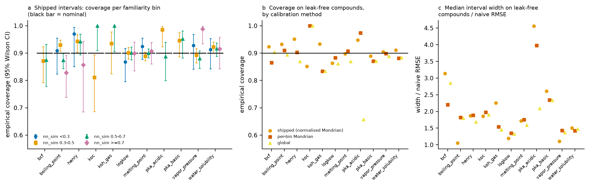

**Figure 4.** *[Model: shipped frozen_v5 SP.]* The intervals mostly keep their promise per familiarity bin. They widen far from training but do not always widen enough. (a) Empirical coverage of the shipped model's intervals with 95% Wilson CIs, per nn_sim_train bin; black bar = nominal level. (b) Median interval width divided by the naive RMSE, so widths are comparable across endpoints. *Source: `W-MODEL/v5_main/test_predictions.parquet  [not redistributed; VM-internal]`, drawn by `make_figures_v4.py  [not redistributed; VM-internal]`.*

### 4.5 Physically undefined is not missing

A property defined through a gas phase or a neutral species does not exist for a species that cannot be in that phase or state. For such a species the property is *undefined*, which is different from missing data. We derived the rule from the endpoint definitions, not from a list of examples:

| endpoint | requires | definition used |
|---|---|---|
| henry | gas_phase | K_H relates the gas-phase partial pressure of the species to its aqueous concentration |
| vapor_pressure | gas_phase | vapour pressure is the pressure of the species in the gas phase over its condensed phase |
| boiling_point | gas_phase | the boiling point is where the vapour pressure of the species reaches 1 atm |
| koh_gas | gas_phase | kOH here is a gas-phase reaction rate constant |
| logkoa | gas_phase | K_OA is the octanol/air concentration ratio of the species |
| logkow | neutral_species | K_OW is defined for the neutral (un-ionised) species |
| water_solubility | nothing (defined for any species) | defined for any substance |
| melting_point | nothing (defined for any species) | defined for any solid substance |
| koc | nothing (defined for any species) | sorption to organic carbon is defined for dissolved ions and neutrals alike |
| bcf | nothing (defined for any species) | bioconcentration is defined for dissolved ions and neutrals alike |
| pka_acidic | acidic_site | needs an ionisable acidic site |
| pka_basic | basic_site | needs an ionisable basic site |

| species type | has a gas-phase form | has a neutral microspecies |
|---|---|---|
| neutralisable | True | True |
| permanent_cation | False | False |
| permanent_anion | False | False |
| permanent_zwitterion | False | False |

Rule (`W-SPACE/domain_rules.json  [not redistributed; VM-internal]`): UNDEFINED := endpoint requires X AND species lacks X; species after Cleanup -> largest organic fragment -> Uncharger; metal-containing parents not assessed; pKa site absence is a separate "not applicable (heuristic)" state.

W-SPACE applied the rule after desalting and neutralising each structure, so that a salt drawn as ions and the same salt drawn as acid + base get the same answer. It covered the 34393 visible inventory compounds, whose species types are {'neutralisable': 33739, 'permanent_cation': 409, 'metal_containing_not_assessed': 161, 'permanent_zwitterion': 75, 'permanent_anion': 9} (`W-SPACE/undefined_vs_gap_summary.json  [not redistributed; VM-internal]`). Of 353,046 unlabelled compound x endpoint pairs, 4,720 are **physically undefined** (A; 1.34%). 46,446 are defined but measurable only as a non-equivalent quantity or by a heuristic (B; 13.16%): for example surfactants, strong acids, compounds that decompose before boiling, or compounds with no ionisable site for pKa, which alone account for 37,365 pairs and are a heuristic SMARTS screen with known misses, so B excluding that screen is 2.57%. 1,215 pairs (0.34%) are metal-containing and **not assessed** at all. 300,665 are **genuine data gaps** (C; 85.16%). These are the v4.1 rule, rerun after the sulfonate/sulfate question was reconciled with the human expert note (Section 4.5, 'checked against a human expert answer'); the v5 draft of this paper quoted the superseded v3 figures of 0.9% undefined and 13.6% non-equivalent. Undefined pairs are therefore few, but they are concentrated in the permanently charged classes, where a gas-phase or neutral-species prediction would be meaningless. Among the 408 class x endpoint cells, 366 have labels. Of the 42 cells with none, 12 are undefined, 13 are genuine gaps, 1 is non-equivalent and 16 are mixed. Table S1 gives the reasoning for every empty cell. Undefined pairs should be reported to users as 'not applicable', never imputed, and they must not be counted as data priorities. Some test labels exist for undefined pairs, such as 'measured' boiling points of permanent cations. These labels are physically doubtful, and they are one reason the EPI comparison changes when doubtful labels are removed (Section 4.1).

**Relation to the expert note.** The three-way A/B/C split extends the human expert's note on this question; it is not the note itself. The rule was derived from the endpoint definitions while the note was still unreadable to the agents (The rule was derived without the note (unreadable until about 20:21); its examples are used here ONLY as a check.), and the note's examples were then used only as a check. For quaternary ammonium compounds in the visible inventory, the derived rule calls vapor_pressure, logkow, henry, logkoa, koh_gas, boiling_point undefined for 253 of 256 skeletons. Koc is defined for them (sorption by cation exchange) and has 0 labels across 256 skeletons, a genuine gap. PFAS acidic pKa has 4 labels across 417 visible PFAS skeletons; 120 of them carry an acidic site and are a genuine gap. One disagreement is recorded: BB groups sulfonate/sulfate salts with permanent cations (undefined). Our derivation puts strong-acid parents in B ("defined only for an unpopulated neutral microspecies"): the free acid exists as a neutral species in principle, but not at any environmental pH. Dashboard behaviour is the same (refuse to give a number); the bookkeeping differs.

**The rule, checked against a human expert answer.** The definedness rule above was derived from the endpoint definitions by two agents independently, without sight of the domain expert's written answer to our question on exactly this point. That answer was then compared with both implementations, cell by cell, by two further agents working separately (`S-7/q003_vs_wtox.md` and `S-1/q003_vs_wtox.md`), and resolved by the critic agent. The expert answer speaks to 26 of the 180 cells in that implementation; the other 154 are outside it. On 14 cells the derived rule and the expert answer agree, with no contradicted verdict and only differences of vocabulary and of how a count is defined - including both of the cells the expert named as genuine gaps rather than undefined (Koc for quaternary ammonium compounds, acidic pKa for PFAS), where a rule that called them undefined would have been wrong in the direction that hides a real data need. That is the useful half: a rule derived from definitions reproduced an expert's reasoning on the cells the expert addressed.

**One class changed, and we did not catch it ourselves.** Sulfonate and sulfate salts fall under the same reasoning as quaternary ammonium compounds - permanently charged in any environmentally relevant condition - but the standardisation step neutralised them before the rule was applied, so one implementation classed them as ordinary neutral organics. That is now corrected rather than merely flagged: the cell table was rebuilt with `CRITIC/q003_override.py` into `CRITIC/undefined_vs_gap_cells_q003.csv`, and the corrected table is what this paper reports. It holds 195 class x endpoint cells - the original 180 plus 15 for the sulfonate/sulfate-salt class (678 skeletons). 6 cells move from defined to physically undefined, and they are exactly the gas-phase and neutral-species endpoints: boiling_point (34 labelled rows), henry (1 labelled row), koh_gas (0 labelled rows), logkoa (0 labelled rows), logkow (176 labelled rows), vapor_pressure (40 labelled rows). 251 labelled rows therefore carry numbers for a quantity that does not exist for the species as drawn, and must not be counted either as training signal or as evidence that the gap is filled. Across the corrected table the verdicts are: undefined 24 (was 18), defined 102, defined-where-an-ionisable-site-exists 18, assay-unattainable 6, not assessed 45 (Figure S11). The shipped predictor was changed to match: it refuses these cells outright (`display='refuse'`) instead of returning a wide interval, so the correction reaches the user and not only the paper.

**One count discrepancy in that comparison is now explained, and it is another class-definition bug.** The two cross-check agents could not reconcile the number of acidic-pKa labels for PFAS: the expert answer says 4, the cell table says 16. The cause is the PFAS pattern used to build the cell table, which matches any trifluoromethyl carbon and so flags 1,203 labelled structures where the stricter definition used everywhere else in this paper - two adjacent fluorinated sp3 carbons - flags 397, a strict subset (`PRINCIPAL/pfas_class_scope_S5.md  [not redistributed; VM-internal]`). The verdicts in the corrected table do not change, but its PFAS counts are an upper bound by roughly a factor of three. Every PFAS count quoted in the main text, including the coverage and data-priority analyses, uses the stricter definition.

**Two deviations from the expert answer are deliberate and stay.** 12 cells - the inorganic and organometal classes across the same six endpoints - are reported as 'not assessed' rather than undefined, because the note's non-volatile clause cannot be applied from a structure drawing (resolution recorded by the critic and principal agents); those cells also hold real measurements (organometallic boiling points and vapour pressures among them), which an 'undefined' verdict would discard. Neutral non-volatile solids likewise stay defined, because a vapour pressure exists for them even when it is far too small to measure - that is a measurement problem, not a definitional one. Both deviations are recorded as disagreements, not resolved in our favour by silence. Supplementary Table S2 gives every cell of the corrected table with its reasoning; the three-way A/B/C table earlier in this section, and Table S1, are W-SPACE's independent implementation on a different class scheme and a different denominator (inventory skeletons, not labelled rows), and were not rebuilt - that owner's work was closed. The two implementations do not conflict on behaviour: W-SPACE places the same strong-acid parents in category B, 'defined only for an unpopulated neutral microspecies', which the dashboard also refuses. The bookkeeping differs; the number the user is shown does not.

**A defect found by the correction, in our own code.** Chasing the same class through the dashboard, the tool owner found that the basic-site pattern used to decide whether a basic pKa applies, `[P,As,Se,S;X3,X4]=O`, also matches the S=O of a sulfonate or sulfate group. Sodium dodecyl sulfate was consequently given a basic pKa of 6.6, a value with no chemical meaning. The dashboard now withholds it and carries a strong-acid caveat on the acidic pKa of sulfonates, where the model returns about 7 and the true value is below 0 (override and its reasoning in `dashboard/tool/wtool_postproc.py`). We report it because it is the same failure as the one above seen from the other end: a SMARTS written for one purpose quietly deciding a definedness question it was never reviewed for.

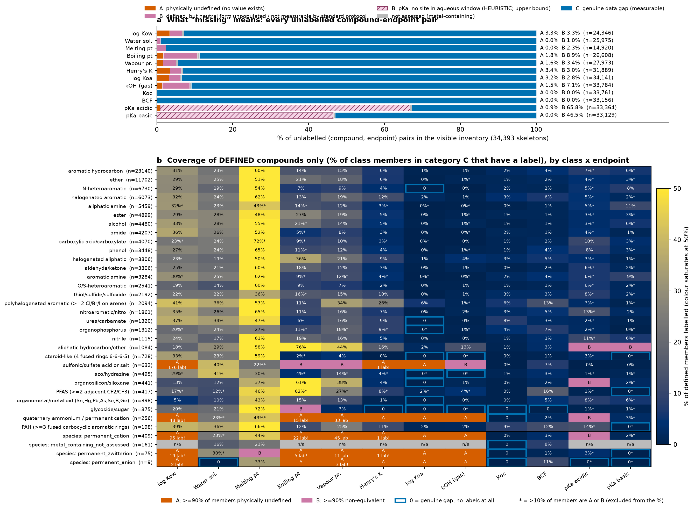

**Figure 5.** *[Model: none - label and inventory bookkeeping only (W-SPACE, `analysis/domain_rules.py` v4.1, redrawn 01:15 after the expert-note reconciliation).]* About 15% of apparent missing data is not a measurement gap but a question that is physically undefined or not measurable as the same quantity, and it is concentrated in particular compound-class x endpoint cells; the other 85% is a genuine gap. The labelled set also leaves real gaps in the halogenated, P, S and Si chemistry that the test set over-represents. (a) Unlabelled inventory compounds per class x endpoint: physically undefined (U) versus genuine data gaps (G). (b) Distribution of similarity to the nearest training compound for calibration and test compounds; dashed line = the 0.40 leak threshold. (c) Share of skeletons containing each heteroatom, by split. *Source: `W-SPACE/fig_undefined_vs_gap.png  [not redistributed; VM-internal]` (drawn by W-SPACE/fig_undefined_vs_gap.py from W-SPACE/undefined_vs_gap_cells.csv + W-SPACE/undefined_vs_gap_summary.json), drawn by `make_figures_v4.py  [not redistributed; VM-internal]`.*

### 4.6 Toxicity and hazard, against the base rate

Three hazard tasks were rebuilt in this run on **measured** labels: oestrogen-receptor-alpha and androgen-receptor potency from ChEMBL dose-response records, and rat oral LD50 from CompTox. This matters, because the equivalent section of our Run-2 draft scored receptor activity against OPERA *consensus model calls* - predictions, not measurements - which measures agreement with another model and not agreement with an experiment. Those numbers are withdrawn and do not appear here. Source: `data/hazard_results.json  [shipped aggregate; working file not redistributed; VM-internal]` and the per-row prediction tables beside it, from which the leak-free subsets and the tables below were computed into `scribe_numbers_v4.json  [not redistributed; VM-internal]` by `make_figures_v4.py  [not redistributed; VM-internal]` (the hazard result file itself carries no leak-free block); leak-free is defined for these tasks as nn_sim_train < 0.40 (to the task's own training set; ChEMBL compounds are outside labels_v2 so the quarantine list does not apply), because the ChEMBL compounds sit outside `labels_v2` and the fate quarantine list does not apply to them.

**Potency and lethality, as % of the naive training-mean guess.** 100% = no skill; the denominator is the RMSE of predicting each task's own training mean, the same denominator used for every fate endpoint in this paper.

| task | units | n leak-free | % of naive, leak-free | % of naive, all test | % of naive at nn_sim < 0.3 (n) | empirical coverage, leak-free (nominal) |
|---|---|---|---|---|---|---|
| er_potency | p_activity = -log10(M) | 255 | 52.4% | 58.4% | 57.2% (78) | 0.871 [0.824, 0.906] (0.90) |
| ar_potency | p_activity = -log10(M) | 149 | 83.1% | 80.4% | 95.1% (38) | 0.913 [0.856, 0.948] (0.90) |
| rat_oral_ld50 | log10 mmol/kg bw | 1012 | 87.0% | 81.8% | 92.8% (324) | 0.862 [0.839, 0.882] (0.90) |

Acute lethality is the one hazard endpoint with enough measured data to behave like a fate endpoint: 87.0% of naive on 1012 leak-free compounds, decaying to 92.8% of naive on the 324 least familiar, where the interval also under-covers (0.809 against a nominal 0.90). Receptor potency is weaker and, for the androgen receptor, close to useless far from training. W-TOX also measured the label noise floor directly: replicate LD50 values for the same standardised InChIKey differ by a median 0.102 log10 units, and pooling assay types across ChEMBL hides real heterogeneity - oestrogen-receptor IC50 rows score 47.7% of naive while Ki rows score 108.5%, i.e. no skill at all (`W-TOX/README.md  [not redistributed; VM-internal]`, not redistributed). A single pooled potency number would have hidden that.

Precision and recall below are quoted at one frozen operating threshold chosen on the calibration split (0.09 for the oestrogen receptor). The critic agent's independent audit of the same model used a different threshold and therefore reports different precision and recall for the same rows; that is a property of the threshold, not a disagreement about the result.

**Rare positives: PR-AUC against each bin's own base rate, never accuracy.** An 'inactive' call for every compound scores high accuracy and zero skill, so accuracy is not reported. PR-AUC has no fixed no-skill value: its no-skill value *is* the base rate, which changes from bin to bin, so the pooled figure is inflated whenever prevalence drifts with familiarity - which it does here.

| task | subset | n | positives | base rate | PR-AUC | PR-AUC - base rate | balanced acc. | precision | recall | label-set coverage (nominal) |
|---|---|---|---|---|---|---|---|---|---|---|
| er_active | all test | 1192 | 317 | 0.266 | 0.845 | 0.579 | 0.876 | 0.709 | 0.883 | 0.861 (0.90) |
| er_active | leak-free | 704 | 85 | 0.121 | 0.683 | 0.562 | 0.824 | 0.554 | 0.729 | 0.882 (0.90) |
| er_active | bin <0.3 | 342 | 16 | 0.047 | 0.329 | 0.283 | 0.685 | 0.241 | 0.438 | 0.895 (0.90) |
| er_active | bin 0.3-0.5 | 508 | 118 | 0.232 | 0.761 | 0.529 | 0.864 | 0.669 | 0.856 | 0.856 (0.90) |
| er_active | bin 0.5-0.7 | 220 | 109 | 0.495 | 0.836 | 0.341 | 0.810 | 0.748 | 0.927 | 0.809 (0.90) |
| er_active | bin >=0.7 | 122 | 74 | 0.607 | 0.966 | 0.360 | 0.886 | 0.887 | 0.959 | 0.877 (0.90) |
| ar_active | all test | 771 | 323 | 0.419 | 0.823 | 0.404 | 0.824 | 0.704 | 0.929 | 0.894 (0.90) |
| ar_active | leak-free | 383 | 90 | 0.235 | 0.735 | 0.500 | 0.826 | 0.586 | 0.833 | 0.922 (0.90) |
| ar_active | bin <0.3 | 185 | 21 | 0.114 | 0.497 | 0.384 | 0.861 | 0.450 | 0.857 | 0.946 (0.90) |
| ar_active | bin 0.3-0.5 | 290 | 116 | 0.400 | 0.790 | 0.390 | 0.809 | 0.687 | 0.888 | 0.903 (0.90) |
| ar_active | bin 0.5-0.7 | 177 | 104 | 0.588 | 0.788 | 0.201 | 0.729 | 0.733 | 0.952 | 0.825 (0.90) |
| ar_active | bin >=0.7 | 119 | 82 | 0.689 | 0.934 | 0.245 | 0.704 | 0.792 | 0.976 | 0.891 (0.90) |

**The familiarity-only control.** CRITIC scored a model that sees nothing but the compound's similarity bin (`CRITIC/audit_wtox_chembl_control.csv  [not redistributed; VM-internal]`): ar_active PR-AUC 0.606 from the bin alone against 0.823 for the real model, at a base rate of 0.419; er_active PR-AUC 0.515 from the bin alone against 0.845 for the real model, at a base rate of 0.266. A large share of the pooled ranking skill is therefore prevalence drift, not chemistry. The honest number is the within-bin one: in the least familiar bin the oestrogen-receptor model reaches PR-AUC 0.329 against a base rate of 0.047 (n=342, precision 0.241, recall 0.438): real but weak skill over the base rate, with most positives missed. CRITIC also found the conformal label sets short of their promise on the full test set for the oestrogen receptor (0.861 against a nominal 0.90); the leak-free subset is closer (0.882).

**Does training on measured labels transfer better than training on another model's labels?** This was a pre-registered bet of ours (P-004). It is falsified for the androgen receptor; for ER-alpha the like-for-like test does not establish it. W-TOX scored both kinds of model on an external benchmark neither was trained on - ToxCast invitrodb v4.3 endocrine_models/ar.er.lit.xlsx literature reference calls (binding), active = score in Strong/Moderate/Medium/Weak - after excluding benchmark compounds by standardised InChIKey and by cluster (`W-TOX/r3/p004_round2_literature.json  [not redistributed; VM-internal]`). ER-alpha: n=1294, 180 positives, base rate 0.139; PR-AUC 0.280 from measured potency, 0.344 from the measured active call, 0.405 from the model-derived consensus labels, 0.404 for those labels at equal training n; AR: n=1141, 139 positives, base rate 0.122; PR-AUC 0.355 from measured potency, 0.427 from the measured active call, 0.569 from the model-derived consensus labels, 0.568 for those labels at equal training n. The paired-bootstrap difference in PR-AUC is, for the model trained on continuous measured potency minus the model-derived-label model, ER-alpha [-0.193, -0.049]; AR [-0.282, -0.139]. **That is not the fair comparison and we no longer lead with it.** The benchmark is a binary call, so a continuous-potency arm is structurally handicapped against a binary-label arm. The matched arm, trained on the measured ChEMBL *call*, gives ER-alpha [-0.117, 0.009], which **spans zero**, and AR [-0.193, -0.084], which does not. On the like-for-like test the falsification of our bet therefore **holds for the androgen receptor and is not established for ER-alpha** (correction logged by W-TOX as L-WTOX-DOPP-01; the matched arm was in the same result file and went unused in the v5 draft). A second caveat belongs here: the model-derived consensus labels are another model's output and are therefore smoother than potencies pooled across assays and laboratories, so the arm that wins may have the more *learnable* labels rather than the more *correct* ones; separating those needs a benchmark that is not itself a consensus call, which we do not have. The strict active definition leaves 18 (ER) and 36 (AR) positives and we claim nothing from it in either direction. The explanation we believe is label-space coverage rather than label fidelity: the measured ChEMBL rows are drug-like, congeneric chemistry, while the benchmark and the model-derived label set are environmental chemistry, so the model-derived labels cover the space the benchmark asks about. **Two caveats go in the same paragraph.** The model-derived labels come from models that were themselves trained on literature and ToxCast receptor data, so even after excluding compounds and clusters that arm may retain an advantage inherited from the underlying studies; and our first attempt at this comparison, on a pathway-level benchmark with 13 and 21 positives, was far too underpowered to separate anything and is reported here only as the first attempt. The practical reading for a designer is uncomfortable but honest: for receptor activity, where your training labels *live in chemical space* matters more than whether they were measured.

**What a designer actually gets, as opposed to what the test split says.** The test split is not a sample of the chemistry a designer will ask about. W-TOX re-weighted the hazard models by the real EPA inventory (`W-TOX/r3/inventory_hazard_domain.json  [not redistributed; VM-internal]`): rat_oral_ld50 - 225,664 structures, 98.7% predictable, 17% of them in the least familiar bin, inventory-weighted error 79.2% of naive against 81.8% on the test split, inventory-weighted empirical coverage 0.898 against a nominal 0.90; er_potency - 225,664 structures, 88.1% predictable, 70% of them in the least familiar bin, inventory-weighted error 56.8% of naive against 58.4% on the test split, inventory-weighted empirical coverage 0.826 against a nominal 0.90; ar_potency - 225,664 structures, 88.1% predictable, 82% of them in the least familiar bin, inventory-weighted error 92.8% of naive against 80.4% on the test split, inventory-weighted empirical coverage 0.916 against a nominal 0.90. Two things follow. Androgen-receptor potency looks usable on the test split and is not usable on the inventory, because the inventory sits overwhelmingly in the familiarity bin where we measured almost no skill. And the oestrogen-receptor intervals, which are close to their nominal level on the test split, under-cover for the typical inventory chemical. A further 10.6% of the inventory cannot be assessed by the in-vitro receptor assays at all, and about 1.2% is undefined or not assessed for lethality - neither is a data gap. We report the inventory-weighted number beside the test-split number everywhere in this section because the difference between them is the difference between a benchmark and a product. *Not independently audited:* this result was computed once, by the agent that owns it, and has not been recomputed by a second agent. The result file is named above.

*Audit status of this section.* The framing above, the choice of measured labels over model-derived ones, the base-rate treatment and the familiarity-only control were audited by the critic agent. The per-familiarity-bin table itself was computed once, by the agent that owns these endpoints, and has not been independently recomputed by a second agent. We say so rather than leave a reader to assume otherwise; the result file is named above and the table can be reproduced from it.

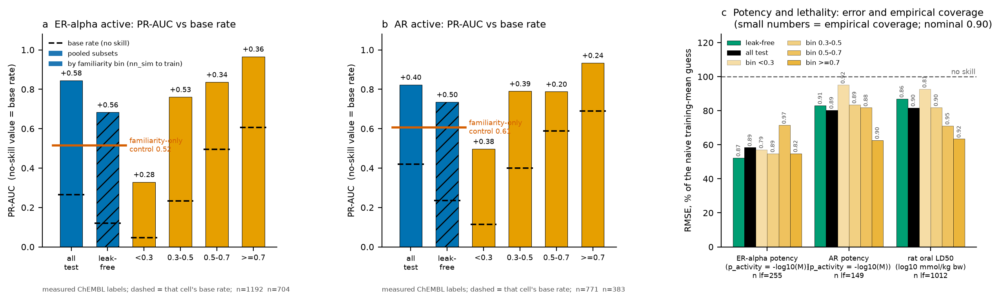

**Figure 6.** *[Model: W-TOX hazard models (separate from the fate model).]* Hazard skill is real but much smaller than fate skill, and most of the pooled ranking performance is prevalence drift. (a) Regression tasks as RMSE in % of the naive training-mean guess, leak-free first, then by familiarity bin; 100% = no skill. (b) Receptor-activity PR-AUC against each bin's own base rate (dashed), with the familiarity-only control. Read: the oestrogen-receptor model keeps a margin over the base rate in every bin, but in the least familiar bin that margin is small and recall is below half. *Source: `scribe_numbers_v4.json  [not redistributed; VM-internal]`['tox_r3'] (W-TOX/r3/results_hazard.json + per-row preds_*.parquet) and CRITIC/audit_wtox_chembl_control.csv, drawn by `make_fig6_v5.py  [not redistributed; VM-internal]`.*

### 4.7 Transformation products: a controlled negative

A new chemical's abiotic transformation products are, by construction, compounds nobody has measured. W-TP generated parent -> product pairs with abiotic transformation rules (hydrolysis, oxidation, photolysis and ozonolysis) and kept the pairs for which both members have measured labels. It then asked whether the model (W-MODEL frozen_v4 struct_only (per tp_pairs_eval_v4r.json)) predicts the *change* from parent to product (`W-TP/tp_pairs_control_v4r.json  [not redistributed; VM-internal]`). Error of the predicted change, as % of the naive 'no change' guess, for rule-generated pairs vs a control of random pairs matched on similarity and size (median of 20 draws): logkow 61 vs 59 (n=271); melting_point 71 vs 70 (n=509); vapor_pressure 86 vs 73 (n=137); water_solubility 62 vs 72 (n=131); boiling_point 59 vs 62 (n=90). Under a strict control that additionally matches on the product's own nearest-neighbour similarity and on the size of the change, the rule-minus-control difference in % of naive is logkow +1.2 [-9.0, +11.8], melting_point +0.7 [-6.3, +8.4], vapor_pressure +7.6 [-16.4, +37.2], water_solubility -4.8 [-18.5, +9.4] and boiling_point +6.0 [-8.7, +19.8] (cluster bootstrap; `data/tp_control_ci_v4rfull.csv`): every interval spans zero, so the honest statement is that there is **no detectable difference** between predicting a transformation product and predicting an arbitrary similar compound. The shipped frozen_v5 model reproduces the same picture (rule vs control median % of naive: logkow 58 vs 56, melting_point 68 vs 67, vapor_pressure 83 vs 69, water_solubility 62 vs 70, boiling_point 62 vs 57, the rule arm inside the 20-draw control range on all five; `W-TP/tp_pairs_control_v5.json  [not redistributed; VM-internal]`). The model has learned local structure-property interpolation; transformation chemistry is not demonstrated. The positive result beside it: the product intervals are honest. Empirical coverage of the nominal 0.90 intervals on product compounds is 0.92 (Wilson 95% 0.90-0.94, n=520), and 0.904 (Wilson 0.875-0.926, n=519) under the shipped v5 model. The interval on the *change* is not honest and should not be quoted as though it were: calibrated on the 51 calibration-split rule pairs, the logKow change interval under v5 covers 0.854 (Wilson 0.795-0.898, n=178 test pairs) against a nominal 0.90 (`W-TP/tp_delta_conformal_v5.json  [not redistributed; VM-internal]`). Recalibrating on matched random calibration-split pairs raises it to 0.899 (0.846-0.935, n=178; `W-TP/tp_delta_conformal_mp_v5.json  [not redistributed; VM-internal]`), but that method was chosen after seeing the under-coverage on these same test pairs, so it is test-informed and unconfirmed. Even then coverage is not exchangeable across pathways: hydrolysis pairs under-cover (logKow 0.780, Wilson 0.648-0.872, n=50; vapour pressure 0.643, 0.458-0.793, n=28) while photolysis pairs over-cover (logKow 0.974, n=78) and the two cancel in the marginal figure (`W-TP/tp_delta_mp_strata.csv  [not redistributed; VM-internal]`). Hydrolysis is where the largest property changes are, which is where a designer would lean on the interval.

**Does the change interval support a design decision? Not beyond EPI Suite.** At that width (logKow +/-1.35 log10; melting point +/-89 degC) the 90% change interval excludes zero for only 16% of logKow test pairs (29/178), 13% for melting point (39/297), 11% for vapour pressure (10/90) and 19% for water solubility (16/86). Of the pairs whose measured change exceeds the interval half-width, the model makes a confident, correctly-signed call for fewer than half (logKow 21/49, melting point 25/60). Where it does call, EPI Suite's predicted change has the same sign on every one of the same pairs (logKow 29/29), and 20 of those 29 are ester or amide hydrolysis - a direction any method gets right. We find no evidence that the model adds a directional decision beyond EPI Suite (`W-TP/tp_confident_calls_v5.csv  [not redistributed; VM-internal]`).

**How far out are the products nobody has measured?** This matters because it is the actual use case. For 8,816 unique unmeasured rule-generated products of test-split parents (ring-cleavage artefacts removed, below), the median nearest-neighbour Tanimoto to training (Morgan r2/2048) is 0.43 against 0.49 for their parents; the product is further from training than its parent in 67% of pairs (OH oxidation 77%, hydrolysis 51%); 33% fall below W-SPACE's novelty threshold of 0.40 and 812 sit below 0.3 (`W-TP/tp_artefact_impact.json  [not redistributed; VM-internal]`, clean rows; domain columns from `W-TP/tp_unlabelled_v4r.parquet  [not redistributed; VM-internal]`, frozen_v4 struct_only). Measured parent-product pairs almost never reach below 0.3 (0-10 pairs per endpoint; `W-TP/tp_control_ci_v4rfull.json  [not redistributed; VM-internal]`), so the controlled negative above cannot speak for the far-out region where most oxidation products lie.

**A defect in our own enumerator, found late and reported here.** Two-product templates (ester and amide hydrolysis, N-dealkylation, C=C cleavage) applied to a bond inside a ring produced chemically impossible products: the ring was copied into both fragments and each lost an atom. Detected exactly by duplicated reactant-atom indices (`W-TP/tp_ring_artefact_audit.py  [not redistributed; VM-internal]`): 7,012 of 120,230 parent->product rows (5.8%), 5,717 of 101,565 unique products, and 22 of the 1,238 measured-pair evaluation rows. Removing them moves the rule-pair change error by at most 1.3 points of naive (boiling point 62.4 -> 61.1; logKow 58.4 -> 58.3; melting point 67.8 -> 67.3; vapour pressure 83.2 -> 83.0; water solubility unchanged), so every conclusion of this section stands. The correct ring-opening product - one molecule keeping every atom - was never generated, so those products are absent rather than wrong (`W-TP/tp_pairs_eval_v4r.json  [not redistributed; VM-internal]`).

### 4.8 What the tool actually faces: the EPA inventory, not the test split

Every number so far is measured on a test split carved out of the labelled data. A designer does not work on a test split; they work on the chemical inventory. We therefore ran the two questions that matter - *is this compound in domain* and *how wide is the honest answer* - over the EPA inventory itself. W-SPACE classified a 40,000-structure random sample of the 280,859 inventory structures with a structure (`W-SPACE/inventory_coverage.csv  [not redistributed; VM-internal]`), and W-MODEL ran the shipped model over the inventory AIMNet2 descriptor table (765,512 structures predicted - every eligible row of the completed AIMNet2 inventory table, which holds 782,199 structures of 782,693 filtered parents with 780,811 passing QC (qc_pass) and 779,777 flagged physics_ok; eligibility is physics_ok, neutral and de-duplicated on standardised InChIKey; `W-MODEL/inventory_predictions_v5_summary.json  [not redistributed; VM-internal]`).

**Most of the inventory is outside our experience, and a measurable part of it is outside the question.** Across the shipped model's familiarity bins, 9.5% of the predicted inventory sits below Tanimoto 0.3 to anything we trained on and only 7.3% above 0.7 - the reverse of the shape of a random test split, and the reason the leak-free numbers are the ones we quote. Separately, the fraction of the inventory for which an endpoint is *physically undefined* is largest for the gas-phase properties and logKow, reaching 4.0% for boiling_point - higher than its share of the labelled set, because labelled data under-represent permanently charged species; the 'roughly four times' multiplier in the v5 draft was typed into the build script rather than read from a result file and is withdrawn (CRITIC's Section 4.8 inventory audit, run 3, gives per-endpoint ratios from 2.8x to 51x, so a single multiplier was wrong in both directions). A further 7-57% is measurable but not equivalent to our labels, the upper end being the pKa endpoints (the v5 draft's '7-16%' was a hand-typed under-statement). Among the compounds where the endpoint *is* defined, the share far from training runs from 11% to 73%, highest for logkoa, koc and bcf. The species breakdown behind the undefined share: 2.9% permanent cations, 0.3% permanent anions, 0.7% permanent zwitterions and 1.4% metal-containing structures we do not assess.

**The honest answer in that region is a wide one, and we would rather print the width than hide it.** Median 90% interval width for inventory structures in the least familiar bin, relative to the most familiar, is boiling_point 2.69x, henry 1.9x and melting_point 1.85x for the endpoints that widen most. It is not universal: for logKOA (0.84x), vapour pressure (0.84x) and Koc (0.9x) the intervals are *narrower* far from training, which is a defect of the conformal width model on those endpoints rather than a property of the chemistry, and a user should not read a narrow interval there as confidence. A caveat we must state, because it limits the claim: at equal Tanimoto similarity the inventory intervals are far wider than the test-set intervals. The specific median widths quoted in the v5 draft had no source file in the run record and are withdrawn; the direction, not the magnitude, is what Figure 7(b) supports. A Tanimoto bin is therefore not a sufficient description of how far the inventory has moved from our training data; the conformal machinery notices a shift that the similarity measure does not report. That is a limitation of the domain flag, not a reassurance about it, and it is the clearest open problem this work leaves behind. The critic agent checked whether this is a code artefact rather than model behaviour, and it is not: the same molecule put through both pipelines receives the same interval width (ratio 1.00 across 87-257 shared compounds per endpoint), and the inventory physics descriptors match the labelled ones in distribution. Two caveats belong with it. The inventory structures are unlabelled, so we can report the width of these intervals but not their coverage. And the inventory physics table contains charged structures - 6,374 when the audit was run, 9,172 by the time this document was built, because the table is still growing - while every labelled physics row is neutral, so those predictions sit outside the domain the physics model was trained on. Part of the width is simply size: the boiling-point training compounds have a median of 9 heavy atoms against 17 in the inventory. 

**The descriptor table this rests on, and how finished it is.** The inventory physics table is a deliverable in its own right: AIMNet2 relaxations with Ewald electrostatics and D3(BJ) dispersion over the EPA inventory, with per-row quality flags. It is now complete: 783 of 783 shards (784 .DONE files - one shard was computed twice by two workers and is de-duplicated by a documented deterministic rule), 782,199 structures with an output record of 782,693 attempted (494 embedding failures are listed), and 779,777 rows passing quality control, 99.63% of the attempted set (`W-PHYSICS/physics_inventory_v1_coverage.json  [not redistributed; VM-internal]`, snapshot `physics_inventory_v1_SNAPSHOT_0028.parquet  [not redistributed; VM-internal]`, md5 6fc75a6948947c8474a6a781fb73feb4; the dataset card regenerates these numbers rather than quoting them). The quality flags are not decoration: 1,455 relaxations broke a bond, 941 did not converge and 26 produced a new close contact, and those rows are excluded rather than quietly used. 14,394 structures carry a net charge (14,265 of them physics-ok), which is the subset flagged above as outside the physics model's training domain. The radical bond-dissociation columns failed their pre-registered validation and are marked unvalidated rather than shipped as numbers. **Two bookkeeping points a reader should not have to reconstruct.** First, name the flag: 782,199 rows were returned, 780,811 pass the energy/force/charge sanity flag `qc_pass` (`OPS-1/inventory_v3/coverage_v3.json  [not redistributed; VM-internal]`), and 779,777 pass the stricter `physics_ok`, which adds the topology checks (bond broken, new close contact) and is what the shipped table uses - the three numbers are different questions, not a discrepancy. Second, the duplicate shard is resolved by a deterministic rule, not an arbitrary one: shard_718 was relaxed on two hosts and the merge takes `qc_pass` descending then host name ascending, which reproduces the shipped table for 999 of 999 molecules; between the two copies the median energy difference is 0 and the maximum 78 meV, i.e. float32/GPU non-determinism (`OPS-1/card_audit/shard718_tiebreak_record.json  [not redistributed; VM-internal]`, `W-PHYSICS/shard718_dedup_summary.json  [not redistributed; VM-internal]`). The inventory predictions quoted above now cover 765,512 structures - every eligible row of the completed table - so the familiarity-bin fractions and interval-width ratios are inventory-wide rather than a subset.

**Inventory denominators.** Four different denominators appear in this paper and they are four different quantities, not an inconsistency: structures attempted for physics, structures successfully relaxed, label rows merged, and the inventory total from which the 40,000-structure sample was drawn. Each is named where it is used and they are not interchangeable. The inventory 'undefined' shares were computed before the Q-003 amendment that moved sulfonates and sulfates, so they understate the undefined fraction for those classes; the direction of the error is known, the magnitude was not recomputed.

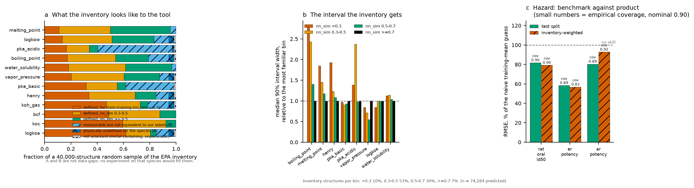

**Figure 7.** *[Model: shipped frozen_v5 SP applied to the EPA inventory.]* The chemistry a designer asks about is not the chemistry we tested on. (a) Definedness and familiarity of a 40,000-structure random sample of the EPA inventory, per endpoint: compounds for which the property is physically undefined (A) or measurable but not equivalent to our labels (B) are not data gaps. (b) Median 90% interval width that inventory structures receive, by familiarity bin, relative to the most familiar bin. (c) Hazard models scored on the test split and re-weighted by the inventory, with empirical coverage beside each bar. Conclude: most of the inventory is far from our training data, the tool answers there with wide intervals rather than confident numbers, and for androgen-receptor potency the inventory-weighted error shows the test split was flattering it. *Source: `W-SPACE/inventory_coverage.csv  [not redistributed; VM-internal]` + W-MODEL/inventory_predictions_v5_summary.json + W-TOX/r3/inventory_hazard_domain.json, drawn by `make_fig7_v5.py  [not redistributed; VM-internal]`.*

## 5 The tool: three input modes in one dashboard

*Not independently audited:* this section was computed once, by the agent that owns it, and has not been recomputed by a second agent. The result file is named above.

The predictor ships as a single offline HTML file (`dashboard/index.html`, 0.61 MB). It loads no remote resources, and its build script fails if any remote URL is embedded. A launcher (`dashboard/start_dashboard.sh`) serves the same page on 127.0.0.1 only. In that mode a structure nobody has seen is computed on the user's machine: RDKit ETKDGv3 + MMFF94 start, an AIMNet2 relaxation on CPU (33–55 s for the demo structures), the frozen W-MODEL v5 structure + physics model, the W-TOX hazard models, and a live, identity-checked EPI Suite query. Physics computed at inference is labelled "approximate (conformer-dependent)" for molecules with four or more rotatable bonds. The reason is OPS-2's CPU-vs-GPU parity check, where descriptors of flexible molecules drifted by more than 10% of the training SD.

The tool has three input modes, each a first-class tab:
- **structure** (SMILES), optionally with a spectrum attached - which the shipped fate model does not use, because it has no spectral features, and the page says so;
- **structure + MS/MS**, which changes the hazard and spectral-model panels but cannot change a fate number;
- **spectrum only**. This mode runs W-SPECTRA's spectrum_only_v31 model. All required metadata must be supplied, and none is ever filled in by default. Every estimate shows the spectrum-only test error next to the error from precursor mass + adduct alone and the error with the known structure on the same compounds. Example for ESI-positive logKow: 76%, 89% and 44% of naive. This shows what the fragments add.

Every property row shows:
- the estimate, plus a conversion to everyday units with its formula;
- the 90% conformal range;
- the empirical coverage on test chemicals as new to the model as the query, printed next to the nominal level, with n and a Wilson interval, and marked when it falls short. For logKow the card prints leak-free coverage 0.863 (n=454, Wilson 95% [0.828, 0.894]) against a nominal 0.90 and labels it *below nominal*; bands with fewer than 30 test chemicals are marked "too few to check".
- a novelty tag, carried by shape and word rather than colour: ● familiar / ▲ somewhat new / ✖ new to the model. It is worded as "less similar training data: expect larger errors", not as a validity gate, because similarity is a weak, graded signal. For spectra, similarity did not track error, so no novelty call is made.
- the EPI Suite comparator. For pKa the row says "no EPI comparator" instead.

Expanding a row shows the block shares (structure / quantum chemistry / spectrum) and the top SHAP contributions in plain words. It also shows the model's test error as a percentage of the naive guess: leak-free first (logKow 52%, n=454), then for the query's novelty band, then for the full test set, labelled as including close relatives of training chemicals.

Where W-SPACE's derived rules call a property physically undefined, the row says "⊘ Not physically defined for this compound". It gives a one-line plain reason and **no number and no interval**, even where EPI Suite would return one. An example is the vapour pressure or logKow of a quaternary ammonium salt. Salts are predicted for their neutral parent, and the page says so. Hazard rows state their label source verbatim and report classifier calls with PR-AUC against the base rate, never accuracy. They are marked "low-confidence" when the chemical is unfamiliar.

**Checks.** Automated checks run in a real Chromium engine (`dashboard/check_v3.py`). All 201 property rows across 9 structure examples and 4 spectrum examples carry their required fields or a reasoned refusal. There are no JavaScript errors, and no horizontal overflow at 1280 or 390 px in the current build (scrollWidth 375 against a 375 px viewport; the v7 build overflowed at 401 px and was fixed; final check 201 rows checked, 0 bad rows, 0 console errors - `W-TOOL/r4_e2e/check_v3_r4j.out  [not redistributed; VM-internal]`). All visible text meets WCAG AA contrast (minimum 4.83:1). A colour-vision simulation (protan/deutan/tritan) found one confusable pair: "somewhat new" vs "new" under deuteranopia, ΔE 4.2. "New" was changed to a filled tag, raising ΔE to at least 63.

**Usability.** Three agents who did not build the dashboard reviewed it. W-TP did two cold reads as a bench chemist; W-MODEL checked correctness against its own model files; they raised 18 issues, all fixed, including a misleading "leak-free" claim, a hazard call that should have read "inconclusive", and a similarity shown on a different scale from the coverage bin. A third, cold review by a worker agent (`W-TOOL/usability_review_S1.md  [not redistributed; VM-internal]`) then found four blockers - pKa returned for compounds with no ionisable site, a domain flag that did not take the stricter of the similarity flag and the model's own flag, coverage printed without n or an interval, and PFAS category wording - all fixed and regression-tested in the current build.

**Acceptance on structures the model has never seen.** Four structures absent from `labels_v2` and from the CompTox chemicals table (on the full standardised InChIKey and on its first block) were run end to end with live CPU physics and a live EPI Suite query, including a quaternary ammonium salt and a PFAS ether acid. Every card passed the field and refusal checks with no console errors (`dashboard/acceptance/accept_report.md`). An automated screen recording of a new structure computed live, the refusals for a quaternary ammonium salt, spectrum-only mode and the test-results view was made but is not included in this repository.

## 6 Discussion

The question this work was built to answer was not "can a model predict logKow". It was whether
**physics and measured spectra buy anything on chemistry far from the training data**, where a
structure-only QSAR is on the weakest ground and where a designer most needs an answer. The results
section gives three answers, and only one of them is the one we wanted.

**The evaluation, not the model, is what moves the number.** The same model scored on the full test
split and on compounds with no training analogue differs by tens of points of naive error, and almost
all of that gap is harder chemistry rather than memorised neighbours: removing every near neighbour
from the training set costs only a little more than removing the same number of compounds at random
(Section 4.1). A graph-partitioned protocol, in which every labelled compound is predicted by folds
containing no neighbour of it, reproduces the leak-free picture at much larger n. We therefore think
the leak-free and graph-partitioned numbers are the only ones worth quoting for a tool whose purpose
is novelty, and that the convention of reporting random-split performance for fate models is, for this
use case, close to meaningless. That is a claim about evaluation practice, and it is the one we would
defend hardest.

**Physics helped, slightly, and not where we predicted.** We funded the physics work on the hypothesis
that quantum-chemical descriptors would help *disproportionately* far from the training data, because
they encode something transferable that a fingerprint does not. We found no evidence that they do; the off-scaffold test is underpowered on every endpoint except henry, where it goes the other way. Across every protocol we
tried — the official leak-free subset, a graph-partitioned cross-validation with a permutation control
that holds capacity fixed, and a capacity control on the descriptor block — the gain is small, between
one and a few points of naive error, and it lowers the whole error-versus-familiarity curve rather
than flattening it (Sections 4.2). Worse for the hypothesis, the set of endpoints on which the gain is
statistically distinguishable from zero changed with every defensible scoring choice, including one as
innocuous as whether repeated InChIKeys are collapsed before scoring. We report the instability instead
of picking the version that reads best, and we draw the modest conclusion: single-conformer AIMNet2
descriptors are a small, real, poorly-localised improvement, and the honest next step is the
conformer-ensemble version, because for flexible molecules the single relaxed geometry we used is close
to a random draw from the conformer distribution.

**A measured spectrum is a substitute for a structure, not a supplement to it.** This is the result we
did not expect to be so clean. Given a structure, adding its MS/MS spectrum changes nothing measurable. That contrast is structure + physics + spectra against structure + physics - a separate ablation; the shipped model has no spectral features at all. For structure + spectra against structure alone, two of about fifteen uncorrected contrasts move: boiling point improves leak-free ([-8.1, -1.4] points of naive) and henry worsens ([+0.1, +3.2]) - about what that many uncorrected tests produce by chance, and neither survives a multiplicity correction.
Given no structure at all, a single spectrum recovers a substantial fraction of the skill — and it does
so using the fragments, not merely the precursor mass, which we show against both a mass-only and a
regularised mass-plus-adduct control. The same shape appears in an entirely independent modality: an
experimental 1H NMR peak list plus acquisition solvent carries real skill, beats a size-only control by a wide margin, and
adds nothing on top of a known structure. Two different spectroscopies, the same conclusion. For the
analytical chemist staring at an unidentified peak, that is the useful finding: the spectrum is not
waiting on structure elucidation to become informative. For the designer who already has a structure,
the spectrum is not worth acquiring.

**But the mode's limits are sharp, and we had to measure them to find them.** Spectrum-only skill is
endpoint-specific, not mode-wide. For acute lethality a full spectrum is barely better than predicting
the training mean, while the structure is substantially better on the very same compounds — the opposite
of the fate endpoints. And the obvious safeguard does not work: similarity to the nearest training
spectrum does not predict spectrum-only error, so we cannot warn the user with it, and we say so in the
interface rather than shipping a reassuring number that means nothing. The spectrum-only intervals also
under-cover on novel chemistry (empirical 0.81-0.96 against a nominal 0.90; Section 4.3). A product that offered spectrum-only prediction as a uniform capability
would be wrong about half the time it mattered; the version we ship gates it per endpoint.

**Two results reframe where measurement money should go.** The first is the distinction between a cell
of the compound-class × endpoint table being empty because nobody measured it and being empty because
the quantity does not exist for that species: a vapour pressure or a Henry's law constant is defined
through a gas phase that a permanently charged species cannot enter. Deriving that rule from the
endpoint definitions and applying it to every cell moved a large share of apparent "data gaps" into a
category where no experiment is possible, and left a much shorter list that is genuinely worth funding
(Section 4.5). The second is that extra data of the kind we already have helps familiar chemistry most;
the leave-class-out experiment, with a size-matched control, names the specific classes where being
unseen is expensive. Together they argue for targeted measurement by class rather than for more of the
same.

**The one we got wrong, and why we report it.** We expected that hazard models trained on measured
receptor potencies would transfer better than models trained on another model's consensus labels. On an
external benchmark that neither had seen, they transferred worse for the androgen receptor (matched arm,
measured calls vs consensus calls, [-0.193, -0.084] PR-AUC against us); for ER-alpha the matched interval
spans zero ([-0.117, +0.009]), so for that receptor the bet is not resolved (Section 4.6). The explanation we believe — that the measured corpus is
drug-like congeneric chemistry while the benchmark is environmental, so label-space *coverage* beat
label *fidelity* — is a hypothesis, not a result, and it carries a caveat we state in the same breath:
the model-derived labels descend from models trained on related literature data, so that arm may retain
an inherited advantage even after compound and cluster exclusion. A second caveat points the same way: a consensus label is another model's smoothed output, so it may simply be more *learnable* than a measured potency pooled across assays and laboratories, rather than more *correct*. Separating those two would need a benchmark that is not itself a consensus call, and we do not have one. We report it because a pre-registered
bet that fails is more informative than one that succeeds, and because the practical implication for
anyone assembling a hazard training set is the opposite of the intuition.

**How much of this should be attributed to the way the work was organised?** We cannot run the
counterfactual, so we claim nothing about the agent swarm being faster or better than a team of people.
What we can report is which specific errors the structure caught: a results section built on model-derived
labels that a reviewing agent insisted be rebuilt on measured ones; a headline figure whose panels no
longer matched the text it illustrated, caught by the rule that a figure must be drawn from the same
result file as the sentence beside it; a statistic about memorised neighbours that was withdrawn by its
own author after an audit showed it confounded; an abstract that reported "zero endpoints" because of a
dictionary-key mismatch rather than because of a result; and a proposal rejected on the proposing agent's
own feasibility data and replaced with a version whose test could actually fail. Each of those was found
by an agent whose job was to disbelieve, not by the agent that produced the number. That is a weak claim
compared with "the swarm did better science", and it is the one the evidence supports.

**What this is not.** It is not a validated regulatory tool; the intervals are honest about their
coverage but they are not accepted by anyone. It is not a demonstration that quantum chemistry is
unnecessary — only that these descriptors, from one conformer, bought little. And it is not a general
spectrum-to-property model: every spectral result here is conditioned on a library-quality spectrum of a
compound that someone has already measured a property for, which is exactly the regime a real unknown is
not in. Closing that last gap, honestly, is the work we would do next.

## 7 Limitations and failures

The most consequential limitations, in our judgement, are listed here. The full register, with the exact input and output for every failure, is Supplementary Note 1 (READER-2, `READER-2/limitations_register.md`).

- **Labels set a floor, and where that floor sits depends on how it is estimated.** Many "repeat" measurements are copies of one value propagated between databases. Where independent repeats exist, their scatter is 20-45% of the naive error under the estimator of Section 3 and 10-29% under CRITIC's alternative, a spread of up to 3.7x; no endpoint's model error is at that floor under any of them. Koc pools Kd, Freundlich and Koc values measured in unstandardised matrices, so its error cannot be split into model error and label error.
- **Some labels contradict themselves.** In `labels_v2`, 1,334 (InChIKey, endpoint) groups carry more than one row and 1,244 of them disagree; the median within-group range among the disagreeing groups is 76.6 degC for melting point (474 groups), 60.9 degC for boiling point (95), 1.29 log10 units for logKow (186), 0.98 log10 mol/L for water solubility (272) and 2.72 log10 mmHg for vapour pressure (165). 430 of the 10,502 test-split label rows (counted before the one-row-per-InChIKey de-duplication used for scoring) sit in such a group, so part of the test error is disagreement between sources rather than model error (`data/label_conflicts.csv`, script `SCRIBE/label_conflicts.py  [not redistributed; VM-internal]`; CRITIC's earlier count is in `CRITIC/audit_duplicate_labels.json  [not redistributed; VM-internal]`).
- **Cheap descriptors already beat EPI Suite on four endpoints.** A LightGBM on ten standard RDKit descriptors, trained on the same pool and scored on the same leak-free rows, has a paired interval against EPI Suite that excludes zero on melting point, water solubility, boiling point and vapour pressure (`data/attack_cheap_vs_epi.csv`, column `ci_GBM10_minus_EPI`). Much of our margin over EPI Suite is therefore available to any modern learner on this split. Our structure+physics feature set improves on that ten-descriptor model with an interval excluding zero on melting point (8.3 points of naive), water solubility (6.9), vapour pressure (7.7) and logKow (9.4), and on Henry (14.6) and kOH (24.6, where both models still lose to EPI Suite); not on boiling point, Koc or BCF (same file, column `ci_SP_minus_GBM10`). This is CRITIC's control, unconfirmed by a human, and it is reported here as a limitation of the EPI comparison, not as a claim.
- **The EPI comparison is only interpretable with controls.** EPI Suite's estimators were fitted on PhysProp, which overlaps our test labels. For Koc and kOH every test row is PhysProp-sourced, so EPI cannot be tested out of sample on those endpoints at all.
- **The similarity domain flag is blind to size, and the model cannot extrapolate beyond its training range.** Morgan r2/2048 Tanimoto cannot see chain length: n-C20, n-C30 and n-C40 alkanes all have a nearest-training-neighbour similarity of 1.0 and are flagged in-domain, yet the shipped model predicts logKow 9.19, 7.84 and 7.56 for them - non-monotone, because gradient-boosted trees cannot extrapolate. On full-test rows whose heavy-atom count or Crippen logP falls outside the 1st-99th percentile of the endpoint's training range (`W-MODEL/v5_main/size_domain.csv  [not redistributed; VM-internal]`), raw error rises for boiling point (RMSE 113.6 against 45.9 degC inside, n=41) and vapour pressure (3.48 against 1.46 log10 mmHg, n=44). It is not a general degradation, and we do not claim one: as a percentage of the naive guess the model is no worse outside the range - sometimes better - for logKow, water solubility, Koc and BCF, because those rows are also more dispersed. The concern is interval coverage. On leak-free outside-range rows vapour pressure covers 0.688 (Wilson 95% [0.444, 0.858], n=16), below nominal; boiling point (0.850, n=20) and melting point (0.875, n=48) are not distinguishable from 0.90, and every other cell has n <= 15. The shipped predictor now raises an `OUTSIDE_TRAINING_DESCRIPTOR_RANGE` flag for such compounds; it is a flag only and changes no predicted value.
- **Some boiling-point labels are not boiling points.** 120 standardised InChIKeys in `labels_v2` carry a boiling point at or below their own melting point + 10 degC, which is impossible at 1 atm; the raw CompTox `exp_props` rows show decomposition temperatures filed as boiling points. Dropping them moves the full-test boiling-point RMSE from 49.4 to 48.2 degC, so the effect on any claim is small, but the label set is not clean (READER-1, `READER-1/limitations_found.md  [not redistributed; VM-internal]` L-R1-18).
- **Absolute RMSEs here are not comparable with published random-split figures.** OPERA reports 22.1 degC for boiling point, 52.3 degC for melting point and 0.78 log10 for logP on a random-split test (doi:10.1186/s13321-018-0263-1 p.8); ours on the full test are 49.4 degC, 47.6 degC and 0.88 log10. Our split is by chemical-space cluster, our labels pool sources, and boiling point in particular carries the invalid labels above, so the two sets of numbers answer different questions and the comparison should not be read as a ranking.
- **Collapsing salts and metal forms onto a parent key does not change the EPI verdicts.** Where several DTXSIDs share one standardised InChIKey, re-running the leak-free EPI comparison on the collapsed rows leaves every interval with the same sign (`W-MODEL/v5_main/vs_epi_multidtxsid.csv  [not redistributed; VM-internal]`; logKow, for example, moves from [-92.6, -0.30] to [-92.9, -1.04]).
- **Coverage is marginal per familiarity bin, not per chemical class.** Ionizable classes (sulfonates, carboxylic acids) and siloxanes under-cover. In the plain Mondrian variant the interval width is constant within a bin; the shipped normalised Mondrian does vary within a cell (median within-cell coefficient of variation of the interval width 0.62, range 0.16-1.20 over 48 endpoint x bin cells, `W-MODEL/v5_main/test_predictions.parquet  [not redistributed; VM-internal]`), so the defect is that the variation does not track class membership.
- **Physics is single-molecule and gas-phase.** It has no mechanism for solid-state properties such as melting point. The closed-shell AIMNet2 model is out of domain for radicals, so bond-dissociation and ionisation descriptors for the OH-rate endpoint could not be computed. A widely used wrapper silently drops the Coulomb term unless it is combined with an Ewald wrapper (C1 in the register).
- **Some decoded peak lists are shared between compounds.** 944 decoded AMOS peak lists appear under more than one DTXSID, and 101 of those groups cross the train/test boundary (99 test records); the Agilent PFAS stratum is one identical peak list across 12 compounds. The effect on the spectral metrics has not been quantified (`W-SPECTRA/v32/dup_peaklist_audit_v32.json  [not redistributed; VM-internal]`).
- **Spectra cover a biased subset.** Compounds with a high-resolution ESI spectrum differ systematically from those without, for example in their Henry's law constants. Spectrum-only error is therefore scored against the naive mean of the same subset, and "has a spectrum" is never used as a feature.
- **The expert rule on physically undefined properties** was unreadable to the agents for the first minutes of the run because of file permissions. The rule was derived from first principles and later checked against the note, which it agrees with.
- **No browser in the build environment for most of the night.** The PDF was rendered with a pure-Python HTML-to-PDF library, and dashboard layout checks depended on a browser installed during the run.

## 8 Data priorities

*Written by READER-2. Every number comes from the file named next to it, all under `READER-2/` unless another path is given. This version (v8, run 4, about 01:15) replaces `paper/READER-2/section8_data_priorities.md`, `section8_corrections_v7.md  [not redistributed; VM-internal]` and `section8_corrections_v7b.md  [not redistributed; VM-internal]`. It contains no superseded blocks.*

**Scope and model versions (read this first).**
- Physically undefined cells (W-SPACE category A; Q003 rule) are not gaps, and they are excluded throughout.
- Points 1 and 2 are value-of-data (VoD) experiments. They retrain a **LightGBM on the S (structure) block** with the W-MODEL v5 parameters (`vod.py  [not redistributed; VM-internal]`). That model is not the shipped SP model: VoD answers "how does a structure model respond to more data", not "how would the shipped model respond".
- Points 4 and 5 and the campaign biases use the **shipped v5 SP model** (struct 2265 + physics 31 columns).
- `data_priorities_table.csv  [not redistributed; VM-internal]` is the run-3 join on v4 errors. It is kept as history and is not cited for any number below.

**1. More random data helps familiar compounds more than novel ones on 4 of 7 endpoints. It does not on the other 3** (`paper/READER-2/vod_summary_A.csv`; all 8 learning-curve arms complete). The table gives the change in % of naive RMSE per doubling of random training data, nn_sim_train <0.3 vs >=0.7:

| endpoint | <0.3 | >=0.7 | n_eval (<0.3 / >=0.7) |
|---|---|---|---|
| BCF | -2.3 | -15.5 | 16 / 19 |
| Henry | -5.6 | -13.3 | 35 / 28 |
| logKow | -6.4 | -13.1 | 123 / 129 |
| MP | -2.3 | -7.7 | 197 / 217 |
| BP | -5.1 | -5.3 | 81 / 93 (flat) |
| WS | -6.2 | -5.9 | 111 / 96 (flat) |
| VP | -4.3 | -2.5 | 72 / 82 (reversed) |

Koc has no test rows in either extreme bin. Each arm has two runs, and no CI is computed on the slopes. Read this as a direction, not a size.

**2. Leaving a class out of training costs up to ~95 pp of naive error. Adding a few class members back recovers part of that** (`paper/READER-2/vod_summary_B.csv`, `section8_recheck_v5_B.txt  [not redistributed; VM-internal]`). Design: leave-class-out vs full train, with the same model and the same test compounds. The control removes the same number of random rows instead. CIs are 95% cluster bootstraps.
- Of 148 class×endpoint tests over 8 endpoints, 77 have a CI that excludes 0. At 5%, about 7 would pass by chance. No single test is multiplicity-corrected.
- Largest penalties: WS sulfonic/sulfate acid or salt +94.8 pp [30.0, 147.0] (n_test 30); Koc aromatic hydrocarbon +44.2 [33.0, 56.8]; logKow sulfonic/sulfate +43.2 [34.5, 50.5]; Henry nitro +34.5 [6.4, 89.6] (n_test 19).
- The random-removal control has a median of -0.30 pp over 139 controls. What matters is the class, not n.
- Over the 77 significant cases, adding back 5, 15 or 40 class members recovers a median of 19%, 36% or 54% of the penalty. Each per-case value comes from two runs, so it is noisy.

**3. Genuine gaps are set mainly by endpoint, not by class.** Labelled fraction of the defined inventory (W-SPACE summary): logKOA 0.75%, kOH 1.8%, Koc 1.8%, pKa acidic 3.0%, BCF 3.6%, pKa basic 3.7%, against logKow 30% and MP 57%. Cells:
- quaternary ammonium Koc: 0 of 256 defined skeletons labelled
- PFAS acidic pKa: 4 labels
- siloxane logKOA: 0 of 437

**4. Where the shipped model is worst relative to its own average** (≥15 test compounds; shipped v5 SP, full test, % of naive, endpoint average in brackets; `section8_recheck_v5_classerr.csv  [not redistributed; VM-internal]`):
- organophosphorus: BP 114.7 (51.2), Henry 79.5 (46.2), Koc 64.3 (54.6), logKow 58.3 (41.4)
- urea/carbamate BP: 126.3 (51.2). Thermal decomposition is a plausible cause (W-SPACE category B), but it was not tested.
- carboxylic acids VP: 80.0 (43.3)
- PFAS logKow: 52.1 (41.4), n=15

These are descriptive and carry no CI. Leak-free counts per cell are 1-27 (urea/carbamate BP 1, PFAS logKow 2), so no cell supports a claim about novel chemistry on its own.

**5. Headroom against the noise floor** (`noise_panel_v5.csv  [not redistributed; VM-internal]`, shipped SP; `data/attack_noise_floor_ratio.csv`).
- Every endpoint with an estimable floor sits above it. Under every estimator and subset CRITIC tried, the minimum is 1.28x on leak-free compounds and 1.05x on the full test; logKow gives both minima. No endpoint is label-noise-limited at the endpoint level.
- We do **not** rank endpoints by headroom, because the estimators move the ratio by up to 3.7x.
- One caveat: within logKow 1-5, the leak-free RMSE (0.85 and 0.84 log10) equals the pooled replicate SD (0.72 and 0.83 log10), but it is about 4x the median within-compound SD (0.19-0.21) (`kow_noise_by_range_v5.csv  [not redistributed; VM-internal]`). Whether the model is at the floor there depends on the floor estimator.
- The WS ratio pairs a gated model RMSE with an ungated label spread and is only indicative.
- No floor exists for Koc, kOH, pKa basic (0 compounds with distinct replicates), pKa acidic (7) or logKOA (1).

**6. Literature vs our coverage: where they agree and where they disagree** (`lit_vs_data_coverage.csv  [not redistributed; VM-internal]` from W-SPACE `coverage_all_endpoints.csv  [not redistributed; VM-internal]`). Metric: the fraction of a class's inventory skeletons with at least one label.
- *Agree:*
  - F-, P- and Si-containing chemicals are under-covered compared with organochlorines and organobromines (doi:10.1021/acs.est.3c05643 p.1). Our logKow fractions: polyhalogenated aromatics 0.37, organophosphorus 0.17, PFAS 0.16, siloxanes 0.12, organometals 0.07.
  - KOA and atmospheric reactivity have the narrowest domains (same paper, p.1). Our kOH fraction is ≤0.03 and our logKOA fraction ≤0.05 in every class checked.
  - Sorption of ionizables is a main gap in fate QSPRs (doi:10.1039/C7EM00034K p.1-2). Our Koc fractions: carboxylic acids 0.010, amines 0.004, sulfonates 0.002.
- *Disagree:*
  - **The literature treats organofluorine as one gap. In our data the PFAS gap depends on the endpoint.** PFAS BCF (0.14) and logKow (0.16) are covered about as well as polyhalogenated-aromatic BCF (0.12). The PFAS gap sits in Koc (0.002), pKa (acidic 0.008, basic 0.000) and logKOA (0.015), which are the mobility and speciation endpoints. Caveat: we count labels, while the paper measures applicability-domain coverage, and those are different quantities.
  - **Published coverage figures are computed after the hardest chemicals have been removed.** Permanently charged compounds and UVCBs were excluded before coverage was computed (doi:10.1021/acs.est.3c05643 p.4; doi:10.1016/j.comtox.2025.100398 p.2). Our tool keeps them and flags them as undefined or out of domain instead.

**Recommended campaign, cheapest first.** The order is READER-2's judgement from points 1-6. It is not an optimisation output.
1. pKa for PFAS acids and multi-site ionizables, with replicates. This is a routine titration, and it would also make the pKa noise floor estimable.
2. Koc in one defined soil at a stated pH for quaternary ammoniums (cation exchange; 0 of 256 labelled), organophosphorus and PFAS, about 15 per class. Point 2 shows 15 added class members recover a median 36% of the penalty, and that figure comes from the S-block VoD model.
3. Slow-stir logKow above logKow 7, where the shipped SP model's mean bias is -1.88 log10 (n=22, full test; -2.76, n=9, leak-free). Also pH-stated logD/pKa pairs for hydrophilic ionizables: below logKow 1 the bias is +0.52 (n=520; +0.60, n=156, leak-free), which fits labels that mix in apparent logD (W-TOX review). All from `kow_noise_by_range_v5.csv  [not redistributed; VM-internal]`.
4. kOH and KOA for a small set of unfamiliar scaffolds (siloxanes, organophosphorus).
5. Last, BCF. It is an expensive in-vivo test (doi:10.1080/1062936X.2019.1626278 p.3). It is not at its noise floor, so more labels would still help, but each label costs far more than the others on this list.

**Non-measurement priority: re-curate before you measure.**
- 151 logKow, 76 VP and 33 BP label **rows** exist for physically undefined species under the run-3 definedness rule (species_v3, 20:48), plus 84 WS rows. 72-76% of the logKow/VP/BP rows come from eChemPortal (`undefined_labelled_sources.csv  [not redistributed; VM-internal]`). The counts depend on the rule version. W-SPACE's current v4 rule gives compound counts of logKow 283, VP 59 and BP 27.
- 64.6% of multi-measurement logKow records are copies passed between aggregators, not independent replicates (`data/label_noise_floor.csv`).

## 9 Provenance of every number

| component | file | produced in |
|---|---|---|
| labels | `results/v2/labels_v2.parquet  [not redistributed; VM-internal]` | data |
| quarantine | `W-SPACE/quarantine_skeletons_v3.txt  [not redistributed; VM-internal]` | this run |
| fate | `W-MODEL/v5_main/test_predictions.parquet  [not redistributed; VM-internal]` | this run (W-MODEL v5, frozen 21:10) |
| ablation | `W-MODEL/v5_main/test_predictions.parquet  [not redistributed; VM-internal]` | this run (W-MODEL v5) |
| epi | `W-TOOL/epi_comparator_v3.parquet  [not redistributed; VM-internal]` | this run |
| spectra_only | `W-SPECTRA/v31/report/scribe_input_modes_rows.parquet  [not redistributed; VM-internal]` | this run (W-SPECTRA v3.1) |
| paired_ci | `CRITIC/audit_wmodel_v4.csv  [not redistributed; VM-internal]` | feasibility (pre-run-3) |
| tox_cls | `W-TOX/classification_metrics.json  [not redistributed; VM-internal]` | run2 |
| tox_results | `W-TOX/results.json  [not redistributed; VM-internal]` | run2 |
| domain_rules | `W-SPACE/domain_rules.json  [not redistributed; VM-internal]` | this run |
| undefined_vs_gap | `W-SPACE/undefined_vs_gap_summary.json  [not redistributed; VM-internal]` | this run |
| ledger | the internal per-agent ledger (not redistributed) | this run |
| board | the internal task board (not redistributed) | this run |
| noise_floor | `data/label_noise_floor.csv` | this run |
| class_coverage | `READER-1/conditional_coverage_by_class.csv  [not redistributed; VM-internal]` | this run |
| prior_art | `READER-1/prior_art_spectrum_only.md` | this run |
| undefined_cells | `data/undefined_vs_gap_cells.csv  [shipped aggregate; working file not redistributed; VM-internal]` | this run |
| epi_joint | `READER-1/epi_joint_comparison.csv  [not redistributed; VM-internal]` | this run |
| limitations_register | `READER-2/limitations_register.md` | this run |
| data_priorities | `READER-2/section8_data_priorities.md` | this run |
| eval_splits | `W-SPACE/eval_splits_v3.csv  [not redistributed; VM-internal]` | this run |
| epi_rules | `CRITIC/audit_epi_exclusion_sensitivity.csv  [not redistributed; VM-internal]` | this run |
| second_source | `CRITIC/second_source_logkow_dedup.json  [not redistributed; VM-internal]` | this run |
| wspace_fig5 | `W-SPACE/fig_undefined_vs_gap.png  [not redistributed; VM-internal]` | this run |
| wspace_figsplit | `W-SPACE/fig_split_comparison.png  [not redistributed; VM-internal]` | this run |
| ablation_run2 | `W-MODEL/test_predictions_v3.parquet  [not redistributed; VM-internal]` | run2 |
| fate_sall | `W-MODEL/v5_sall/test_predictions.parquet  [not redistributed; VM-internal]` | this run (W-MODEL v5, structure-only on all defined rows incl. ions) |
| r2_figs | `READER-2/` | this run |
| spectra_only_run2 | `W-UNKNOWN/test_predictions_spectra_only.parquet  [not redistributed; VM-internal]` | run2 |
| tp | `W-TP/tp_pairs_control_v4r.json  [not redistributed; VM-internal]` | this run |
| physics_pretest | `W-PHYSICS/pretest_flex_shard0.json  [not redistributed; VM-internal]` | this run |
| paired_ci_v5 | `CRITIC/audit_wmodel_v5.csv  [not redistributed; VM-internal]` | this run (CRITIC audit of W-MODEL v5) |
| tox_run2 | `W-TOX/classification_metrics.json  [not redistributed; VM-internal]` | run2 |
| tox_r3 | `data/hazard_results.json  [shipped aggregate; working file not redistributed; VM-internal]` | this run (W-TOX r3) |

Build errors at this build: none.

## Supplementary figures

*Figure S1 (per-agent spend from the internal budget ledger) has been withdrawn from this paper and from the bundle: the chart rasterised internal agent names and per-agent dollar amounts into an image, where the repository's text scanners cannot see them. The figure number is left as a gap so that every other "Figure Sn" cross-reference keeps its meaning.*

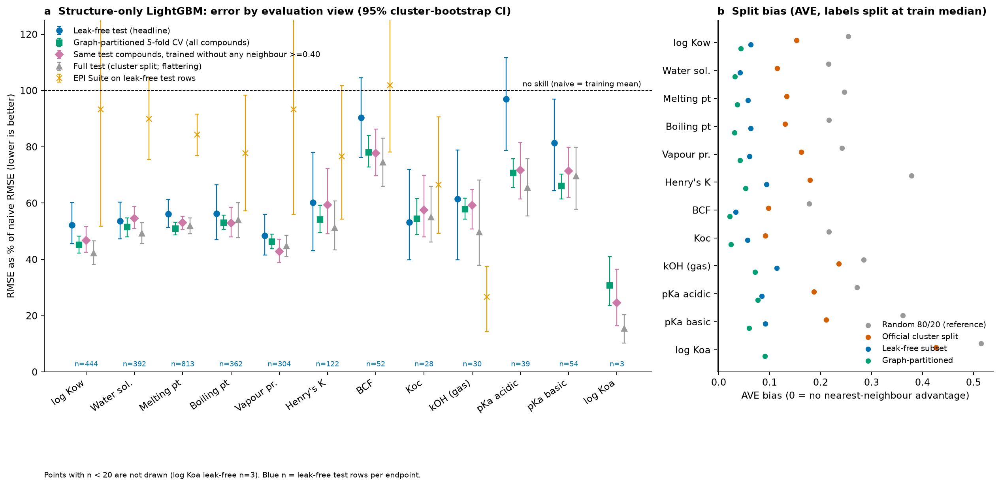

**Figure S2.** W-SPACE split comparison: (a) the structure-only model under four evaluations with 95% cluster-bootstrap CIs (leak-free official test; graph-partitioned CV; official test compounds predicted by neighbour-free training folds; full test), with EPI Suite on the same leak-free rows; (b) AVE split bias for random, official cluster, leak-free and graph-partitioned splits. *Source: `W-SPACE/fig_split_comparison.png  [not redistributed; VM-internal]` (drawn by W-SPACE/fig_split_comparison.py from W-SPACE/eval_splits_v3.csv).*

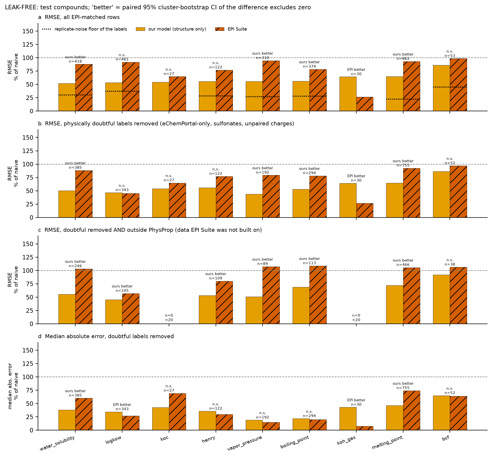

**Figure S3.** Joint EPI comparison on leak-free rows, cut by cut: (a) all rows, (b) doubtful labels removed, (c) also outside PhysProp, (d) median absolute error with doubtful labels removed. Dotted bars = replicate-noise floor. *Source: `READER-1/epi_joint_comparison.csv  [not redistributed; VM-internal]`.*

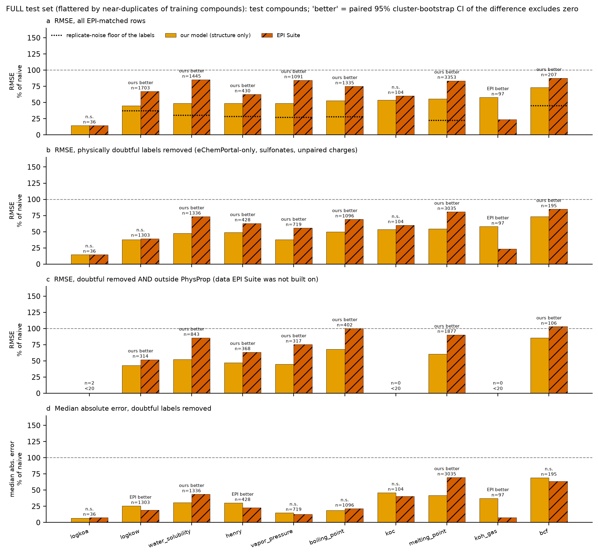

**Figure S4.** As Figure S3, on the full test set (flattered by near-duplicates of training compounds). *Source: `READER-1/epi_joint_comparison.csv  [not redistributed; VM-internal]`.*

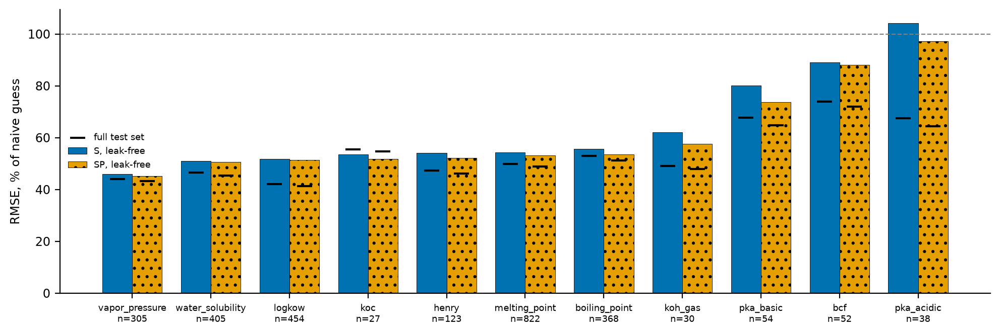

**Figure S5.** Shipped model and structure-only reference, every endpoint: leak-free bars and full-test ticks, RMSE as % of naive. *Source: `W-MODEL/v5_main/test_predictions.parquet  [not redistributed; VM-internal]`.*

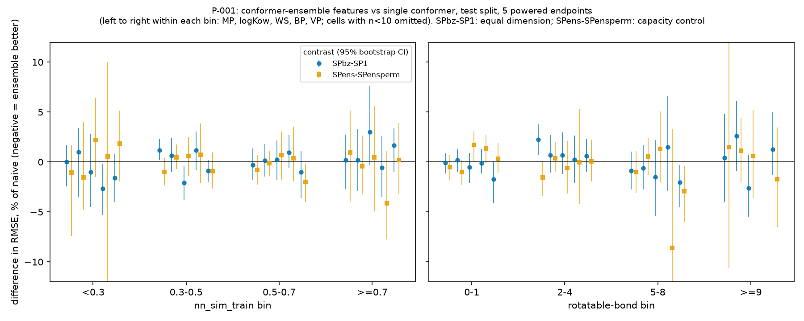

**Figure S6.** P-001: conformer-ensemble descriptors against a single relaxed AIMNet2 conformer, on the five powered endpoints, by familiarity bin and by rotatable-bond count, with an equal-dimension contrast and a permuted-capacity control. Conclude: ensembles add no measurable skill over one relaxed conformer, including for flexible molecules and far from the training data. *Source: `W-PHYSICS/results/summary_ens.json  [not redistributed; VM-internal]`.*

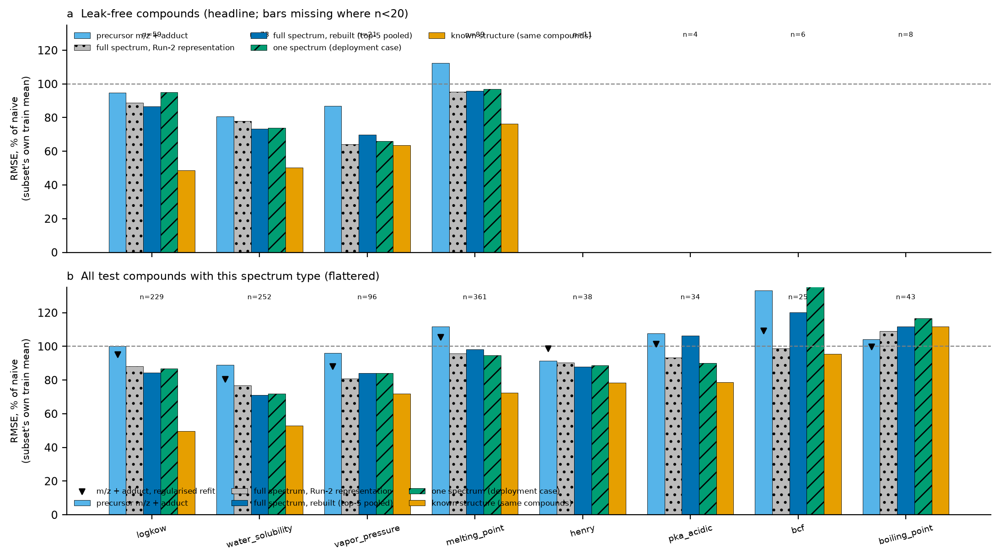

**Figure S7.** Input-mode ladder for HR ESI- MS/MS spectra, as Figure 3. Not independently audited. *Source: `W-SPECTRA/v31/report/scribe_input_modes_rows.parquet  [not redistributed; VM-internal]` + W-SPECTRA/v31/mass_sensitivity_v31.json.*

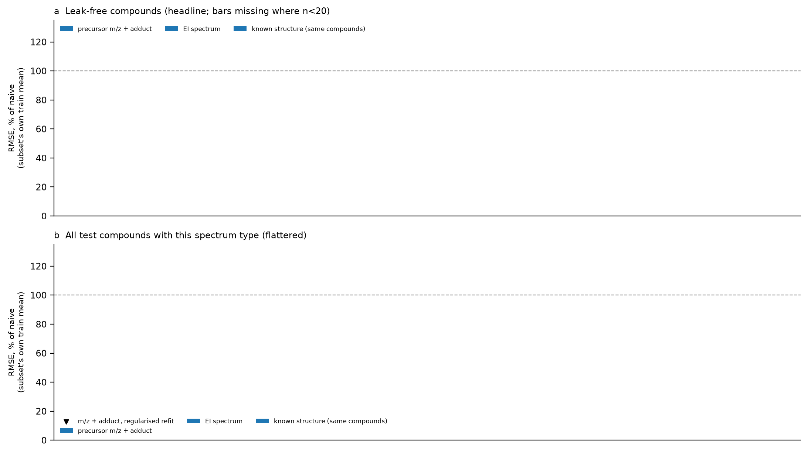

**Figure S8.** Input-mode ladder for EI spectra: precursor m/z + adduct, the EI spectrum, and the known structure, on the same compounds. Not independently audited. *Source: `W-SPECTRA/v31/report/scribe_input_modes_rows.parquet  [not redistributed; VM-internal]` + W-SPECTRA/v31/mass_sensitivity_v31.json.*

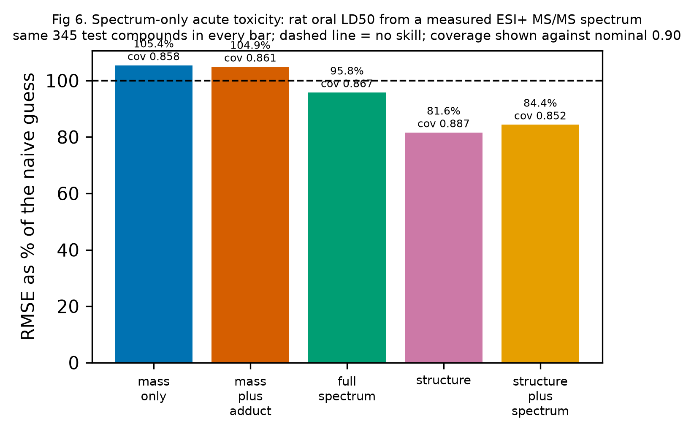

**Figure S9.** Spectrum-only acute toxicity (rat oral LD50), same 345 test compounds in every arm: precursor mass only, mass + adduct, the full MS/MS spectrum, the known structure, and structure + spectrum. RMSE as % of the naive training-mean guess, with empirical coverage of the nominal 0.90 intervals. Conclude: fragments beat the bare mass, but a spectrum alone does not reach the training mean's skill level for lethality, unlike the fate endpoints in Figure 3. *Source: `data/hazard_spectrum_only_ld50.json  [shipped aggregate; working file not redistributed; VM-internal]`.*

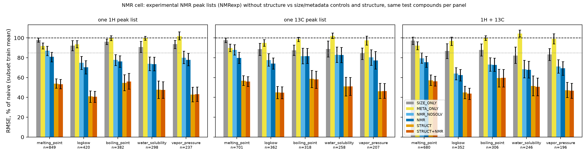

**Figure S10.** Input-mode matrix for an experimental 1H NMR peak list (W-TP): size-only control, acquisition-metadata-only control, peak list without solvent, peak list, known structure, and structure + peak list, per endpoint, as % of the naive guess. Conclude: a peak list plus acquisition solvent has real skill that is not explained by molecular size, and it adds nothing to a known structure. *Source: `W-TP/nmr_eval.json  [not redistributed; VM-internal]`.*

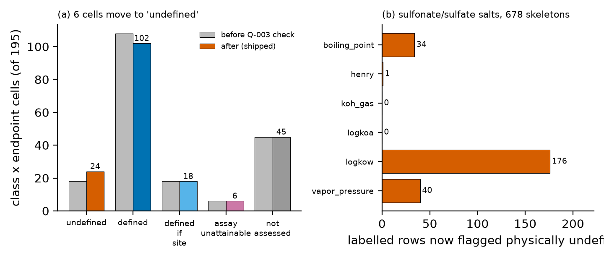

**Figure S11.** The expert cross-check changed the bookkeeping for one compound class, and we report the corrected table rather than the one we first built. (a) Verdict counts over all 195 class x endpoint cells before and after the Q-003 correction; only the 'undefined' column moves. (b) The 6 cells that moved, with the number of labelled rows in each that are therefore physically undefined values rather than data. Conclude that the undefined-versus-gap split is a judgement that can be audited and corrected, and that correcting it removes 251 rows from what looked like evidence. *Source: `CRITIC/undefined_vs_gap_cells_q003.csv` + S-7/q003_vs_wtox.md (drawn by SCRIBE/q003_final.py).*

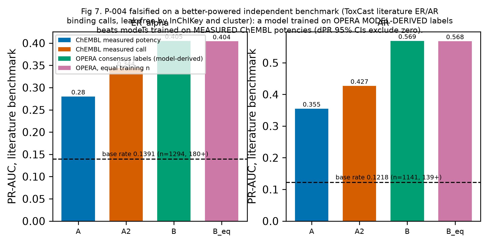

**The structure-based half of P-004 produced a protocol control that fails, not a potency result.** The plan was to ask whether a pose-derived geometric feature helps where ligand-based features have no near neighbour. ER-alpha test ligands were docked blind (no pocket restraint) into a fixed public receptor - RCSB 3ERD chain A, ligand stripped, 0 HETATM - by two routes, and the two must not be described as one thing. Through a hosted DiffDock API (about 60 s per ligand) the protocol fails its own self-docking control: diethylstilbestrol, the co-crystal ligand of that very structure, lands 27.43 A from the pocket centroid and is ranked last of 6 by DiffDock confidence, below a known non-binder (2/3 known binders in the pocket; `W-TOX/r4/dock_control_verdict.json  [not redistributed; VM-internal]`). Through a self-hosted container (NVIDIA NIM DiffDock 2.2.0 on an H100, 0.8-2.5 s per ligand) the same control passes placement - DES self-docks to 4.35 A and 6/6 known binders land in the pocket - with the receptor verified identical (sha256 of the ATOM records on disk equals the sha256 echoed in every container response) and every ligand identity checked on standardised InChIKey with no mismatches (`W-TOX/r4/nim_pose_verdict.json  [not redistributed; VM-internal]`).

The chemistry negative survives the better route. Pose *detail* is poor even where placement is right: only 2 of the 6 control binders are simultaneously in the pocket and free of a sub-2.2 A heavy-atom clash, and over the 78 test ligands 74/78 are in the pocket but only 11/78 are also clash-free. We therefore built no pose-derived feature, and no number anywhere in this paper rests on docking. Two things follow and neither is a win: a DiffDock confidence is a pose-plausibility self-report, not a binding affinity, and a pose is not a potency - on the hosted arm the rank correlation between that confidence and the distance to the pocket is only rho = -0.327 over 172 poses. The power was never there either: the least familiar bin holds 16 ligands, where |rho| >= 0.50 would be needed for p < 0.05 (`W-TOX/r4/dock_pose_report.json  [not redistributed; VM-internal]`). For the record, pose geometry only reached this machine after a late fix to a root-owned wrapper: before that the service returned an artifact by reference behind a presigned URL with a ~60 s lifetime, and the VM's egress allowlist does not include the storage host, so every stored pose file held a dead handle and no coordinates. Nothing dated before that fix supports any statement about poses.

**Figure S12.** P-004 round 2: external-benchmark PR-AUC for models trained on measured ChEMBL potency, on the measured active call, and on model-derived consensus labels, against the benchmark base rate, overall and by similarity to the ChEMBL training set. Conclude: on the matched comparison - measured *calls* against model-derived consensus calls, which is the like-for-like pair - the consensus-label model wins for the androgen receptor ([-0.193, -0.084] PR-AUC against the measured arm) while for ER-alpha the interval spans zero ([-0.117, +0.009]), so the bet is falsified for AR and not established for ER-alpha. The panel's unmatched pair (continuous potency scored on a binary benchmark) structurally handicaps the measured arm and is not the test. *Source: `W-TOX/r3/p004_round2_literature.json  [not redistributed; VM-internal]`.*

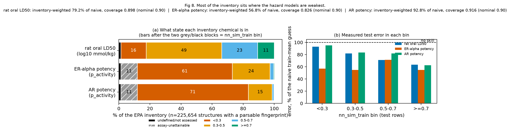

**Figure S13.** Hazard-model domain coverage of the EPA inventory: the fraction of inventory structures that are predictable, undefined or assay-unattainable, their distribution across familiarity bins, and the inventory-weighted error and interval coverage beside the test-split values. Conclude: the test split flatters what a designer gets, most severely for androgen-receptor potency. *Source: `W-TOX/r3/inventory_hazard_domain.json  [not redistributed; VM-internal]`.*

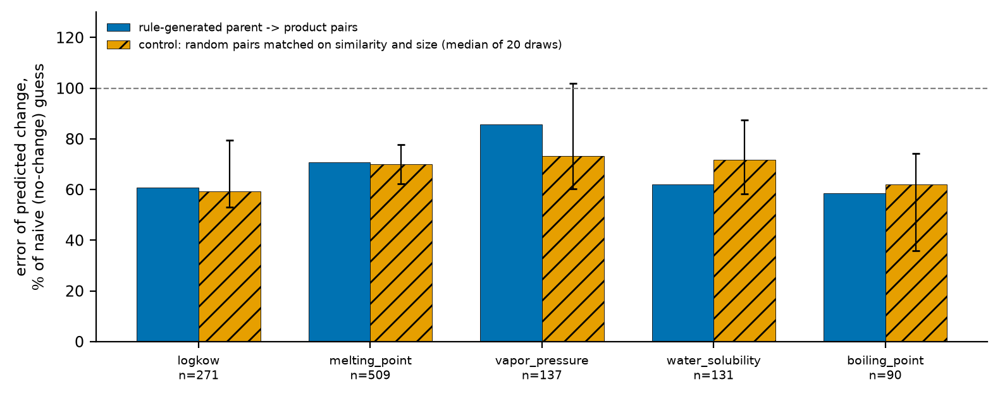

**Figure S14.** Transformation products, controlled: error of the predicted parent -> product change for rule-generated pairs, and for random pairs matched on similarity and size (median and range of 20 draws), as % of the naive no-change guess. *Source: `W-TP/tp_pairs_control_v4r.json  [not redistributed; VM-internal]`.*

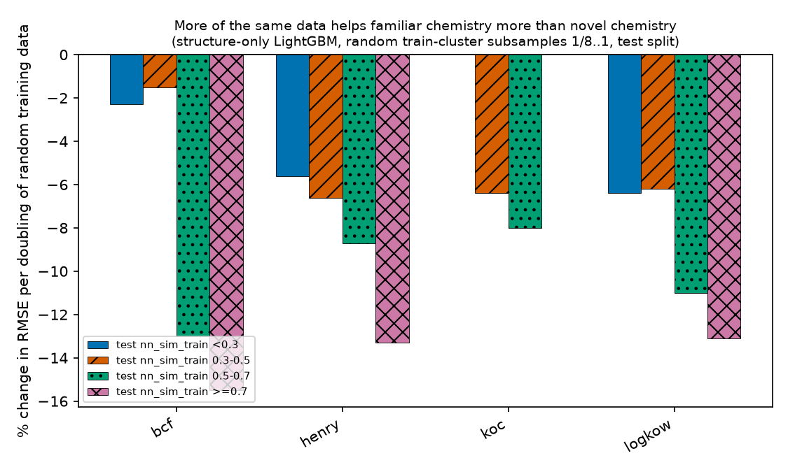

**Figure S15.** Value of data (READER-2): change in RMSE per doubling of randomly added training data, by nn_sim_train bin. More of the same data helps familiar compounds far more than novel ones. *Source: `READER-2/fig_vod_learning.png` (drawn by READER-2 from READER-2/vod_summary_A.csv).*

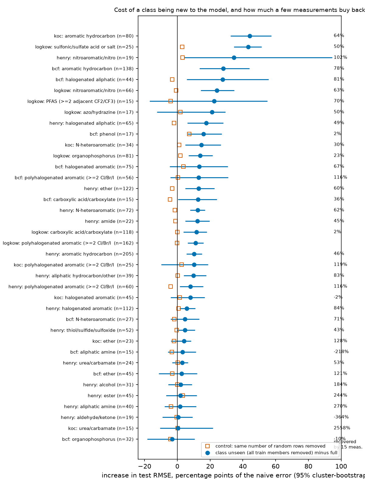

**Figure S16.** Value of data (READER-2): cost of a compound class being unseen (leave-class-out vs full training, same test compounds, with a random-removal control) and the share recovered by adding 5, 15 or 40 measurements of that class. *Source: `READER-2/fig_vod_classes.png` (drawn by READER-2 from READER-2/vod_summary_B.csv).*

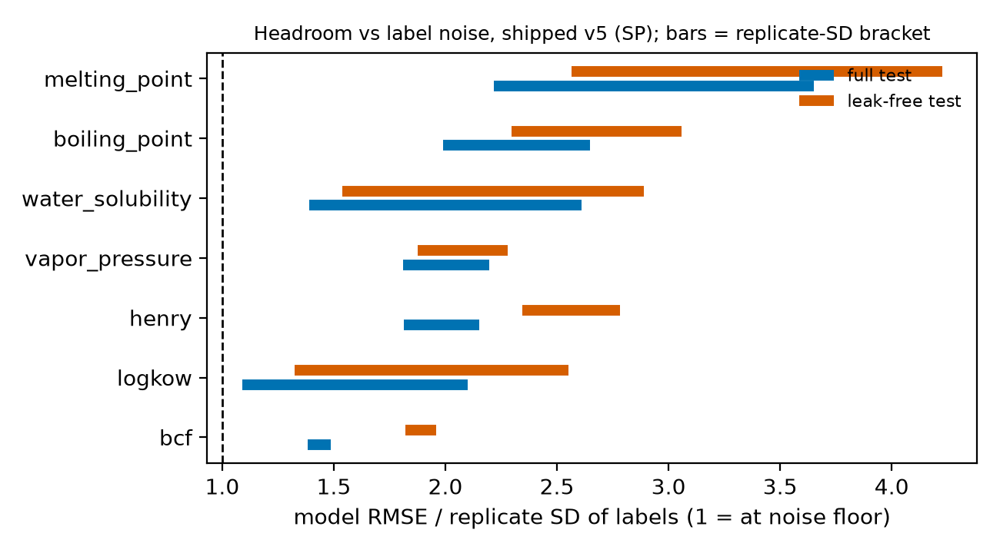

**Figure S17.** Headroom against label noise (READER-2): model RMSE divided by the replicate standard deviation of the labels, per endpoint, for the shipped v5 SP model. Conclude: every endpoint still sits above its label-noise floor, melting point by the largest margin; BCF is closest on the full test but not on leak-free compounds. An earlier version of this figure was drawn from the v4 structure-only model and gave higher ratios. *Source: `READER-2/fig_noise_panel_v5.png  [not redistributed; VM-internal]` (drawn by READER-2 from READER-2/noise_panel_v5.csv). An earlier draft of this caption cited the v4 file; the embedded figure was always the v5 one, so only the citation was wrong.*

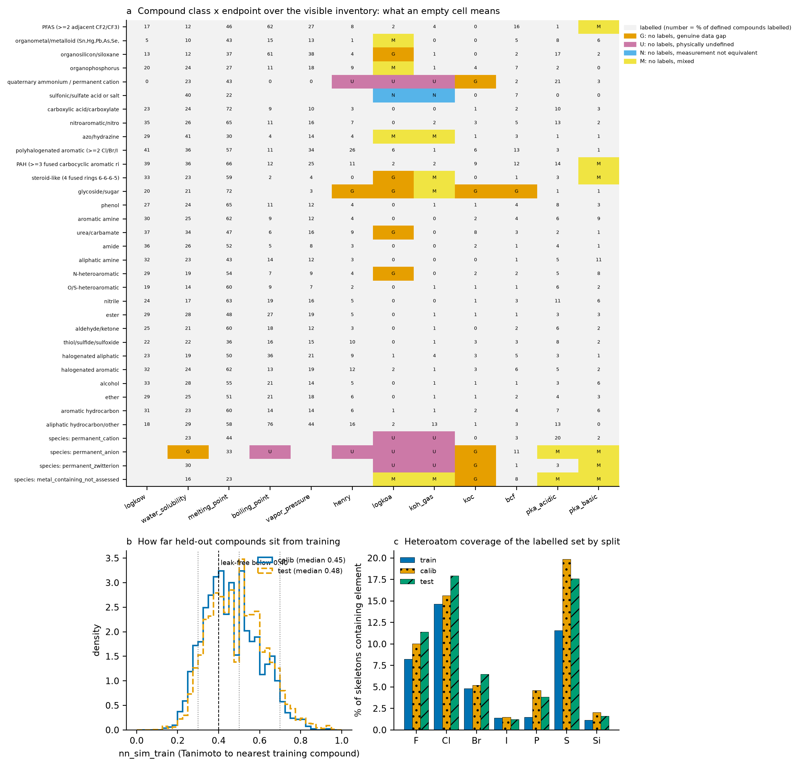

**Figure S18.** Chemical space of the labelled set: (a) class x endpoint cell status over the visible inventory (number = % of defined compounds labelled); (b) similarity of calibration and test compounds to the nearest training compound; (c) heteroatom coverage by split. *Source: `data/undefined_vs_gap_cells.csv  [shipped aggregate; working file not redistributed; VM-internal]` + results/v2/labels_v2.parquet.*

## Supplementary Note 1: limitations register

*Included verbatim from `READER-2/limitations_register.md` (written by its owning agent from its own result files).*

A primary deliverable of this work in its own right. Each entry gives **what failed**, **the exact input → output** (or the count), **the consequence**, and **the source**: an agent's file or note, or a literature reference cited as DOI + page in our own words. Literature text is never quoted.
Status: OPEN means it still applies to the shipped tool, FIXED means it was handled in this run, FIELD means it is a property of the field and not of our code.

### A. Label data (CompTox exp_props → labels_v2)

| # | Limitation | Exact evidence | Consequence | Status | Source |
|---|---|---|---|---|---|
| A1 | Repeat measurements are mostly copies passed between aggregators, not replicates | logKow: 7,116 of 10,342 compounds have n_measurements ≥ 2. Of those, 4,518 (63.5%) have spread = 0. Raw exp_props with copies collapsed gives 64.6% copies, leaving 2,577 compounds with distinct replicates. Water solubility raw rows: 58% copies | n_measurements overstates evidence and must not be used as a confidence weight | OPEN (documented) | READER-2/noise_panel.csv; READER-1/label_noise_floor.csv |
| A2 | No replicate noise floor exists for Koc, kOH, pKa basic, pKa acidic or logKOA | Compounds with ≥ 2 distinct values: Koc 0, kOH 0, pKa basic 0, pKa acidic 7, logKOA 1 | Nobody can say whether a model is near the measurement limit on these endpoints | FIELD | READER-2/noise_panel.csv |
| A3 | Labels exist for quantities that are physically undefined | Category-A rows (W-SPACE rule): logKow 151, VP 76, BP 33, Henry 2. Example: benzyltrimethylammonium logKow -1.61. 72–76% of these come from eChemPortal (REACH dossiers), where a calculated value is accepted when the test cannot be run (doi:10.1021/acs.chemrev.5b00215 p.33) | A model trained on them learns numbers for non-existent quantities | FIXED in W-MODEL v5 (category-A rows dropped before fitting) | READER-2/undefined_labelled_sources.csv; W-SPACE/species_v3.parquet |
| A4 | Carbon acidities are filed as pKa | pka_basic: acetophenone 18.34, propiophenone 17.56, isobutyraldehyde 15.67 (all OPERA2.8). 167 of 2,293 pKa rows have no ionisable site by SMARTS | pKa targets mix non-equivalent quantities | FIXED for pka_basic > 14 (dropped in v5); the remaining category-B rows are flagged | CRITIC/audit_impossible_labels.json; W-SPACE note 20:29 |
| A5 | Linear Pow stored as log | eChemPortal DTXSID0027511 has propValue 62031 with original text '62031 (log Pow)'. About 300 such rows | Silent corruption of up to about 5 log units | FIXED (range filter in labels_v2; READER-1 found label min/max exactly -3.0/10.0, i.e. filtered, not clipped: only 4 and 2 rows sit at the bounds) | READER-1/label_noise_floor.py (n_raw_rows_dropped_range_or_T: logkow 361) |
| A6 | Contradictory duplicates within one InChIKey | logKow 236 keys with median within-key range 0.73 log10. VP 169 keys with median range 2.58 log10 | Raises the noise floor | OPEN | W-MODEL limitation (run 2) |
| A7 | Koc pools non-equivalent quantities | Kd, Freundlich KF and Koc are all reported as "Koc". Matrix and pH are not standardised, and foc variation alone spans about a factor of 25 in Kd (doi:10.1039/C7EM00034K p.8; doi:10.3389/fenvs.2024.1379283 p.2) | Koc error cannot be split into model error and label error | FIELD | literature |
| A8 | "No label" in the swarm DB is partly an artefact | Property rows for held-out compounds were removed from the swarm copy | Coverage counts are lower bounds | OPEN (documented) | W-SPACE README |

### B. The EPI Suite comparator

| # | Limitation | Exact evidence | Consequence | Status | Source |
|---|---|---|---|---|---|
| B1 | EPI's apparent skill is concentrated on PhysProp-sourced rows | RMSE % of naive, PhysProp rows vs other rows. EPI: logKow 34 vs 93, BP 29 vs 104, VP 39 vs 107, WS 53 vs 103. Our L1 control on the same rows: 34 vs 56, 30 vs 70, 34 vs 59, 40 vs 56. Difference-in-differences -31 to -44 pp, with cluster CIs excluding 0 for logKow, BP, VP, WS and BCF. In the leak-free, not-doubtful, non-PhysProp cell, EPI is at 106–109% of naive for MP, BP and VP | EPI's whole-test numbers flatter it. Report EPI on non-PhysProp rows as the cleaner comparator | OPEN (reported) | READER-2/epi_overlap_strat.py; READER-1/epi_joint_comparison.md |
| B2 | No out-of-sample EPI test is possible for Koc, kOH or pKa | 100% of test rows carry the OPERA2.8 (PhysProp) tag | EPI's strong kOH score (AOPWIN) cannot be told apart from in-sample fit | FIELD/OPEN | READER-2/physprop_flag_test.parquet |
| B3 | The API is estimate-only | experimentalValues is empty in all 4,999 cached responses. Queried by SMILES with cas=None | No lookup leakage, but EPI's coefficients are still fitted on overlapping data | documented | CRITIC note 20:35 |
| B4 | EPI Suite emits no per-prediction domain flag; its documented applicability-domain rules (training-range bounding box, MW range, fragment counts, unseen fragments) must be applied by hand (doi:10.1021/acs.est.3c05643 p.6) | A user cannot tell an extrapolation from an interpolation without doing that work (doi:10.1016/j.namjnl.2025.100054 p.12) | Our flag is automated and per prediction, not the first applicability domain in the field | FIELD | literature |
| B5 | Published "external" benchmarks overlap training sets | 13–38% of a cosmetics test set were already in the tools' training sets (doi:10.1016/j.namjnl.2025.100054 p.8–9). BCF RMSE of one tool varies by about 1 log unit across benchmarks for the same reason (doi:10.1080/1062936X.2019.1626278 p.3). OPERA used random 75/25 splits (doi:10.1186/s13321-018-0263-1 p.5) | Literature accuracy figures are interpolation numbers. Our leak-free numbers are not comparable with them | FIELD | literature |

### C. Software and compute

| # | Limitation | Exact input → output | Consequence | Status | Source |
|---|---|---|---|---|---|
| C1 | nvalchemi AIMNet2Wrapper silently drops the Coulomb term without Ewald | HCN at the physics_v1 geometry gives E = -2543.354 eV with max\|F\| = 1.83 eV/Å. The native calculator gives -2544.0806 eV with max\|F\| = 7e-4 eV/Å | Physics that looks plausible but is wrong, with no warning | FIXED (native calculator) | OPS-2 note 20:32 |
| C2 | Closed-shell AIMNet2 is out of domain for radicals; the open-shell checkpoint fixes that and was obtained | With `aimnet2_wb97m_d3_0` (closed shell) E(H atom) = -10.781 eV against the exact -13.606 eV, so X–H BDEs come out about 100 kcal/mol too high and IPs 1–2 eV too high. With `aimnet2-nse_0` (the two-channel spin-polarised AIMNet2-NSE, run at mult 2) the same job gives -13.862 eV, 0.26 eV from exact | **The shipped model carries no BDE, IP, EA or Fukui feature** — `frozen_v5/columns.json  [not redistributed; VM-internal]` is 2,265 structure plus 31 closed-shell physics columns and contains none. **The descriptors themselves do exist**: AIMNet2-NSE was run over 37,726 jobs and `mech_descriptors_v1.parquet  [not redistributed; VM-internal]` (sha256 `f50f57bf…067ae2b2`, 3,728 rows × 28 columns, 3,706 `qc_pass`) ships BDE, vertical IP and EA, gas-phase deprotonation energy, proton affinity and condensed Fukui f-/f+. Its vertical IPs agree with 170 PubChem experimental values at MAE 0.30 eV, r = 0.95. Its **BDE columns ship flagged `unvalidated`**: the pre-registered gate gives exact rank order (Spearman 1.0) but offsets of -2.0 to +3.1 kcal/mol against BDE(298 K) where +0 to +12 kcal/mol was required, so they are a relative scale and not absolute bond strengths | FIXED for the obtainability claim; the descriptors are shipped as a standalone dataset, deliberately not as model features | W-PHYSICS note 20:39; OPS-2 T-036 |
| C3 | GPU driver vs pinned torch | hyperstack driver 570.195 (CUDA 12.8) with torch 2.14.1 cu130 gives "NVIDIA driver … too old" | Some GPU hosts are unusable | workaround | OPS-1 note 20:37 |
| C4 | The apt wrapper logs success on failure | apt.log says "install OK pkgs=weasyprint", but /usr/bin/weasyprint is absent because of a dpkg lock held by a hung chromium install | Check the binary, not the log | OPEN | SCRIBE note 20:26 |
| C5 | Expert note unreadable for the first 8 minutes | BB_EXPERT_NOTE_Q003.md was mode 640, group team. The swarm uid is in no shared group | Undefined-vs-gap rules were derived from first principles before the note could be read. They agree with it (sulfonate/quaternary reasoning) | FIXED 20:21 | PRINCIPAL notes |
| C6 | The model does not know when pKa is not applicable | Input C[N+](C)(C)CCCCCCCCCCCCCC.[Br-] gave pka_acidic 12.63 under frozen_v2 | Confident numbers for undefined quantities | FIXED in the tool via the domain_rules category gate | W-TOOL note 20:06 |

### D. Our own model and methods (what still fails)

| # | Limitation | Evidence | Source |
|---|---|---|---|
| D1 | Predictions are thermodynamically inconsistent across endpoints | Measured labels obey log H = log(VP/760) − log(WS·1000) to a median 0.13 log10. Our predictions miss it by a median 0.64 log10, and 35% are off by more than 1 log unit | READER-1/thermo_consistency_preds_summary.csv |
| D2 | Leak-free test n is too small to resolve some endpoints | logKOA 3, Koc 27, kOH 30, pKa acidic 38, BCF 52 | W-MODEL v5_main/results.json |
| D3 | Conformal coverage is not guaranteed off-distribution | Validity needs exchangeability, which a cluster split breaks by design (doi:10.1021/ci5001168 p.5). Per-bin coverage must be shown with its n | READER-1 audit |
| D4 | More of the same data helps familiar chemistry far more than novel chemistry | See data_priorities.md, experiment A | READER-2/vod_summary_A.csv |

### E. Field-level limits (literature), relevant to "novel chemistry"

1. **Coverage statistics exclude the hardest chemicals.** A large inventory study dropped about 24k of 112k records (permanently charged, UVCB, unparseable) before measuring QSPR domain coverage (doi:10.1021/acs.est.3c05643 p.4). Another excluded UVCBs and multi-constituent substances, about 30% of REACH registrations (doi:10.1016/j.comtox.2025.100398 p.2).
2. **Roughly one third of registered substances have no single structure.** Of about 235k CAS-identified entries across 22 inventories, over 75k are mixtures, polymers or UVCBs. A further 50k+ are confidential and up to 70k are ambiguously described (doi:10.1021/acs.est.9b06379 p.1, p.4–5). A SMILES-in tool, ours included, cannot address them.
3. **Being inside the domain is not accuracy.** Leverage-based and deny-list domains disagree on the same model, and Kow-only Koc domains accept about 20k chemicals that Abraham-descriptor domains reject (doi:10.1021/acs.est.3c05643 p.6, p.10). Restricting to the domain sometimes lowered balanced accuracy, for example for two BCF models (doi:10.1016/j.namjnl.2025.100054 p.9, p.12).
4. **QSPRs ignore fast-degrading functional groups.** Hydrolysable groups and peroxides are not represented, so expert review remains necessary (doi:10.1021/es903383a p.1). Measured logKow for hydrolysable silanes in our test set (e.g. CC[Si](ON=C(C)C)(ON=C(C)C)ON=C(C)C, labelled 0.20 while EPI estimates 8.85) probably describes the hydrolysis products.
5. **Ready biodegradability models do not travel.** On REACH substances mostly outside their training sets, balanced accuracy is 0.60–0.77, and consensus did not help (doi:10.1016/j.comtox.2025.100398 p.1).
6. **Coverage is weakest for KOA, atmospheric reactivity, F/P-containing chemicals and ionizables** (doi:10.1021/acs.est.3c05643 p.1). Our labelled fractions agree: logKOA ≤ 0.05 in every class, and 0.000 for organophosphorus, siloxanes and organometals (READER-2/lit_vs_data_coverage.csv).

## Supplementary Table S1: empty class x endpoint cells and why

| class | endpoint | inventory n | undefined (A) | non-equivalent (B) | genuine gap (C) | status | reasoning |
|---|---|---|---|---|---|---|---|
| PFAS (>=2 adjacent CF2/CF3) | pka_basic | 417 | 0 | 319 | 98 | mixed | pka_basic needs an ionisable basic site. Of 417: A=0, B=319 (no_site_in_aqueous_window(heuristic)=319), C=98; labelled=0. |
| organometal/metalloid (Sn,Hg,Pb,As,Se,B,Ge) | logkoa | 398 | 10 | 11 | 224 | mixed | logkoa is defined through a gas phase of the species. Of 398: A=10 (permanent_charge:permanent_anion=8; permanent_charge:permanent_cation=1; permanent_charge:permanent_zwitterion=1), B=11 (inner_salt=7; unpopulated_neutral:strong_acid_or_base=4), C=224, not assessed (metal)=153; labelled=0. |
| organosilicon/siloxane | logkoa | 441 | 3 | 0 | 437 | C_genuine_gap | logkoa is defined through a gas phase of the species. Of 441: A=3 (permanent_charge:permanent_cation=3), B=0, C=437, not assessed (metal)=1; labelled=0. |
| organophosphorus | logkoa | 1312 | 48 | 131 | 1130 | mixed | logkoa is defined through a gas phase of the species. Of 1312: A=48 (permanent_charge:permanent_cation=34; permanent_charge:permanent_zwitterion=14), B=131 (unpopulated_neutral:strong_acid_or_base=123; inner_salt+unpopulated_neutral:strong_acid_or_base=5; inner_salt=3), C=1130, not assessed (metal)=3; labelled=0. |
| quaternary ammonium / permanent cation | henry | 256 | 253 | 0 | 3 | A_undefined | henry is defined through a gas phase of the species. Of 256: A=253 (permanent_charge:permanent_cation=221; permanent_charge:permanent_zwitterion=32), B=0, C=3; labelled=0. Undefined for (nearly) all members by the endpoint definition: not missing data. |
| quaternary ammonium / permanent cation | logkoa | 256 | 253 | 0 | 3 | A_undefined | logkoa is defined through a gas phase of the species. Of 256: A=253 (permanent_charge:permanent_cation=221; permanent_charge:permanent_zwitterion=32), B=0, C=3; labelled=0. Undefined for (nearly) all members by the endpoint definition: not missing data. |
| quaternary ammonium / permanent cation | koh_gas | 256 | 253 | 0 | 3 | A_undefined | koh_gas is defined through a gas phase of the species. Of 256: A=253 (permanent_charge:permanent_cation=221; permanent_charge:permanent_zwitterion=32), B=0, C=3; labelled=0. Undefined for (nearly) all members by the endpoint definition: not missing data. |
| quaternary ammonium / permanent cation | koc | 256 | 0 | 0 | 256 | C_genuine_gap | koc is defined for any species. Of 256: A=0, B=0, C=256; labelled=0. No member is undefined or protocol-limited, so every unlabelled member is a genuine gap. |
| sulfonic/sulfate acid or salt | logkoa | 632 | 25 | 605 | 0 | B_nonequivalent | logkoa is defined through a gas phase of the species. Of 632: A=25 (permanent_charge:permanent_zwitterion=25), B=605 (unpopulated_neutral:strong_acid_or_base=556; inner_salt+unpopulated_neutral:strong_acid_or_base=49), C=0, not assessed (metal)=2; labelled=0. |
| sulfonic/sulfate acid or salt | koh_gas | 632 | 25 | 605 | 0 | B_nonequivalent | koh_gas is defined through a gas phase of the species. Of 632: A=25 (permanent_charge:permanent_zwitterion=25), B=605 (unpopulated_neutral:strong_acid_or_base=410; unpopulated_neutral:strong_acid_or_base+low_volatility=195), C=0, not assessed (metal)=2; labelled=0. |
| azo/hydrazine | logkoa | 495 | 11 | 182 | 301 | mixed | logkoa is defined through a gas phase of the species. Of 495: A=11 (permanent_charge:permanent_cation=11), B=182 (unpopulated_neutral:strong_acid_or_base=174; inner_salt+unpopulated_neutral:strong_acid_or_base=6; inner_salt=2), C=301, not assessed (metal)=1; labelled=0. |
| azo/hydrazine | koh_gas | 495 | 11 | 227 | 256 | mixed | koh_gas is defined through a gas phase of the species. Of 495: A=11 (permanent_charge:permanent_cation=11), B=227 (unpopulated_neutral:strong_acid_or_base+low_volatility=115; unpopulated_neutral:strong_acid_or_base=65; low_volatility=47), C=256, not assessed (metal)=1; labelled=0. |
| PAH (>=3 fused carbocyclic aromatic rings) | pka_basic | 198 | 0 | 145 | 53 | mixed | pka_basic needs an ionisable basic site. Of 198: A=0, B=145 (no_site_in_aqueous_window(heuristic)=145), C=53; labelled=0. |
| steroid-like (4 fused rings 6-6-6-5) | logkoa | 728 | 6 | 16 | 706 | C_genuine_gap | logkoa is defined through a gas phase of the species. Of 728: A=6 (permanent_charge:permanent_cation=6), B=16 (unpopulated_neutral:strong_acid_or_base=15; inner_salt=1), C=706; labelled=0. |
| steroid-like (4 fused rings 6-6-6-5) | koh_gas | 728 | 6 | 151 | 571 | mixed | koh_gas is defined through a gas phase of the species. Of 728: A=6 (permanent_charge:permanent_cation=6), B=151 (low_volatility=136; unpopulated_neutral:strong_acid_or_base=11; unpopulated_neutral:strong_acid_or_base+low_volatility=4), C=571; labelled=0. |
| steroid-like (4 fused rings 6-6-6-5) | pka_basic | 728 | 0 | 573 | 155 | mixed | pka_basic needs an ionisable basic site. Of 728: A=0, B=573 (no_site_in_aqueous_window(heuristic)=573), C=155; labelled=0. |
| glycoside/sugar | henry | 375 | 3 | 7 | 365 | C_genuine_gap | henry is defined through a gas phase of the species. Of 375: A=3 (permanent_charge:permanent_cation=3), B=7 (inner_salt=4; unpopulated_neutral:strong_acid_or_base=2; inner_salt+unpopulated_neutral:strong_acid_or_base=1), C=365; labelled=0. |
| glycoside/sugar | logkoa | 375 | 3 | 7 | 365 | C_genuine_gap | logkoa is defined through a gas phase of the species. Of 375: A=3 (permanent_charge:permanent_cation=3), B=7 (inner_salt=4; unpopulated_neutral:strong_acid_or_base=2; inner_salt+unpopulated_neutral:strong_acid_or_base=1), C=365; labelled=0. |
| glycoside/sugar | koh_gas | 375 | 3 | 210 | 162 | mixed | koh_gas is defined through a gas phase of the species. Of 375: A=3 (permanent_charge:permanent_cation=3), B=210 (low_volatility=207; unpopulated_neutral:strong_acid_or_base=2; unpopulated_neutral:strong_acid_or_base+low_volatility=1), C=162; labelled=0. |
| glycoside/sugar | koc | 375 | 0 | 0 | 375 | C_genuine_gap | koc is defined for any species. Of 375: A=0, B=0, C=375; labelled=0. No member is undefined or protocol-limited, so every unlabelled member is a genuine gap. |
| glycoside/sugar | bcf | 375 | 0 | 0 | 375 | C_genuine_gap | bcf is defined for any species. Of 375: A=0, B=0, C=375; labelled=0. No member is undefined or protocol-limited, so every unlabelled member is a genuine gap. |
| urea/carbamate | logkoa | 1320 | 10 | 33 | 1276 | C_genuine_gap | logkoa is defined through a gas phase of the species. Of 1320: A=10 (permanent_charge:permanent_cation=9; permanent_charge:permanent_zwitterion=1), B=33 (unpopulated_neutral:strong_acid_or_base=23; inner_salt=10), C=1276, not assessed (metal)=1; labelled=0. |
| N-heteroaromatic | logkoa | 6730 | 140 | 263 | 6326 | C_genuine_gap | logkoa is defined through a gas phase of the species. Of 6730: A=140 (permanent_charge:permanent_cation=115; permanent_charge:permanent_zwitterion=25), B=263 (unpopulated_neutral:strong_acid_or_base=167; inner_salt=83; inner_salt+unpopulated_neutral:strong_acid_or_base=13), C=6326, not assessed (metal)=1; labelled=0. |
| species: permanent_cation | logkoa | 409 | 409 | 0 | 0 | A_undefined | logkoa is defined through a gas phase of the species. Of 409: A=409 (permanent_charge:permanent_cation=409), B=0, C=0; labelled=0. Undefined for (nearly) all members by the endpoint definition: not missing data. |
| species: permanent_cation | koh_gas | 409 | 409 | 0 | 0 | A_undefined | koh_gas is defined through a gas phase of the species. Of 409: A=409 (permanent_charge:permanent_cation=409), B=0, C=0; labelled=0. Undefined for (nearly) all members by the endpoint definition: not missing data. |
| species: permanent_anion | water_solubility | 9 | 0 | 0 | 9 | C_genuine_gap | water_solubility is defined for any species. Of 9: A=0, B=0, C=9; labelled=0. No member is undefined or protocol-limited, so every unlabelled member is a genuine gap. |
| species: permanent_anion | boiling_point | 9 | 9 | 0 | 0 | A_undefined | boiling_point is defined through a gas phase of the species. Of 9: A=9 (permanent_charge:permanent_anion=9), B=0, C=0; labelled=0. Undefined for (nearly) all members by the endpoint definition: not missing data. |
| species: permanent_anion | henry | 9 | 9 | 0 | 0 | A_undefined | henry is defined through a gas phase of the species. Of 9: A=9 (permanent_charge:permanent_anion=9), B=0, C=0; labelled=0. Undefined for (nearly) all members by the endpoint definition: not missing data. |
| species: permanent_anion | logkoa | 9 | 9 | 0 | 0 | A_undefined | logkoa is defined through a gas phase of the species. Of 9: A=9 (permanent_charge:permanent_anion=9), B=0, C=0; labelled=0. Undefined for (nearly) all members by the endpoint definition: not missing data. |
| species: permanent_anion | koh_gas | 9 | 9 | 0 | 0 | A_undefined | koh_gas is defined through a gas phase of the species. Of 9: A=9 (permanent_charge:permanent_anion=9), B=0, C=0; labelled=0. Undefined for (nearly) all members by the endpoint definition: not missing data. |
| species: permanent_anion | koc | 9 | 0 | 0 | 9 | C_genuine_gap | koc is defined for any species. Of 9: A=0, B=0, C=9; labelled=0. No member is undefined or protocol-limited, so every unlabelled member is a genuine gap. |
| species: permanent_anion | pka_acidic | 9 | 4 | 3 | 2 | mixed | pka_acidic needs an ionisable acidic site. Of 9: A=4 (no_hydrogen=4), B=3 (no_site_in_aqueous_window(heuristic)=3), C=2; labelled=0. |
| species: permanent_anion | pka_basic | 9 | 0 | 8 | 1 | mixed | pka_basic needs an ionisable basic site. Of 9: A=0, B=8 (no_site_in_aqueous_window(heuristic)=8), C=1; labelled=0. |
| species: permanent_zwitterion | logkoa | 75 | 75 | 0 | 0 | A_undefined | logkoa is defined through a gas phase of the species. Of 75: A=75 (permanent_charge:permanent_zwitterion=75), B=0, C=0; labelled=0. Undefined for (nearly) all members by the endpoint definition: not missing data. |
| species: permanent_zwitterion | koh_gas | 75 | 75 | 0 | 0 | A_undefined | koh_gas is defined through a gas phase of the species. Of 75: A=75 (permanent_charge:permanent_zwitterion=75), B=0, C=0; labelled=0. Undefined for (nearly) all members by the endpoint definition: not missing data. |
| species: permanent_zwitterion | koc | 75 | 0 | 0 | 75 | C_genuine_gap | koc is defined for any species. Of 75: A=0, B=0, C=75; labelled=0. No member is undefined or protocol-limited, so every unlabelled member is a genuine gap. |
| species: permanent_zwitterion | pka_basic | 75 | 0 | 14 | 61 | mixed | pka_basic needs an ionisable basic site. Of 75: A=0, B=14 (no_site_in_aqueous_window(heuristic)=14), C=61; labelled=0. |
| species: metal_containing_not_assessed | logkoa | 161 | 0 | 0 | 0 | mixed | logkoa is defined through a gas phase of the species. Of 161: A=0, B=0, C=0, not assessed (metal)=161; labelled=0. No member is undefined or protocol-limited, so every unlabelled member is a genuine gap. |
| species: metal_containing_not_assessed | koh_gas | 161 | 0 | 0 | 0 | mixed | koh_gas is defined through a gas phase of the species. Of 161: A=0, B=0, C=0, not assessed (metal)=161; labelled=0. No member is undefined or protocol-limited, so every unlabelled member is a genuine gap. |
| species: metal_containing_not_assessed | koc | 161 | 0 | 0 | 161 | C_genuine_gap | koc is defined for any species. Of 161: A=0, B=0, C=161; labelled=0. No member is undefined or protocol-limited, so every unlabelled member is a genuine gap. |
| species: metal_containing_not_assessed | pka_acidic | 161 | 0 | 0 | 0 | mixed | pka_acidic needs an ionisable acidic site. Of 161: A=0, B=0, C=0, not assessed (metal)=161; labelled=0. No member is undefined or protocol-limited, so every unlabelled member is a genuine gap. |
| species: metal_containing_not_assessed | pka_basic | 161 | 0 | 0 | 0 | mixed | pka_basic needs an ionisable basic site. Of 161: A=0, B=0, C=0, not assessed (metal)=161; labelled=0. No member is undefined or protocol-limited, so every unlabelled member is a genuine gap. |

## Supplementary Table S2: the corrected definedness table (Q-003)

Every class x endpoint cell of `CRITIC/undefined_vs_gap_cells_q003.csv`, after the expert cross-check. `moved` marks the cells the correction changed. Counts are over the denominator that file uses for the class; the sulfonate/sulfate-salt rows use a labelled-set denominator and are not comparable with Table S1's inventory counts. Rows of class `pfas` inherit the over-broad PFAS pattern described in Section 4.5 and overcount by roughly a factor of three (`PRINCIPAL/pfas_class_scope_S5.md  [not redistributed; VM-internal]`); the verdicts stand, the counts are an upper bound.

| class | endpoint | verdict | moved | inventory n | labelled n | reasoning |
|---|---|---|---|---|---|---|
| hydrolytically_labile | henry | defined |  | 3940 | 27 | unchanged: consistent with or not addressed by Q-003 |
| inorganic | henry | not_assessed |  | 6186 | 0 | kept (CRITIC/PRINCIPAL): the note's non-volatile clause cannot be applied from a structure drawing; ionic vs covalent organometallics differ; labelled measurements exist (e.g. organometal VP/BP) |
| neutral_organic | henry | defined |  | 202058 | 1528 | unchanged: consistent with or not addressed by Q-003 |
| organometal | henry | not_assessed |  | 4978 | 25 | kept (CRITIC/PRINCIPAL): the note's non-volatile clause cannot be applied from a structure drawing; ionic vs covalent organometallics differ; labelled measurements exist (e.g. organometal VP/BP) |
| permanent_anion | henry | undefined |  | 283 | 0 | unchanged: consistent with or not addressed by Q-003 |
| permanent_cation | henry | undefined |  | 8099 | 1 | unchanged: consistent with or not addressed by Q-003 |
| permanent_zwitterion | henry | undefined |  | 2002 | 1 | unchanged: consistent with or not addressed by Q-003 |
| pfas | henry | defined |  | 23429 | 117 | unchanged: consistent with or not addressed by Q-003 |
| small_volatile | henry | defined |  | 14265 | 721 | unchanged: consistent with or not addressed by Q-003 |
| surfactant_like | henry | defined |  | 3914 | 7 | unchanged: consistent with or not addressed by Q-003 |
| unparsed | henry | not_assessed |  | 437 | 0 | kept (CRITIC/PRINCIPAL): the note's non-volatile clause cannot be applied from a structure drawing; ionic vs covalent organometallics differ; labelled measurements exist (e.g. organometal VP/BP) |
| very_hydrophobic | henry | defined |  | 11268 | 159 | unchanged: consistent with or not addressed by Q-003 |
| hydrolytically_labile | vapor_pressure | defined |  | 3940 | 212 | unchanged: consistent with or not addressed by Q-003 |
| inorganic | vapor_pressure | not_assessed |  | 6186 | 0 | kept (CRITIC/PRINCIPAL): the note's non-volatile clause cannot be applied from a structure drawing; ionic vs covalent organometallics differ; labelled measurements exist (e.g. organometal VP/BP) |
| neutral_organic | vapor_pressure | defined |  | 202058 | 4291 | unchanged: consistent with or not addressed by Q-003 |
| organometal | vapor_pressure | not_assessed |  | 4978 | 216 | kept (CRITIC/PRINCIPAL): the note's non-volatile clause cannot be applied from a structure drawing; ionic vs covalent organometallics differ; labelled measurements exist (e.g. organometal VP/BP) |
| permanent_anion | vapor_pressure | undefined |  | 283 | 4 | unchanged: consistent with or not addressed by Q-003 |
| permanent_cation | vapor_pressure | undefined |  | 8099 | 61 | unchanged: consistent with or not addressed by Q-003 |
| permanent_zwitterion | vapor_pressure | undefined |  | 2002 | 11 | unchanged: consistent with or not addressed by Q-003 |
| pfas | vapor_pressure | defined |  | 23429 | 309 | unchanged: consistent with or not addressed by Q-003 |
| small_volatile | vapor_pressure | defined |  | 14265 | 1335 | unchanged: consistent with or not addressed by Q-003 |
| surfactant_like | vapor_pressure | defined |  | 3914 | 52 | unchanged: consistent with or not addressed by Q-003 |
| unparsed | vapor_pressure | not_assessed |  | 437 | 0 | kept (CRITIC/PRINCIPAL): the note's non-volatile clause cannot be applied from a structure drawing; ionic vs covalent organometallics differ; labelled measurements exist (e.g. organometal VP/BP) |
| very_hydrophobic | vapor_pressure | defined |  | 11268 | 344 | unchanged: consistent with or not addressed by Q-003 |
| hydrolytically_labile | boiling_point | defined |  | 3940 | 273 | unchanged: consistent with or not addressed by Q-003 |
| inorganic | boiling_point | not_assessed |  | 6186 | 0 | kept (CRITIC/PRINCIPAL): the note's non-volatile clause cannot be applied from a structure drawing; ionic vs covalent organometallics differ; labelled measurements exist (e.g. organometal VP/BP) |
| neutral_organic | boiling_point | defined |  | 202058 | 4637 | unchanged: consistent with or not addressed by Q-003 |
| organometal | boiling_point | not_assessed |  | 4978 | 298 | kept (CRITIC/PRINCIPAL): the note's non-volatile clause cannot be applied from a structure drawing; ionic vs covalent organometallics differ; labelled measurements exist (e.g. organometal VP/BP) |
| permanent_anion | boiling_point | undefined |  | 283 | 0 | unchanged: consistent with or not addressed by Q-003 |
| permanent_cation | boiling_point | undefined |  | 8099 | 29 | unchanged: consistent with or not addressed by Q-003 |
| permanent_zwitterion | boiling_point | undefined |  | 2002 | 4 | unchanged: consistent with or not addressed by Q-003 |
| pfas | boiling_point | defined |  | 23429 | 499 | unchanged: consistent with or not addressed by Q-003 |
| small_volatile | boiling_point | defined |  | 14265 | 2232 | unchanged: consistent with or not addressed by Q-003 |
| surfactant_like | boiling_point | defined |  | 3914 | 53 | unchanged: consistent with or not addressed by Q-003 |
| unparsed | boiling_point | not_assessed |  | 437 | 0 | kept (CRITIC/PRINCIPAL): the note's non-volatile clause cannot be applied from a structure drawing; ionic vs covalent organometallics differ; labelled measurements exist (e.g. organometal VP/BP) |
| very_hydrophobic | boiling_point | defined |  | 11268 | 132 | unchanged: consistent with or not addressed by Q-003 |
| hydrolytically_labile | koh_gas | defined |  | 3940 | 11 | unchanged: consistent with or not addressed by Q-003 |
| inorganic | koh_gas | not_assessed |  | 6186 | 0 | kept (CRITIC/PRINCIPAL): the note's non-volatile clause cannot be applied from a structure drawing; ionic vs covalent organometallics differ; labelled measurements exist (e.g. organometal VP/BP) |
| neutral_organic | koh_gas | defined |  | 202058 | 149 | unchanged: consistent with or not addressed by Q-003 |
| organometal | koh_gas | not_assessed |  | 4978 | 6 | kept (CRITIC/PRINCIPAL): the note's non-volatile clause cannot be applied from a structure drawing; ionic vs covalent organometallics differ; labelled measurements exist (e.g. organometal VP/BP) |
| permanent_anion | koh_gas | undefined |  | 283 | 0 | unchanged: consistent with or not addressed by Q-003 |
| permanent_cation | koh_gas | undefined |  | 8099 | 0 | unchanged: consistent with or not addressed by Q-003 |
| permanent_zwitterion | koh_gas | undefined |  | 2002 | 0 | unchanged: consistent with or not addressed by Q-003 |
| pfas | koh_gas | defined |  | 23429 | 49 | unchanged: consistent with or not addressed by Q-003 |
| small_volatile | koh_gas | defined |  | 14265 | 395 | unchanged: consistent with or not addressed by Q-003 |
| surfactant_like | koh_gas | defined |  | 3914 | 0 | unchanged: consistent with or not addressed by Q-003 |
| unparsed | koh_gas | not_assessed |  | 437 | 0 | kept (CRITIC/PRINCIPAL): the note's non-volatile clause cannot be applied from a structure drawing; ionic vs covalent organometallics differ; labelled measurements exist (e.g. organometal VP/BP) |
| very_hydrophobic | koh_gas | defined |  | 11268 | 0 | unchanged: consistent with or not addressed by Q-003 |
| hydrolytically_labile | logkoa | defined |  | 3940 | 0 | unchanged: consistent with or not addressed by Q-003 |
| inorganic | logkoa | not_assessed |  | 6186 | 0 | kept (CRITIC/PRINCIPAL): the note's non-volatile clause cannot be applied from a structure drawing; ionic vs covalent organometallics differ; labelled measurements exist (e.g. organometal VP/BP) |
| neutral_organic | logkoa | defined |  | 202058 | 124 | unchanged: consistent with or not addressed by Q-003 |
| organometal | logkoa | not_assessed |  | 4978 | 0 | kept (CRITIC/PRINCIPAL): the note's non-volatile clause cannot be applied from a structure drawing; ionic vs covalent organometallics differ; labelled measurements exist (e.g. organometal VP/BP) |
| permanent_anion | logkoa | undefined |  | 283 | 0 | unchanged: consistent with or not addressed by Q-003 |
| permanent_cation | logkoa | undefined |  | 8099 | 0 | unchanged: consistent with or not addressed by Q-003 |
| permanent_zwitterion | logkoa | undefined |  | 2002 | 0 | unchanged: consistent with or not addressed by Q-003 |
| pfas | logkoa | defined |  | 23429 | 8 | unchanged: consistent with or not addressed by Q-003 |
| small_volatile | logkoa | defined |  | 14265 | 98 | unchanged: consistent with or not addressed by Q-003 |
| surfactant_like | logkoa | defined |  | 3914 | 0 | unchanged: consistent with or not addressed by Q-003 |
| unparsed | logkoa | not_assessed |  | 437 | 0 | kept (CRITIC/PRINCIPAL): the note's non-volatile clause cannot be applied from a structure drawing; ionic vs covalent organometallics differ; labelled measurements exist (e.g. organometal VP/BP) |
| very_hydrophobic | logkoa | defined |  | 11268 | 22 | unchanged: consistent with or not addressed by Q-003 |
| hydrolytically_labile | logkow | defined |  | 3940 | 96 | unchanged: consistent with or not addressed by Q-003 |
| inorganic | logkow | not_assessed |  | 6186 | 0 | kept (CRITIC/PRINCIPAL): the note's non-volatile clause cannot be applied from a structure drawing; ionic vs covalent organometallics differ; labelled measurements exist (e.g. organometal VP/BP) |
| neutral_organic | logkow | defined |  | 202058 | 8475 | unchanged: consistent with or not addressed by Q-003 |
| organometal | logkow | not_assessed |  | 4978 | 80 | kept (CRITIC/PRINCIPAL): the note's non-volatile clause cannot be applied from a structure drawing; ionic vs covalent organometallics differ; labelled measurements exist (e.g. organometal VP/BP) |
| permanent_anion | logkow | undefined |  | 283 | 2 | unchanged: consistent with or not addressed by Q-003 |
| permanent_cation | logkow | undefined |  | 8099 | 128 | unchanged: consistent with or not addressed by Q-003 |
| permanent_zwitterion | logkow | undefined |  | 2002 | 21 | unchanged: consistent with or not addressed by Q-003 |
| pfas | logkow | defined |  | 23429 | 350 | unchanged: consistent with or not addressed by Q-003 |
| small_volatile | logkow | defined |  | 14265 | 1190 | unchanged: consistent with or not addressed by Q-003 |
| surfactant_like | logkow | defined |  | 3914 | 59 | unchanged: consistent with or not addressed by Q-003 |
| unparsed | logkow | not_assessed |  | 437 | 0 | kept (CRITIC/PRINCIPAL): the note's non-volatile clause cannot be applied from a structure drawing; ionic vs covalent organometallics differ; labelled measurements exist (e.g. organometal VP/BP) |
| very_hydrophobic | logkow | defined |  | 11268 | 241 | unchanged: consistent with or not addressed by Q-003 |
| hydrolytically_labile | water_solubility | defined |  | 3940 | 96 | unchanged: consistent with or not addressed by Q-003 |
| inorganic | water_solubility | not_assessed |  | 6186 | 0 | unchanged: consistent with or not addressed by Q-003 |
| neutral_organic | water_solubility | defined |  | 202058 | 7174 | unchanged: consistent with or not addressed by Q-003 |
| organometal | water_solubility | not_assessed |  | 4978 | 100 | unchanged: consistent with or not addressed by Q-003 |
| permanent_anion | water_solubility | defined |  | 283 | 0 | unchanged: consistent with or not addressed by Q-003 |
| permanent_cation | water_solubility | defined |  | 8099 | 116 | unchanged: consistent with or not addressed by Q-003 |
| permanent_zwitterion | water_solubility | defined |  | 2002 | 21 | unchanged: consistent with or not addressed by Q-003 |
| pfas | water_solubility | defined |  | 23429 | 260 | unchanged: consistent with or not addressed by Q-003 |
| small_volatile | water_solubility | defined |  | 14265 | 1044 | unchanged: consistent with or not addressed by Q-003 |
| surfactant_like | water_solubility | defined |  | 3914 | 90 | unchanged: consistent with or not addressed by Q-003 |
| unparsed | water_solubility | not_assessed |  | 437 | 0 | unchanged: consistent with or not addressed by Q-003 |
| very_hydrophobic | water_solubility | defined |  | 11268 | 342 | unchanged: consistent with or not addressed by Q-003 |
| hydrolytically_labile | melting_point | defined |  | 3940 | 484 | unchanged: consistent with or not addressed by Q-003 |
| inorganic | melting_point | not_assessed |  | 6186 | 0 | unchanged: consistent with or not addressed by Q-003 |
| neutral_organic | melting_point | defined |  | 202058 | 16262 | unchanged: consistent with or not addressed by Q-003 |
| organometal | melting_point | not_assessed |  | 4978 | 241 | unchanged: consistent with or not addressed by Q-003 |
| permanent_anion | melting_point | defined |  | 283 | 3 | unchanged: consistent with or not addressed by Q-003 |
| permanent_cation | melting_point | defined |  | 8099 | 280 | unchanged: consistent with or not addressed by Q-003 |
| permanent_zwitterion | melting_point | defined |  | 2002 | 19 | unchanged: consistent with or not addressed by Q-003 |
| pfas | melting_point | defined |  | 23429 | 785 | unchanged: consistent with or not addressed by Q-003 |
| small_volatile | melting_point | defined |  | 14265 | 1938 | unchanged: consistent with or not addressed by Q-003 |
| surfactant_like | melting_point | defined |  | 3914 | 186 | unchanged: consistent with or not addressed by Q-003 |
| unparsed | melting_point | not_assessed |  | 437 | 0 | unchanged: consistent with or not addressed by Q-003 |
| very_hydrophobic | melting_point | defined |  | 11268 | 680 | unchanged: consistent with or not addressed by Q-003 |
| hydrolytically_labile | koc | defined |  | 3940 | 3 | unchanged: consistent with or not addressed by Q-003 |
| inorganic | koc | not_assessed |  | 6186 | 0 | unchanged: consistent with or not addressed by Q-003 |
| neutral_organic | koc | defined |  | 202058 | 517 | unchanged: consistent with or not addressed by Q-003 |
| organometal | koc | not_assessed |  | 4978 | 2 | unchanged: consistent with or not addressed by Q-003 |
| permanent_anion | koc | defined |  | 283 | 0 | unchanged: consistent with or not addressed by Q-003 |
| permanent_cation | koc | defined |  | 8099 | 1 | unchanged: consistent with or not addressed by Q-003 |
| permanent_zwitterion | koc | defined |  | 2002 | 0 | unchanged: consistent with or not addressed by Q-003 |
| pfas | koc | defined |  | 23429 | 31 | unchanged: consistent with or not addressed by Q-003 |
| small_volatile | koc | defined |  | 14265 | 68 | unchanged: consistent with or not addressed by Q-003 |
| surfactant_like | koc | defined |  | 3914 | 0 | unchanged: consistent with or not addressed by Q-003 |
| unparsed | koc | not_assessed |  | 437 | 0 | unchanged: consistent with or not addressed by Q-003 |
| very_hydrophobic | koc | defined |  | 11268 | 13 | unchanged: consistent with or not addressed by Q-003 |
| hydrolytically_labile | bcf | defined |  | 3940 | 5 | unchanged: consistent with or not addressed by Q-003 |
| inorganic | bcf | not_assessed |  | 6186 | 0 | unchanged: consistent with or not addressed by Q-003 |
| neutral_organic | bcf | defined |  | 202058 | 901 | unchanged: consistent with or not addressed by Q-003 |
| organometal | bcf | not_assessed |  | 4978 | 33 | unchanged: consistent with or not addressed by Q-003 |
| permanent_anion | bcf | defined |  | 283 | 2 | unchanged: consistent with or not addressed by Q-003 |
| permanent_cation | bcf | defined |  | 8099 | 12 | unchanged: consistent with or not addressed by Q-003 |
| permanent_zwitterion | bcf | defined |  | 2002 | 1 | unchanged: consistent with or not addressed by Q-003 |
| pfas | bcf | defined |  | 23429 | 107 | unchanged: consistent with or not addressed by Q-003 |
| small_volatile | bcf | defined |  | 14265 | 133 | unchanged: consistent with or not addressed by Q-003 |
| surfactant_like | bcf | defined |  | 3914 | 8 | unchanged: consistent with or not addressed by Q-003 |
| unparsed | bcf | not_assessed |  | 437 | 0 | unchanged: consistent with or not addressed by Q-003 |
| very_hydrophobic | bcf | defined |  | 11268 | 95 | unchanged: consistent with or not addressed by Q-003 |
| hydrolytically_labile | pka_acidic | defined_if_site |  | 3940 | 2 | unchanged: consistent with or not addressed by Q-003 |
| inorganic | pka_acidic | not_assessed |  | 6186 | 0 | unchanged: consistent with or not addressed by Q-003 |
| neutral_organic | pka_acidic | defined_if_site |  | 202058 | 865 | unchanged: consistent with or not addressed by Q-003 |
| organometal | pka_acidic | not_assessed |  | 4978 | 2 | unchanged: consistent with or not addressed by Q-003 |
| permanent_anion | pka_acidic | defined_if_site |  | 283 | 0 | unchanged: consistent with or not addressed by Q-003 |
| permanent_cation | pka_acidic | defined_if_site |  | 8099 | 10 | unchanged: consistent with or not addressed by Q-003 |
| permanent_zwitterion | pka_acidic | defined_if_site |  | 2002 | 0 | unchanged: consistent with or not addressed by Q-003 |
| pfas | pka_acidic | defined_if_site |  | 23429 | 16 | unchanged: consistent with or not addressed by Q-003 |
| small_volatile | pka_acidic | defined_if_site |  | 14265 | 123 | unchanged: consistent with or not addressed by Q-003 |
| surfactant_like | pka_acidic | defined_if_site |  | 3914 | 9 | unchanged: consistent with or not addressed by Q-003 |
| unparsed | pka_acidic | not_assessed |  | 437 | 0 | unchanged: consistent with or not addressed by Q-003 |
| very_hydrophobic | pka_acidic | defined_if_site |  | 11268 | 2 | unchanged: consistent with or not addressed by Q-003 |
| hydrolytically_labile | pka_basic | defined_if_site |  | 3940 | 4 | unchanged: consistent with or not addressed by Q-003 |
| inorganic | pka_basic | not_assessed |  | 6186 | 0 | unchanged: consistent with or not addressed by Q-003 |
| neutral_organic | pka_basic | defined_if_site |  | 202058 | 888 | unchanged: consistent with or not addressed by Q-003 |
| organometal | pka_basic | not_assessed |  | 4978 | 2 | unchanged: consistent with or not addressed by Q-003 |
| permanent_anion | pka_basic | defined_if_site |  | 283 | 0 | unchanged: consistent with or not addressed by Q-003 |
| permanent_cation | pka_basic | defined_if_site |  | 8099 | 2 | unchanged: consistent with or not addressed by Q-003 |
| permanent_zwitterion | pka_basic | defined_if_site |  | 2002 | 0 | unchanged: consistent with or not addressed by Q-003 |
| pfas | pka_basic | defined_if_site |  | 23429 | 3 | unchanged: consistent with or not addressed by Q-003 |
| small_volatile | pka_basic | defined_if_site |  | 14265 | 355 | unchanged: consistent with or not addressed by Q-003 |
| surfactant_like | pka_basic | defined_if_site |  | 3914 | 3 | unchanged: consistent with or not addressed by Q-003 |
| unparsed | pka_basic | not_assessed |  | 437 | 0 | unchanged: consistent with or not addressed by Q-003 |
| very_hydrophobic | pka_basic | defined_if_site |  | 11268 | 7 | unchanged: consistent with or not addressed by Q-003 |
| hydrolytically_labile | rat_oral_ld50 | defined |  | 3940 | 250 | unchanged: consistent with or not addressed by Q-003 |
| inorganic | rat_oral_ld50 | not_assessed |  | 6186 | 0 | unchanged: consistent with or not addressed by Q-003 |
| neutral_organic | rat_oral_ld50 | defined |  | 202058 | 8821 | unchanged: consistent with or not addressed by Q-003 |
| organometal | rat_oral_ld50 | not_assessed |  | 4978 | 237 | unchanged: consistent with or not addressed by Q-003 |
| permanent_anion | rat_oral_ld50 | defined |  | 283 | 5 | unchanged: consistent with or not addressed by Q-003 |
| permanent_cation | rat_oral_ld50 | defined |  | 8099 | 244 | unchanged: consistent with or not addressed by Q-003 |
| permanent_zwitterion | rat_oral_ld50 | defined |  | 2002 | 37 | unchanged: consistent with or not addressed by Q-003 |
| pfas | rat_oral_ld50 | defined |  | 23429 | 424 | unchanged: consistent with or not addressed by Q-003 |
| small_volatile | rat_oral_ld50 | defined |  | 14265 | 899 | unchanged: consistent with or not addressed by Q-003 |
| surfactant_like | rat_oral_ld50 | defined |  | 3914 | 56 | unchanged: consistent with or not addressed by Q-003 |
| unparsed | rat_oral_ld50 | not_assessed |  | 437 | 0 | unchanged: consistent with or not addressed by Q-003 |
| very_hydrophobic | rat_oral_ld50 | defined |  | 11268 | 242 | unchanged: consistent with or not addressed by Q-003 |
| hydrolytically_labile | er_potency | assay_unattainable |  | 3940 | 1 | unchanged: consistent with or not addressed by Q-003 |
| inorganic | er_potency | not_assessed |  | 6186 | 0 | unchanged: consistent with or not addressed by Q-003 |
| neutral_organic | er_potency | defined |  | 202058 | 5557 | unchanged: consistent with or not addressed by Q-003 |
| organometal | er_potency | not_assessed |  | 4978 | 9 | unchanged: consistent with or not addressed by Q-003 |
| permanent_anion | er_potency | defined |  | 283 | 0 | unchanged: consistent with or not addressed by Q-003 |
| permanent_cation | er_potency | defined |  | 8099 | 61 | unchanged: consistent with or not addressed by Q-003 |
| permanent_zwitterion | er_potency | defined |  | 2002 | 14 | unchanged: consistent with or not addressed by Q-003 |
| pfas | er_potency | defined |  | 23429 | 636 | unchanged: consistent with or not addressed by Q-003 |
| small_volatile | er_potency | assay_unattainable |  | 14265 | 6 | unchanged: consistent with or not addressed by Q-003 |
| surfactant_like | er_potency | defined |  | 3914 | 8 | unchanged: consistent with or not addressed by Q-003 |
| unparsed | er_potency | not_assessed |  | 437 | 0 | unchanged: consistent with or not addressed by Q-003 |
| very_hydrophobic | er_potency | assay_unattainable |  | 11268 | 432 | unchanged: consistent with or not addressed by Q-003 |
| hydrolytically_labile | ar_potency | assay_unattainable |  | 3940 | 2 | unchanged: consistent with or not addressed by Q-003 |
| inorganic | ar_potency | not_assessed |  | 6186 | 0 | unchanged: consistent with or not addressed by Q-003 |
| neutral_organic | ar_potency | defined |  | 202058 | 2594 | unchanged: consistent with or not addressed by Q-003 |
| organometal | ar_potency | not_assessed |  | 4978 | 16 | unchanged: consistent with or not addressed by Q-003 |
| permanent_anion | ar_potency | defined |  | 283 | 0 | unchanged: consistent with or not addressed by Q-003 |
| permanent_cation | ar_potency | defined |  | 8099 | 26 | unchanged: consistent with or not addressed by Q-003 |
| permanent_zwitterion | ar_potency | defined |  | 2002 | 8 | unchanged: consistent with or not addressed by Q-003 |
| pfas | ar_potency | defined |  | 23429 | 1612 | unchanged: consistent with or not addressed by Q-003 |
| small_volatile | ar_potency | assay_unattainable |  | 14265 | 6 | unchanged: consistent with or not addressed by Q-003 |
| surfactant_like | ar_potency | defined |  | 3914 | 7 | unchanged: consistent with or not addressed by Q-003 |
| unparsed | ar_potency | not_assessed |  | 437 | 0 | unchanged: consistent with or not addressed by Q-003 |
| very_hydrophobic | ar_potency | assay_unattainable |  | 11268 | 89 | unchanged: consistent with or not addressed by Q-003 |
| sulfonate_sulfate_salt (Q-003; labelled-set denominator) | ar_potency | defined |  | 678 | 0 | defined: no gas-phase or neutral-species requirement |
| sulfonate_sulfate_salt (Q-003; labelled-set denominator) | bcf | defined |  | 678 | 47 | defined: no gas-phase or neutral-species requirement |
| sulfonate_sulfate_salt (Q-003; labelled-set denominator) | boiling_point | undefined | yes | 678 | 34 | CHANGED by Q-003: "Sulfonate and sulfate salts fall under the same reasoning as quaternary ammonium cations" |
| sulfonate_sulfate_salt (Q-003; labelled-set denominator) | er_potency | defined |  | 678 | 0 | defined: no gas-phase or neutral-species requirement |
| sulfonate_sulfate_salt (Q-003; labelled-set denominator) | henry | undefined | yes | 678 | 1 | CHANGED by Q-003: "Sulfonate and sulfate salts fall under the same reasoning as quaternary ammonium cations" |
| sulfonate_sulfate_salt (Q-003; labelled-set denominator) | koc | defined |  | 678 | 1 | defined: no gas-phase or neutral-species requirement |
| sulfonate_sulfate_salt (Q-003; labelled-set denominator) | koh_gas | undefined | yes | 678 | 0 | CHANGED by Q-003: "Sulfonate and sulfate salts fall under the same reasoning as quaternary ammonium cations" |
| sulfonate_sulfate_salt (Q-003; labelled-set denominator) | logkoa | undefined | yes | 678 | 0 | CHANGED by Q-003: "Sulfonate and sulfate salts fall under the same reasoning as quaternary ammonium cations" |
| sulfonate_sulfate_salt (Q-003; labelled-set denominator) | logkow | undefined | yes | 678 | 176 | CHANGED by Q-003: "Sulfonate and sulfate salts fall under the same reasoning as quaternary ammonium cations" |
| sulfonate_sulfate_salt (Q-003; labelled-set denominator) | melting_point | defined |  | 678 | 158 | defined: no gas-phase or neutral-species requirement |
| sulfonate_sulfate_salt (Q-003; labelled-set denominator) | pka_acidic | defined |  | 678 | 1 | defined: no gas-phase or neutral-species requirement |
| sulfonate_sulfate_salt (Q-003; labelled-set denominator) | pka_basic | defined |  | 678 | 3 | defined: no gas-phase or neutral-species requirement |
| sulfonate_sulfate_salt (Q-003; labelled-set denominator) | rat_oral_ld50 | defined |  | 678 | 0 | defined: no gas-phase or neutral-species requirement |
| sulfonate_sulfate_salt (Q-003; labelled-set denominator) | vapor_pressure | undefined | yes | 678 | 40 | CHANGED by Q-003: "Sulfonate and sulfate salts fall under the same reasoning as quaternary ammonium cations" |
| sulfonate_sulfate_salt (Q-003; labelled-set denominator) | water_solubility | defined |  | 678 | 250 | defined: no gas-phase or neutral-species requirement |

## Supplementary tables: per-bin error

**bcf** (log10_L_per_kg_linear): % of naive (n) per nn_sim_train bin

| variant | <0.3 | 0.3-0.5 | 0.5-0.7 | >=0.7 | leak-free | full |
|---|---|---|---|---|---|---|
| S | n<20 (14) | 85% (101) | 57% (72) | n<20 (19) | 89% (52) | 74% (206) |
| SP | n<20 (14) | 82% (101) | 56% (72) | n<20 (19) | 88% (52) | 72% (206) |

**boiling_point** (degC): % of naive (n) per nn_sim_train bin

| variant | <0.3 | 0.3-0.5 | 0.5-0.7 | >=0.7 | leak-free | full |
|---|---|---|---|---|---|---|
| S | 61% (77) | 54% (616) | 48% (540) | 62% (93) | 56% (368) | 53% (1326) |
| SP | 61% (77) | 51% (616) | 46% (540) | 63% (93) | 53% (368) | 51% (1326) |

**henry** (log10_atm_m3_per_mol): % of naive (n) per nn_sim_train bin

| variant | <0.3 | 0.3-0.5 | 0.5-0.7 | >=0.7 | leak-free | full |
|---|---|---|---|---|---|---|
| S | 76% (34) | 41% (213) | 43% (156) | 45% (28) | 54% (123) | 47% (431) |
| SP | 74% (34) | 40% (213) | 44% (156) | 43% (28) | 52% (123) | 46% (431) |

**koc** (log10_L_per_kg_linear): % of naive (n) per nn_sim_train bin

| variant | <0.3 | 0.3-0.5 | 0.5-0.7 | >=0.7 | leak-free | full |
|---|---|---|---|---|---|---|
| S | n<20 (5) | 65% (53) | 46% (39) | n<20 (7) | 54% (27) | 56% (104) |
| SP | n<20 (5) | 63% (53) | 45% (39) | n<20 (7) | 52% (27) | 55% (104) |

**koh_gas** (log10_cm3_per_molecule_s): % of naive (n) per nn_sim_train bin

| variant | <0.3 | 0.3-0.5 | 0.5-0.7 | >=0.7 | leak-free | full |
|---|---|---|---|---|---|---|
| S | n<20 (14) | 51% (46) | 34% (37) | n<20 (4) | 62% (30) | 49% (101) |
| SP | n<20 (14) | 53% (46) | 33% (37) | n<20 (4) | 58% (30) | 48% (101) |

**logkoa** (log10): % of naive (n) per nn_sim_train bin

| variant | <0.3 | 0.3-0.5 | 0.5-0.7 | >=0.7 | leak-free | full |
|---|---|---|---|---|---|---|
| S | n<20 (3) | n<20 (9) | n<20 (18) | n<20 (6) | n<20 (3) | 14% (36) |
| SP | n<20 (3) | n<20 (9) | n<20 (18) | n<20 (6) | n<20 (3) | 15% (36) |

**logkow** (log10): % of naive (n) per nn_sim_train bin

| variant | <0.3 | 0.3-0.5 | 0.5-0.7 | >=0.7 | leak-free | full |
|---|---|---|---|---|---|---|
| S | 57% (121) | 46% (781) | 36% (639) | 30% (129) | 52% (454) | 42% (1670) |
| SP | 56% (121) | 45% (781) | 36% (639) | 31% (129) | 51% (454) | 41% (1670) |

**melting_point** (degC): % of naive (n) per nn_sim_train bin

| variant | <0.3 | 0.3-0.5 | 0.5-0.7 | >=0.7 | leak-free | full |
|---|---|---|---|---|---|---|
| S | 57% (186) | 52% (1508) | 47% (1344) | 39% (215) | 54% (822) | 50% (3253) |
| SP | 56% (186) | 50% (1508) | 46% (1344) | 41% (215) | 53% (822) | 49% (3253) |

**pka_acidic** (log10): % of naive (n) per nn_sim_train bin

| variant | <0.3 | 0.3-0.5 | 0.5-0.7 | >=0.7 | leak-free | full |
|---|---|---|---|---|---|---|
| S | n<20 (2) | 83% (70) | 44% (80) | n<20 (16) | 104% (38) | 67% (168) |
| SP | n<20 (2) | 78% (70) | 44% (80) | n<20 (16) | 97% (38) | 64% (168) |

**pka_basic** (log10): % of naive (n) per nn_sim_train bin

| variant | <0.3 | 0.3-0.5 | 0.5-0.7 | >=0.7 | leak-free | full |
|---|---|---|---|---|---|---|
| S | n<20 (6) | 71% (111) | 60% (83) | n<20 (10) | 80% (54) | 68% (210) |
| SP | n<20 (6) | 66% (111) | 58% (83) | n<20 (10) | 74% (54) | 65% (210) |

**vapor_pressure** (log10_mmHg): % of naive (n) per nn_sim_train bin

| variant | <0.3 | 0.3-0.5 | 0.5-0.7 | >=0.7 | leak-free | full |
|---|---|---|---|---|---|---|
| S | 50% (69) | 44% (533) | 43% (392) | 44% (82) | 46% (305) | 44% (1076) |
| SP | 51% (69) | 43% (533) | 42% (392) | 44% (82) | 45% (305) | 43% (1076) |

**water_solubility** (log10_mol_per_L): % of naive (n) per nn_sim_train bin

| variant | <0.3 | 0.3-0.5 | 0.5-0.7 | >=0.7 | leak-free | full |
|---|---|---|---|---|---|---|
| S | 56% (103) | 49% (698) | 42% (512) | 43% (95) | 51% (405) | 46% (1408) |
| SP | 56% (103) | 48% (698) | 41% (512) | 40% (95) | 51% (405) | 45% (1408) |

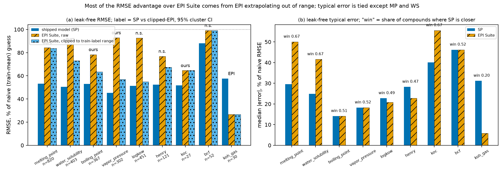

**Figure S20.** CRITIC's range-clip control on the EPI Suite comparison. Clipping EPI Suite's estimate to the 0.5-99.5 percentile range of the training labels - a one-line post-process with no learning - removes most of our RMSE advantage for logKow, vapour pressure and boiling point, and leaves melting point essentially unchanged. Conclude: a large part of the headline margin over EPI Suite comes from EPI emitting occasional out-of-range estimates, not from better typical predictions; melting point and water solubility survive the control. *Source: `CRITIC/attack_epi_clip.csv  [not redistributed; VM-internal]` and `CRITIC/attack_epi_headline.csv  [not redistributed; VM-internal]` (script `attack_epi_fig.py  [not redistributed; VM-internal]`).*

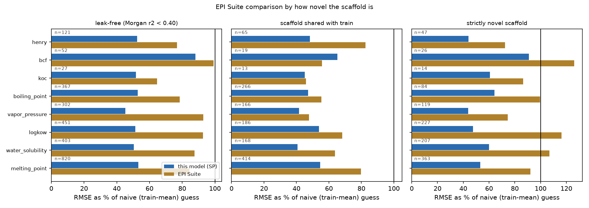

**Figure S21.** The comparison against EPI Suite on compounds whose Bemis-Murcko scaffold is absent from the training set, i.e. the cut that does not depend on the Morgan fingerprint used to build the split. Conclude: melting point and water solubility keep their margin on strictly novel scaffolds and survive every control we applied; the other endpoints move the same way but do not survive the range-clipping control and are shown, not claimed; our own error rises on novel scaffolds and EPI Suite's rises further. RMSE as % of each subset's naive training-mean guess. *Source: `data/vs_epi_by_scaffold.csv`, drawn by `make_figs_v7.py  [not redistributed; VM-internal]`.*

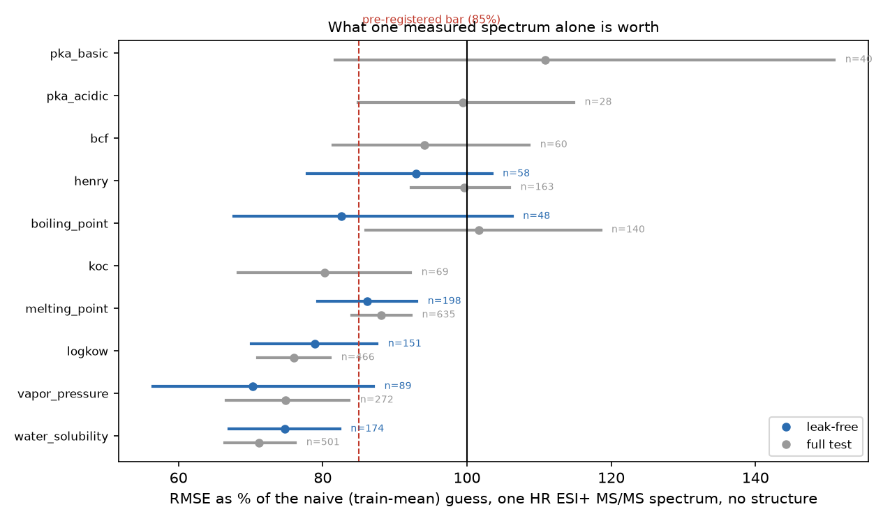

**Figure S22.** What one measured HR ESI+ MS/MS spectrum alone is worth, per endpoint, with 95% cluster-bootstrap intervals, on leak-free compounds and on the full test. Conclude: three endpoints clear the pre-registered skill bar on both cuts, melting point clears it on one, and the rest do not - the result is a ranking, not a pass/fail list. [DISPUTED, deliberately left open: the spectrum-only skill count is 3 or 4 depending on which model is quoted - W-SPECTRA's single-spectrum model puts melting point at 86.1% of naive leak-free (HR ESI+), over the 85% bar, and W-MODEL's pooled spectra-only ablation arm puts it at 81.0%, under it (`W-SPECTRA/spectrum_only_final_table.md  [not redistributed; VM-internal]`). Melting point is shown, not promoted.] *Source: `data/single_spectrum_skill_ci_v32.csv`, drawn by `make_figs_v7.py  [not redistributed; VM-internal]`.*

